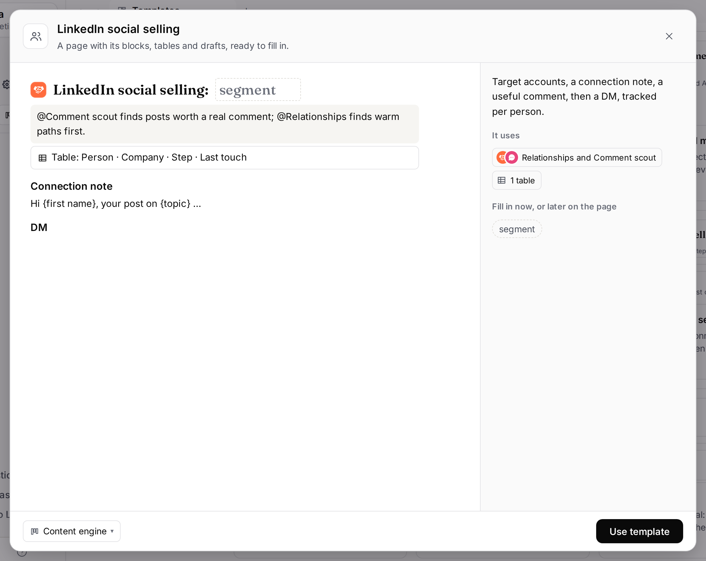
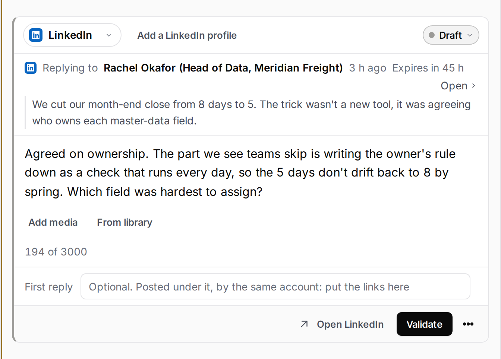

import { Aside, Steps } from '@astrojs/starlight/components';
import Tutorial from '../../../../components/Tutorial.astro';
import PlaybookMeta from '../../../../components/superstar/PlaybookMeta.astro';

Comment first, connect second, message only with a reason. Agents find and draft; you validate every word.

<PlaybookMeta id="social-selling" template="LinkedIn social selling" />

<Tutorial id="social-selling" />

## Before you start

- Your LinkedIn profile under **Setup** → **Identities**, signed in through a saved browser login, so the crew works from it and the Publisher posts what you validate.
- A list of 20 to 50 people you sell to.
- The [rules](/superstar/how-it-works/#the-rules) every agent keeps.

## Steps

<Steps>

1. **Choose the people**

   **Templates** → **LinkedIn social selling** with your segment: a list of 20 to 50 people you want to know.

   

2. **Comment where you add something**

   **@Comment scout** finds their posts worth a real comment and drafts one under each. You validate it; the Publisher posts it from the profile it names.

   

3. **Connect with a reason**

   After two or three good exchanges, connect. A free account can add a note to only a few invites a month (200 characters), so save notes for the people who matter; otherwise connect without one and write after they accept. **@Relationships** sends invites from the profile.

4. **Message only with news**

   A signal from **Signals** is a reason to write; nothing else is.

</Steps>

## The template

**LinkedIn social selling** is a page. Open it from **Templates** in the sidebar. It makes a **Targets** board by Step (Follow, Comment, Connect, DM, Meeting) with Person, Company and Last touch, and blocks for your **Connection note** and **DM**.

## Prompts

Copy one and change the names. A prompt that starts with an @name goes in a block on the page; the others go in **Ask** (**Ctrl J**).

```text title="A block that starts with @Comment scout"
@Comment scout Find three posts this week by data leaders in logistics or banking where a comment from me adds something real, and draft the comments.
```

```text title="Ask (Ctrl J)"
Draft a one-line connection note to Henrik Dahl that refers to his BCBS 239 post.
```

## What good looks like

A comment that asks a sharp question or adds one fact from experience. Never "Great post!".

Rachel Okafor (Head of Data, Meridian Freight) posted: "We cut our month-end close from 8 days to 5. The trick wasn't a new tool, it was agreeing who owns each master-data field."

The Comment scout drafted, for Maya:

> Agreed on ownership. The part we see teams skip is writing the owner's rule down as a check that runs every day, so the 5 days don't drift back to 8 by spring. Which field was hardest to assign?

It adds one thing from experience and ends on a question Rachel can answer. It doesn't mention Halcyon.

<Aside title="LinkedIn's limits">
A free account can add a personal note to about 3 invites a month, up to 200 characters ([LinkedIn Help](https://www.linkedin.com/help/linkedin/answer/a563153)). LinkedIn's May 2026 update says it treats comments that restate the post as low value ([LinkedIn](https://news.linkedin.com/2026/keeping-conversations-real-on-linkedin)), and its Professional Community Policies forbid promotional invitations to people you don't know ([LinkedIn](https://www.linkedin.com/legal/professional-community-policies)).
</Aside>

## Watch for

- A comment that restates the post is treated as low value, and LinkedIn says it spots generic AI text 94% of the time. Add a fact, a number or a question.
- No invite note that sells. LinkedIn's rules forbid promotional invitations to people you don't know.
- Messaging rules may cover LinkedIn DMs too in the EU: keep them personal and with a reason.

## What to count

- Comments posted a week
- Replies to your comments
- Conversations that became meetings

Move each person along the **Targets** board (Follow, Comment, Connect, DM, Meeting) and count how many reach Meeting each month.

## Next

[Plan a week on LinkedIn](/superstar/playbooks/linkedin-week/): three posts in your voice from real material, comments where you add something, nothing posted unvalidated.
