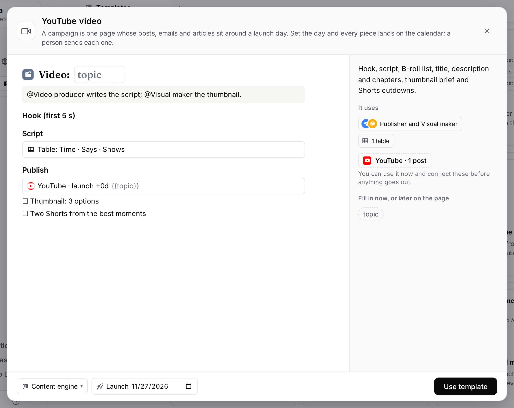

import { Aside, Steps } from '@astrojs/starlight/components';
import Tutorial from '../../../../components/Tutorial.astro';

Video briefs, scripts and cutdowns from what you already have.

- **Time:** 1 h
- **Crew:** Video producer, Visual maker
- **Template:** YouTube video

<Tutorial id="video-content" />

## Before you start

- A post, a demo or a recording to start from, in Storage or on a page.
- The [rules](/superstar/how-it-works/#the-rules) every agent keeps.

## Steps

<Steps>

1. **Start from a source**

   **Templates** → **Video**: the topic. Give **@Video producer** a post, a demo or a talk.

   

2. **Brief and script**

   It writes the brief and the script: hook, the product doing the job, one proof, the ask.

3. **Cutdowns**

   Ask for a 9:16 and a 1:1 version with captions, so it works with the sound off.

</Steps>

## The template

**YouTube video** is a campaign. Open it from **Templates** in the sidebar. It makes the **Hook (first 5 s)**, a **Script** table (Time, Says, Shows), the YouTube post, and to-dos for three thumbnails and two Shorts.

## Prompts

Copy one and change the names. A prompt that starts with an @name goes in a block on the page; the others go in **Ask** (**Ctrl J**).

```text title="A block that starts with @Video producer"
@Video producer Write a 45-second script showing anomaly alerts catching a short feed, with captions.
```

```text title="A block that starts with @Video producer"
@Video producer Turn the webinar replay into three 30-second clips: the timestamps and a caption for each.
```

## What good looks like

The product on screen in the first five seconds.

A script that opens on the product:

| Time | Says | Shows |
|---|---|---|
| 0:00 | "Your vendor feed came in 40% short this morning." | The alert, with the rows |
| 0:05 | "Halcyon noticed before your dashboard did." | The table's normal day beside today |
| 0:30 | "Anomaly alerts. Live now." | The settings, one click |

## Watch for

- Real product, real data: no fake screens.

## What to count

- Watch time
- Completion rate

Watch time and completion from each platform's analytics.

## Next

[Turn one source into many pieces](/superstar/playbooks/content-engine/): one talk, customer story or release becomes posts, a newsletter section and an article, each written for where it goes.
