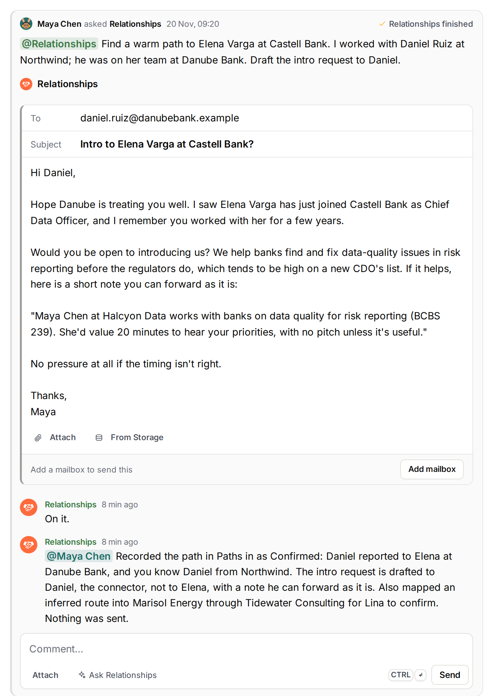
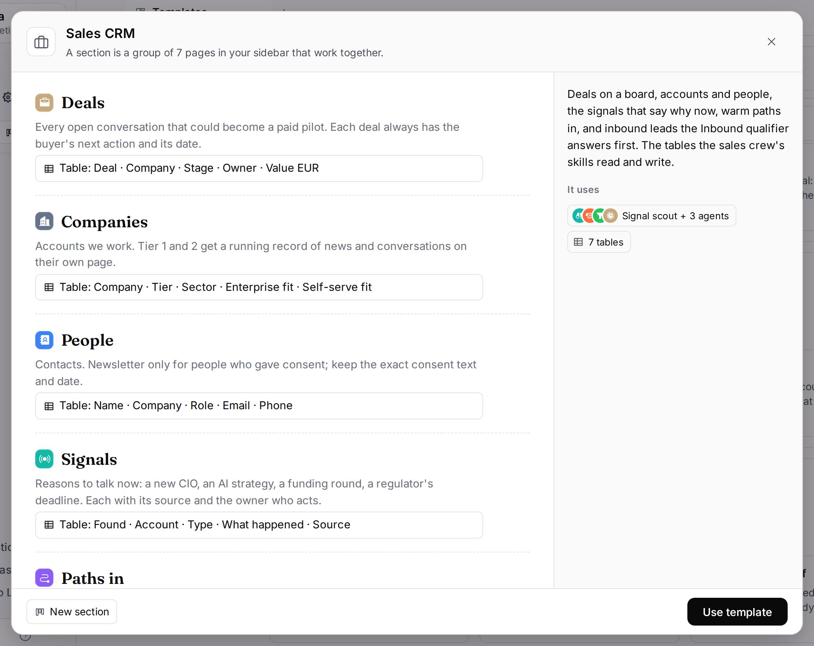

import { Aside, Steps } from '@astrojs/starlight/components';
import Tutorial from '../../../../components/Tutorial.astro';

Who can introduce you, how sure that is, and a request the connector can forward as it is.

- **Time:** 5 min
- **Crew:** Relationships
- **Template:** Sales CRM

<Tutorial id="warm-intros" />

## Before you start

- The **Paths in** table (Sales desk or Sales CRM).
- The people you know at or near the account. Only you know them: the agent never logs in to your LinkedIn.
- The [rules](/superstar/how-it-works/#the-rules) every agent keeps.

## Steps

<Steps>

1. **Tell it who you know**

   On **Paths in**, ask **@Relationships** for a route to a person. Mention the people you know there or near there.

2. **Check the path**

   Each path has a connector, how they know each other, the team member and a confidence: **Confirmed** or **Inferred**. Confirm an inferred one before anyone writes.

3. **Ask the connector**

   The request is drafted to the connector, never to the target, with a short note they can forward. They decide.

   

4. **Thank them**

   Whatever happens, tell the connector how it went.

</Steps>

## The template

**Sales CRM** is a section. Open it from **Templates** in the sidebar. It makes seven pages, each one table: **Deals**, **Companies**, **People**, **Signals**, **Paths in**, **Inbound leads** and **Do not contact**. These are the tables the sales crew reads and writes.



## Prompts

Copy one and change the names. A prompt that starts with an @name goes in a block on the page; the others go in **Ask** (**Ctrl J**).

```text title="A block that starts with @Relationships"
@Relationships Find a warm path to Elena Varga at Castell Bank. I worked with Daniel Ruiz at Northwind; he was on her team. Draft the intro request to Daniel.
```

```text title="A block that starts with @Relationships"
@Relationships Who in our network knows someone at our Tier 1 accounts? Map them in Paths in.
```

```text title="A block that starts with @Relationships"
@Relationships Draft a thank-you to Daniel for the intro, and tell him what came of it.
```

## What good looks like

"Would you be open to introducing us? Here is a short note you can forward as it is. No pressure at all if the timing isn't right." Easy to say yes, easy to say no.

Maya knew Daniel Ruiz from Northwind, and Daniel had reported to Elena Varga at Danube Bank. Relationships recorded the path as Confirmed and drafted this, to Daniel, from Maya:

> **Subject:** Intro to Elena Varga at Castell Bank?
>
> Hi Daniel,
>
> Hope Danube is treating you well. I saw Elena Varga has just joined Castell Bank as Chief Data Officer, and I remember you worked with her for a few years.
>
> Would you be open to introducing us? We help banks find and fix data-quality issues in risk reporting before the regulators do, which tends to be high on a new CDO's list. If it helps, here is a short note you can forward as it is:
>
> "Maya Chen at Halcyon Data works with banks on data quality for risk reporting (BCBS 239). She'd value 20 minutes to hear your priorities, with no pitch unless it's useful."
>
> No pressure at all if the timing isn't right.
>
> Thanks,
> Maya

It also mapped a second path, into Marisol Energy through an implementation partner, as **Inferred**, for Lina to confirm before anyone writes.

<Aside type="tip" title="This is double opt-in">
The connector asks the person first, and either can say no. That is why the request goes to the connector and never to the target. The forwardable paragraph is what makes it easy for them.
</Aside>

## Watch for

- Never write to the target as if the intro happened.
- Romania: a warm intro is the safe way into a company you haven't spoken to.

## What to count

- Intro requests sent
- Accepted by the connector
- Intro to meeting

Paths in has **Status**: Mapped, Intro asked, Intro made, Met. Move each row as it happens and count by month.

## Next

[Plan a strategic account](/superstar/playbooks/account-plan/): one page per big account: the buying group, the reasons now, the plays and who runs each.
