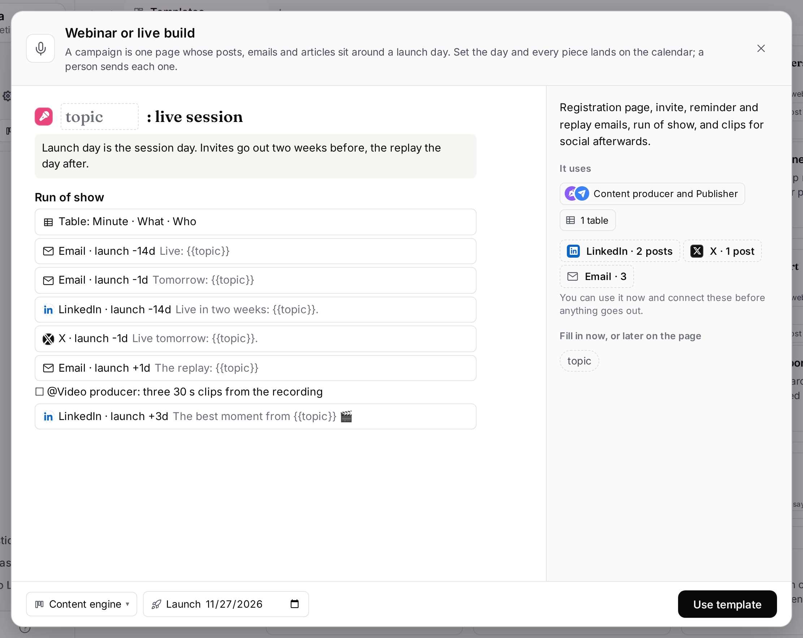

import { Aside, Steps } from '@astrojs/starlight/components';
import Tutorial from '../../../../components/Tutorial.astro';

Invites, reminders, the replay and the follow-up placed around the live day.

- **Time:** 2 h over three weeks
- **Crew:** Content producer, Visual maker, Follow-up keeper
- **Template:** Webinar or live build

<Tutorial id="webinar" />

## Before you start

- A topic, a date and who presents.
- Where registrations land: a People row per registrant, with consent.
- The [rules](/superstar/how-it-works/#the-rules) every agent keeps.

## Steps

<Steps>

1. **Use the kit**

   **Templates** → **Live session**: the topic and the date. Invite posts, the invite email, Tomorrow and The replay are already placed.

   

2. **Fill it**

   Ask **@Content producer** to write each piece from the outline.

3. **After the session**

   Paste the questions people asked. The producer writes the replay email; the keeper drafts a follow-up for each attendee who asked something.

</Steps>

## The template

**Webinar or live build** is a campaign. Open it from **Templates** in the sidebar. It makes a **Run of show** table, invite posts and an email two weeks before, a reminder the day before, the replay email the day after, a to-do for three clips and a post with the best moment.

## Prompts

Copy one and change the names. A prompt that starts with an @name goes in a block on the page; the others go in **Ask** (**Ctrl J**).

```text title="A block that starts with @Content producer"
@Content producer Fill this webinar kit from the outline: three invite posts, the invite email, the reminder and the replay email.
```

```text title="A block that starts with @Follow-up keeper"
@Follow-up keeper Draft a follow-up to each attendee who asked a question, answering it.
```

## What good looks like

The replay email leads with the one answer people asked about most, then the link.

A replay email that leads with the most-asked answer:

> **Subject:** The replay: closing in five days
>
> The question most of you asked: where do the two lost days of the close actually go? Our answer starts at 14:20 in the replay.
>
> Watch it here: (link)

## Watch for

- Send the replay to registrants only, not to your whole list.

## What to count

- Registrations
- Attendance
- Meetings from attendees

Registrations and attendance in People; meetings as Deals with the session as **Source**.

## Next

[Turn a customer win into proof](/superstar/playbooks/case-study/): one customer story with a real number, then posts, an email and a sales one-pager from it.
