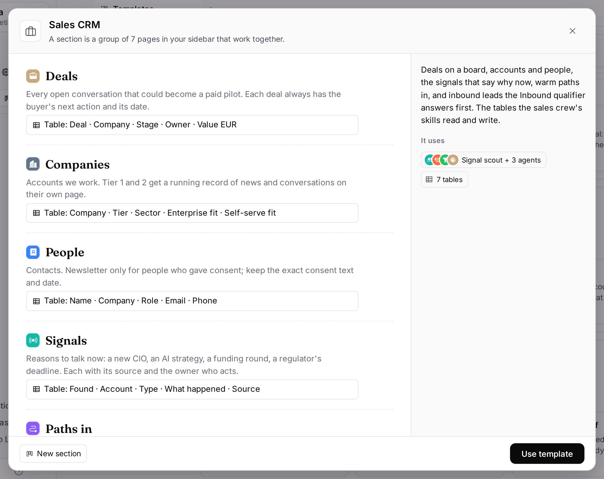

import { Aside, Steps } from '@astrojs/starlight/components';
import Tutorial from '../../../../components/Tutorial.astro';

Lost deals and quiet customers get a new reason to talk when something changes on their side.

- **Time:** 20 min a month
- **Crew:** Signal scout, Follow-up keeper
- **Template:** Sales CRM

<Tutorial id="win-back" />

## Before you start

- A **Lost reason** on every lost deal. Deals has the column.
- Do not contact up to date: a firm no is never a win-back.
- The [rules](/superstar/how-it-works/#the-rules) every agent keeps.

## Steps

<Steps>

1. **Keep the reason**

   When a deal is **Lost**, write why in its row: price, timing, a competitor, no budget.

2. **Watch for change**

   Ask **@Signal scout** monthly for news at lost accounts: a new leader, new budget, the competitor's contract ending.

3. **Write with the news**

   A message that names what changed and why it may matter now. One ask.

</Steps>

## The template

**Sales CRM** is a section. Open it from **Templates** in the sidebar. It makes seven pages, each one table: **Deals**, **Companies**, **People**, **Signals**, **Paths in**, **Inbound leads** and **Do not contact**. These are the tables the sales crew reads and writes.



## Prompts

Copy one and change the names. A prompt that starts with an @name goes in a block on the page; the others go in **Ask** (**Ctrl J**).

```text title="A block that starts with @Signal scout"
@Signal scout Check every Lost deal from the last 12 months for a change that reopens it: new leaders, funding, a tender, a competitor problem.
```

```text title="Ask (Ctrl J)"
Draft a short note to Kasia Nowak at Wisla Trans: they said not before Q1, it's December, and they just bought two fleets.
```

## What good looks like

"You said Q1 might be the time, and you've since added two fleets. Is the close still taking a week?"

A row worth reopening has a reason that time can change:

| Deal | Stage | Lost reason |
|---|---|---|
| Wisla Trans, fleet data | Lost | Timing: not before Q1, after the fleet purchase |

When the Signal scout finds "Wisla Trans completed two fleet acquisitions", that is the new reason. A deal lost with "Went with a competitor, three-year contract" waits for the contract to end.

## Watch for

- Respect a clear no: those go to Do not contact.
- Timing losses are the best ones to reopen; price losses need a new offer.

## What to count

- Lost deals reopened
- Reopened to won

Filter Deals by Stage **Lost**, then count rows that moved back to an open stage, and how many of those reach **Won**.

## Next

[Find a reason to write now](/superstar/playbooks/signals/): leadership changes, strategy, funding, hiring and regulation at your accounts, each with its source and owner.
