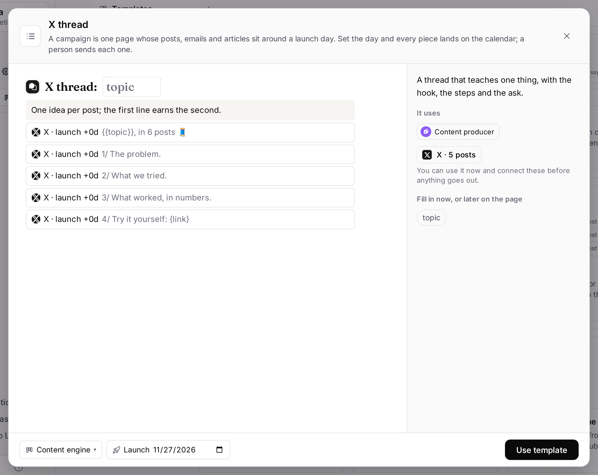

import { Aside, Steps } from '@astrojs/starlight/components';
import Tutorial from '../../../../components/Tutorial.astro';
import PlaybookMeta from '../../../../components/superstar/PlaybookMeta.astro';

A thread on X, a post on LinkedIn and answers to every reply, each written for its platform.

<PlaybookMeta id="x-launch" template="X thread" />

<Tutorial id="x-launch" />

## Before you start

- The launch article or announcement, on a page.
- Your X and LinkedIn company profiles in **Setup** → **Profiles**.
- The [rules](/superstar/how-it-works/#the-rules) every agent keeps.

## Steps

<Steps>

1. **Write per platform**

   **Templates** → **X thread**. Ask **@Content producer** for the thread and a LinkedIn version: short and sharp on X, a story on LinkedIn.

   

2. **Links in the first reply**

   Put the link in **First reply**, posted right under the post by the same account.

3. **Answer the day's replies**

   Ask **@Comment scout** for the replies worth answering. Each answer is a reply post: validate it, then **Post now** or **Schedule** before it expires.

4. **Look back**

   A week later, ask what performed and why.

</Steps>

## The template

**X thread** is a campaign. Open it from **Templates** in the sidebar. It makes five X posts in order: the hook, the problem, what you tried, what worked in numbers, and the link.

## Prompts

Copy one and change the names. A prompt that starts with an @name goes in a block on the page; the others go in **Ask** (**Ctrl J**).

```text title="A block that starts with @Content producer"
@Content producer Turn the launch article into an X thread of 6 posts and a LinkedIn post. The link goes in the first reply.
```

```text title="A block that starts with @Comment scout"
@Comment scout Find the replies to our launch thread worth answering and draft each answer.
```

```text title="A block that starts with @Strategist"
@Strategist What did the launch posts do this week, per platform? What should we repeat?
```

## What good looks like

The first post of the thread stands alone: what it does, for whom, shown in the image.

A first post that stands alone, for a thread on anomaly alerts:

> Halcyon now tells you when a table has a bad day: a feed 40% short, a currency column with three values, a vendor twice. No rule to write.

The link goes in **First reply**, posted under the post by the same account. The LinkedIn version tells the story behind it instead of repeating the thread.

<Aside type="caution" title="X automation">
We couldn't open X's automation rules page while writing this ([help.x.com](https://help.x.com/en/rules-and-policies/x-automation)). Superstar schedules and posts your own validated posts. Check X's current rules yourself before automating anything more.
</Aside>

## Watch for

- Replies on one profile queue its gap apart: answer the best five, not fifty.
- Check X's automation rules before automating anything beyond your own scheduled posts.

## What to count

- Engagement per post, by platform
- Clicks from the first reply
- Replies answered within the day

Each posted post keeps its link. Ask the Strategist the third prompt a week after launch.

## Next

[Turn one source into many pieces](/superstar/playbooks/content-engine/): one talk, customer story or release becomes posts, a newsletter section and an article, each written for where it goes.
