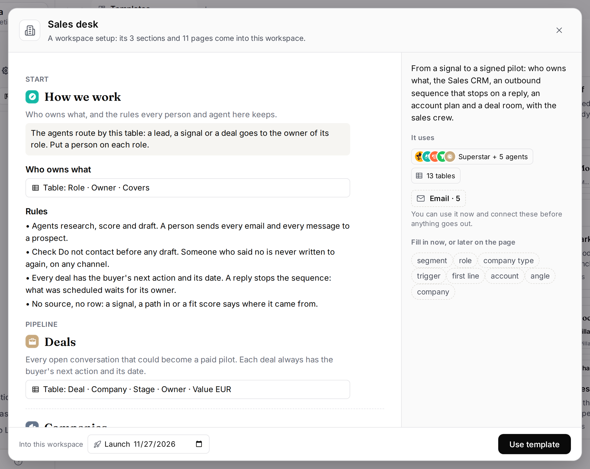
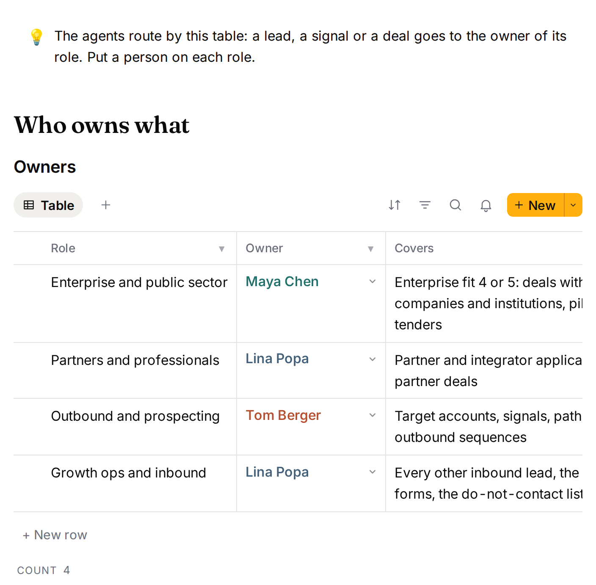
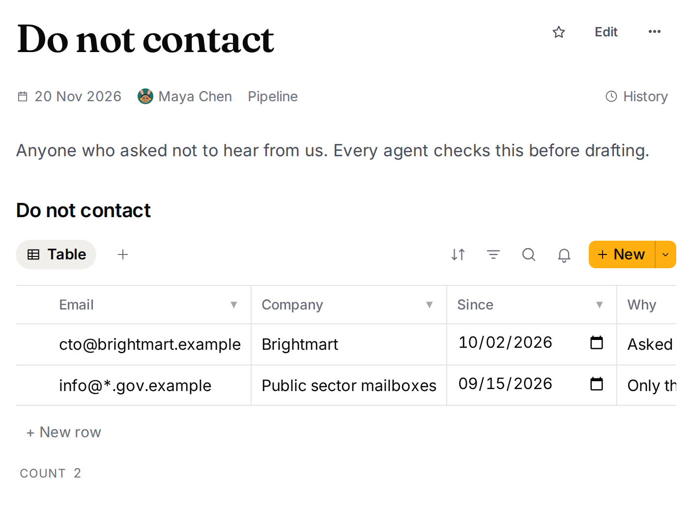
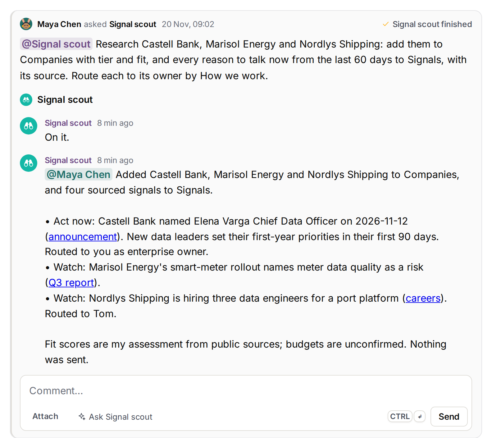

import { Aside, Steps } from '@astrojs/starlight/components';

A sales desk in about **ten minutes**: the CRM tables, an owner on every role, a first lead the Inbound qualifier answers, and a first ask to the Signal scout.

You need a Superstar account with the **Member** or **Admin** role. Viewers can read everything here but not change it.

<Steps>

1. **Start from the Sales desk template.**

   In the sidebar, click **Templates** (at the bottom of the sidebar), then the **Sales desk** card. The preview shows every page you get and the agents that fill them.

   Type what you can into its fields right there: who you sell to (**segment**, **role**, **company type**, **trigger**) and the account and company you want an account plan and a deal room for. You can fill the rest later on the pages. Click **Use template**.

   

   Three sections land in your sidebar: **Start** (How we work), **Pipeline** (Deals, Companies, People, Signals, Paths in, Inbound leads, Do not contact) and **Plays** (an outbound sequence, an account plan and a deal room).

2. **Put a person on every role.**

   Open **How we work**. The **Owners** table has four roles: **Enterprise and public sector**, **Partners and professionals**, **Outbound and prospecting**, and **Growth ops and inbound**. Click each **Owner** cell and pick a person.

   

   The agents route every lead, signal and deal by this table. An empty owner means work that nobody is told about.

3. **Fill in Do not contact.**

   Open **Do not contact** and add one row per person who asked not to hear from you: **Email**, **Company**, **Since** and **Why**. Every agent checks this table before it drafts.

   

4. **Connect your mailbox.**

   Click the gear (**Setup**) at the top of the sidebar, then **Mail**, then **+ Add mailbox**. On Microsoft 365, click **Sign in with Microsoft** (an admin sets this up once). On Google, use an app password.

   Agents never send. Your mailbox is how *you* send what they draft, and how replies reach the pages of the people who wrote.

5. **Add your first lead.**

   Open **Inbound leads** and click **+ New row**. Fill **Received**, **Name**, **Email**, **Company** and **Message**, and set **Status** to **New**.

   The table watches its Status column (the bell shows **1 watching**). A row at **New** goes to the **Inbound qualifier** on its own. In a few minutes the row has an owner, and its page has a reply drafted for that owner to read and send. The full flow is in [Answer a lead within the hour](/superstar/playbooks/inbound-leads/).

6. **Ask the Signal scout about an account.**

   Open **Signals**, click below the table and type a line that starts with the agent's name:

   ```text title="On Signals"
   @Signal scout Research Castell Bank, Marisol Energy and Nordlys Shipping: add them to Companies with tier and fit, and every reason to talk now from the last 60 days to Signals, with its source. Route each to its owner by How we work.
   ```

   The line becomes an ask. The agent answers **On it.**, works, and writes what it did under your line, with links.

   

</Steps>

## What you have now

- A pipeline the agents can read and write: Deals, Companies, People, Signals, Paths in and Inbound leads.
- Owners, so every lead and signal reaches one person.
- A **Do not contact** list that every draft is checked against.
- A first lead with a reply waiting for its owner, and a first set of signals.

<Aside type="tip" title="Stuck?">
Press **Ctrl J** (**⌘ J** on a Mac) and ask Superstar how to do it. The **?** at the bottom of the sidebar opens Help, which has the playbooks too.
</Aside>

Next: [how Superstar works](/superstar/how-it-works/), or go straight to a [playbook](/superstar/playbooks/sales-desk/).
