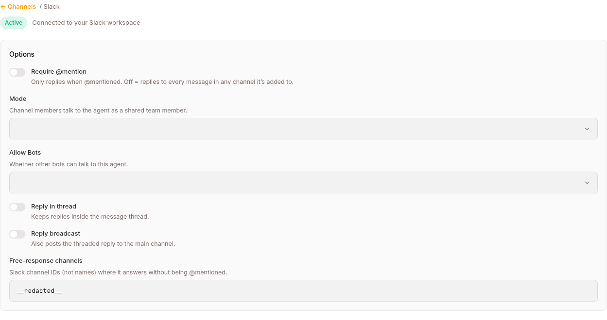
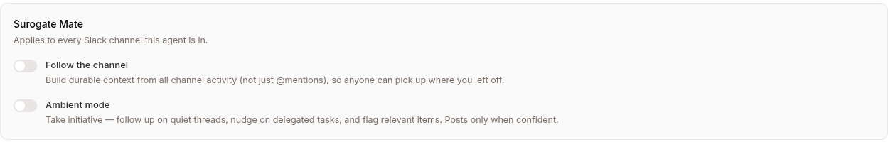

Publishes the agent as a Slack bot. Users DM it or @mention it in channels. Same conversations as on Web — if Slack identities are linked to Surogate users, sessions are shared.

Surogate connects to Slack over **webhooks** (Event Subscriptions), not Socket Mode. You create a Slack app, paste a few Request URLs into it, and hand Surogate your app's Signing Secret and Bot Token.

## Configuration in Surogate

Open the agent → **Publish** in the left nav → the **Channels** tab → find **Slack** under **Add a channel** → **Connect**. That opens a step-by-step walkthrough:

1. **Create a Slack app** at [api.slack.com/apps](https://api.slack.com/apps) → *Create New App* → *From scratch*.
2. **Add Bot Token Scopes** (OAuth & Permissions → Bot Token Scopes):
   `chat:write`, `app_mentions:read`, `im:read`, `im:write`, `channels:history`, `groups:history`, `files:read`, `users:read`. The wizard has a **Copy** button for the full list.
3. **Enable Event Subscriptions and paste your Request URLs.** Enter your **App ID** in the wizard; it then shows the exact URLs to paste back into Slack:
   - Event Subscriptions Request URL — `https://channels.surogate.ai/slack/<APP_ID>`
   - Interactivity Request URL — `https://channels.surogate.ai/slack/<APP_ID>/interact`
   - Slash Command Request URL — `https://channels.surogate.ai/slack/<APP_ID>/commands`

   Also subscribe to these bot events: `message.im`, `app_mention`, `message.channels`.
4. **Install to your workspace** (OAuth & Permissions → *Install to Workspace*) and copy the **Bot User OAuth Token** (starts with `xoxb-`).
5. **Paste your credentials** — the **Signing Secret** (Basic Information) and the **Bot Token** (`xoxb-…`).

Click **Connect Slack**. There is no separate save button — the connect step and every later option change save automatically.

## Options (the Slack "Manage" screen)



Once connected, Slack moves to the **Live** list. Click its row to manage it. The options there auto-save as you change them:

| Option | What it does |
|---|---|
| **Require @mention** (default ON) | Only replies when @mentioned. Off = replies to every message in any channel it's added to. |
| **Mode** | **Team member** — channel members talk to a shared agent identity. **Personal assistant** — each user links their own Surogate account; unlinked users are prompted to link. |
| **Allow Bots** | Whether other bots can talk to this agent: **None** (default), **Mentions only**, or **All**. |
| **Reply in thread** (default ON) | Keeps replies inside the message thread. |
| **Reply broadcast** (default OFF) | Also posts the threaded reply to the main channel. |
| **Free-response channels** | Comma-separated Slack **channel IDs** (not names, e.g. `C0123ABCD`) where it answers without being @mentioned. |

The Slack manage screen also has a **Surogate Mate** section (Follow / Ambient) — see [Proactive engagement](/work/channels/proactive/).



## What users see

If the agent's **AI disclosure** is on (Configure → Governance), the disclosure text is posted as its own message at the start of every new conversation, before any agent output. It doesn't repeat on established conversations, and control commands like `/stop` don't trigger it. See [Governance & AI disclosure](/work/workflow/governance/).

### DMs

The user types a message; the bot responds. Each DM is one Surogate session. Subsequent messages in the same DM continue the session.

### Channel @mentions

```
@acme-support what's the refund policy?
```

The bot responds inside the thread (assuming Reply in thread is on). Subsequent messages in that thread continue the session — no need to @mention again.

### The slash command

Pasting the Slash Command Request URL doesn't create the command. You also have to add it in the Slack app (Slash Commands → *Create New Command*), point it at that URL, and reinstall if Slack asks. Any name works, but call it `/surogates` — that's the name the built-in usage hint tells your users, which they see if they send the command with nothing after it.

Whatever the user types after the command goes to the agent as a message. It works from any channel, but the message always lands in the sender's **DM session** with the agent, never the channel's session. It's a quick private question without leaving the channel you're in — not a way to talk to the channel's shared conversation.

### Channel history on the first message

The first time the bot is messaged in a channel, that session starts with a snapshot of the channel's recent history, so the agent isn't answering blind on a conversation already underway. The snapshot is bounded — at most the last **7 days** and **200 messages** — and joins, leaves, topic changes and other bots' posts are dropped. DMs are never backfilled.

It's a one-time snapshot per session, not continuous reading. To have the agent keep building context from everything posted in the channel, turn on FOLLOW THE CHANNEL — see [Proactive engagement](/work/channels/proactive/).

### File attachments

Slack users can attach files to messages. The bot reads them (markdown, CSV, JSON, images, PDFs) like any other input. If the bot writes files in response (e.g. an analysis CSV), it uploads them to Slack.

## How Slack identities are linked

The first time a Slack user messages the bot:

1. The platform looks up `(platform=slack, platform_user_id=U03ABCDEF)` in the channel-identity table.
2. If found, the message routes to that user's existing Surogate sessions.
3. If not found, the behavior follows the channel's **Mode**: in **Team member** mode an internal user is created automatically; in **Personal assistant** mode the bot DMs them an 8-character pairing code and a link to the agent app's `/link` page, where they sign in and enter the code (codes last 10 minutes, single-use — see [Users](/work/channels/users/#identity-across-channels)).

Once linked, the same person on Web and Slack sees the same agent, same memory, same sessions — and shares the same per-user usage allowance, so switching channels never resets a limit.

When the agent asks a question (`ask_user_question`) with up to five short choices, such as a yes/no confirmation, the choices are buttons in the message: one tap answers it and the message turns into the answer. Free-text questions, longer or more choices, and several questions at once keep the **Answer** button, which opens a form. Typed replies aren't converted into answers here (unlike Web and Telegram); the bot nudges toward the buttons or the form instead. On monetized agents, Slack is a **sellable channel**: a buyer whose package excludes it gets a short notice with their buy link.

## Programs on Slack

[Programs](/work/tools/programs/) can reach a workspace member first: when a journey step is due, the agent writes it as a direct message from the app, at any time and with no template, then follows up on the reply. Team members can be alerted on Slack too, and a Slack channel can be the team's [shared alert place](/work/tools/programs-team/#shared-alert-place).

What it needs, beyond a connected channel:

- **Personal assistant mode** on this channel's Manage screen. In Team member mode every sender shares one identity, so a reply could not be attributed to the person; a step on a channel in that mode is refused at activation.
- **Each person linked to their workspace member**, from the agent's Users tab: **Link Slack member** opens the workspace directory. See [Linking a Slack member](/work/channels/users/#linking-a-slack-member). A person can also be added by their Slack member alone, without an email or phone.
- **Permission to message them first**, recorded on that binding.

No channel membership is needed: a direct message reaches any member of the workspace the app is installed in. No new scopes either; `chat:write`, `im:write` and `users:read` from the setup above cover posting, opening the direct message and listing members. A member who leaves the workspace is caught at activation, and a send to someone Slack cannot reach shows as *Failed* with Slack's reason, and the step moves to the person's next channel if they have one. Slack sends no delivery receipts, so a post Slack accepted counts as delivered.

## Multi-workspace

Each Slack workspace needs its own Slack app + its own credentials. To run the same agent across multiple workspaces, create multiple agents in Surogate (each pointing at its workspace's app), or use the API channel for cross-workspace routing.

## When the Slack bot isn't responding

Common causes:

- **Missing scopes** — you added a new scope but didn't re-install the app to the workspace. Re-install, then paste the new Bot Token via **Reconnect**.
- **Request URLs not verified** — Slack must accept the Event Subscriptions Request URL (it shows a green "Verified"). If it's not verified, events never reach Surogate.
- **Wrong credentials** — the Signing Secret and Bot Token must both be from the same Slack app.

Check the agent's **Sessions** view — if no Slack-channel sessions are appearing when you send Slack messages, the inbound path is broken.

## Reconnecting and disconnecting

- **Reconnect** reopens the walkthrough so you can paste a new Bot Token after re-installing the app (e.g. when you added scopes).
- **Disconnect** stops the bot from replying. Your Slack app and credentials stay in place — reconnect anytime.

## What's next

For Telegram setup: [Telegram channel](/work/channels/telegram/). For embedding chat on your website: [Website widget](/work/channels/website-widget/). For end-user accounts: [Users](/work/channels/users/).
