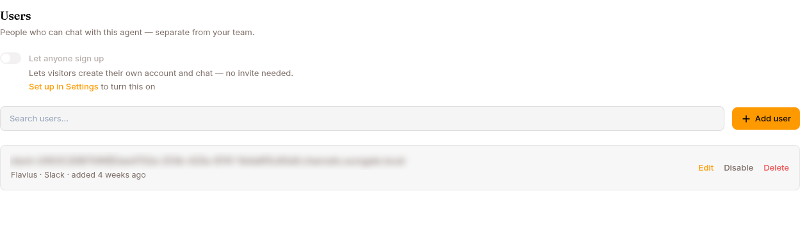

The **Users** tab on an agent's [Publish](/work/workflow/publish-agent/) page manages the people who chat with this agent through its public Web endpoint. These are **distinct from your operator account** (your `ops.surogate.ai` login).

## When you'd use this

Three patterns:

- **Internal-only agent** — your team only. Don't add users here; only operators in your tenant can chat with the agent via `ops.surogate.ai`. The Web endpoint at `<slug>.cloud.surogate.ai` is locked down.
- **Closed customer-facing bot** — invite specific customers / partners. Add them one at a time. The Web endpoint requires sign-in.
- **Open sign-up** — let visitors create their own accounts via Firebase. Configure once at the project level, then toggle **Let anyone sign up** per agent. See [Self-registration](/work/channels/self-registration/).
- **Public-facing bot** — use the **Website widget** instead (see [Website widget](/work/channels/website-widget/)). Visitors are anonymous; identity is managed in your existing system.

## Adding a user

Open the agent → **Configure** in the left nav → the **Users** tab → **Add user**:

| Field | Notes |
|---|---|
| **Email** | The user's login email. Required unless you give a phone number |
| **Phone** | Their WhatsApp number with country code, e.g. `+40 746 148 303`. Required unless you give an email. See [Enrolling by phone](#enrolling-by-phone-whatsapp) |
| **Slack member** | Optional — pick the person from the agent's Slack workspace. See [Linking a Slack member](#linking-a-slack-member) |
| **Permission to message them first** | A checkbox: the agent may open a conversation with them on the channel you bound. Needed before a [Program](/work/tools/programs/) can include them |
| **Display name** | Optional — what shows up in chat. Defaults to the email's local part. |
| **Password** | Optional — set one for password login, or leave empty for SSO / self-registration |

Click **Send invite** — a user with an email gets a link to chat with this agent. A user added with only a phone number receives nothing: the agent recognises them when they write, or when a Program writes to them. The auth provider (Email & password, Google, or GitHub) shows up per user in the list once they sign in; SSO providers are configured project-wide through [Self-registration](/work/channels/self-registration/), not on this form.

### Enrolling by phone (WhatsApp)

A user added with a phone number is bound to that number on WhatsApp straight away, with no pairing code: their first message from that number reaches the agent as them, and a check-in Program can open a conversation with them. This is how you enrol people for a Program.

- **Give the country code.** The number is normalised to WhatsApp's own form (digits only, no `+`, no trunk `0`), so `+40 (0)746 148 303` and `0040746148303` both become the same number. A number without a country code is refused.
- **One number, one person, per organisation.** If the number already belongs to another user, the form says so and does nothing; it never moves a number silently. Use that existing user, or change their number first.
- **Permission is recorded, not assumed.** The checkbox stores who granted permission and when. It is shown next to each user in the list. Leaving it unticked still creates the user; they can chat with the agent, but no Program will message them, and the activation gate names them as a blocker. WhatsApp's business messaging policy requires this opt-in, and your own obligations for health information are yours to confirm before a operational rollout.
- **Withdrawing permission** is done from the person's **Edit** form; see [Permission to message first](#permission-to-message-first).

### Linking a Slack member

A Program on Slack reaches a person through their workspace **member id**, the way WhatsApp reaches them through a phone number. Bind it from the person's row: **Link Slack member** opens the agent's workspace directory, searchable by name or email, and stores the member you pick. The email is shown so you can recognise the right person; it is never used to match automatically, because a person's Slack email often differs from the one they were enrolled with.

The app has to be installed in that workspace, which connecting the [Slack channel](/work/channels/slack/) already does, and the person has to be a member of it. Someone who has already paired their own Slack account with the agent is bound already; you only record permission.

### Permission to message first

Permission is recorded per bound channel, with who granted it and when, and shown on the row. **Edit** a person to grant or withdraw it for WhatsApp and Slack separately. The runtime re-checks permission every time it is about to send, so a withdrawal takes effect at once: queued check-ins to that person are cancelled and future runs skip them with a reason. Re-activating a Program never restores it.

## Identity across channels

A user on the Web endpoint is one identity. If they also use Slack, Telegram, or WhatsApp, their channel identities link to this same user. They see the same sessions across all channels. A user enrolled with a phone number already has their WhatsApp identity, so they are never asked to pair.

Linking is prompted only when the channel is in **Personal assistant** mode (in **Team member** mode everyone shares the agent's identity and is never prompted). An unknown sender gets a private message from the bot with an 8-character pairing code (like `A3F7-K9M2`) and a link to the agent app's `/link` page — they sign in there, enter the code, and the identities pair. Codes live **10 minutes**, are single-use, and are minted at most once per user per 10 minutes; if the private message can't be delivered, the still-live code is re-sent on their next message. Users can also start from the web side: **Settings → Connected Channels → Link a channel**.

## Per-user usage limits

Usage is tracked per **(agent, end user)** — and because channel identities link, the limit follows the user across web, Slack, Telegram, and WhatsApp; switching channels doesn't reset it.

The controls live on the **Monetize** tab, not here: a **Per-user usage limit** for free agents, and the **Free trial** for monetized ones (see [Monetize](/work/monetize/#free-trial-and-per-user-limits)). There is no per-row override on this page. A user who hits their limit sees a clear message in their chat — with a buy link when the agent sells access.

Each user's recorded **sign-in method** (email/password, Google, GitHub; blank for accounts you created here) also decides which password controls they see in their own Settings — see [Web](/work/channels/web/).

## Managing existing users

The Users section shows every user with email, display name, auth provider, and when they were added. A search box filters the list. Per-row actions let you **Edit**, **Disable**/**Enable**, or **Delete** each one.

## Bulk operations

The Users tab adds people one at a time. To add many users at once, operators with admin permissions can script it against the REST API.

## What's next

You've covered channels. Loop back to your daily workflow at [Improve your agent](/work/workflow/improve-agent/), or jump to [Use cases](/work/use-cases/) for end-to-end recipes.
