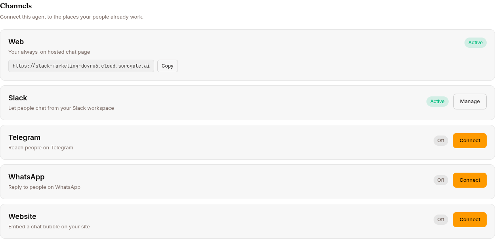

The Web channel is **always on** for every deployed agent. Once the agent is `running`, anyone with the URL `https://<slug>.cloud.surogate.ai` can sign in and chat. On monetized agents, the web app is also the one channel a buyer's package can never exclude — every purchase includes it.

## What users see

A clean, branded chat UI with:

- The agent's name and avatar
- A composer at the bottom
- A session history sidebar (their own sessions only)
- File upload + download
- A live browser pane (when the agent's **Live browser support** capability is on)
- An inbox icon for items needing the user's attention

This is the customer-facing Web UI — a separate React app from `ops.surogate.ai`. Each user only sees what they're allowed to see (their sessions, their files).

If the agent's **AI disclosure** is on (Configure → Governance), a disclosure banner is shown before interaction — **Accept** records a `disclosure.confirmed` event, **Decline** blocks interaction. See [Governance & AI disclosure](/work/workflow/governance/).

### Answering the agent's questions

When the agent asks something via `ask_user_question`, a tabbed question widget appears — but users can also just **type their reply in the composer** and it's consumed as the answer: an exact match on a choice label picks that choice, anything else is recorded as "Other". Messages with images or attachments stay ordinary messages, and the shortcut expires with the question (30 minutes).

### The inbox spans a user's agents

A user's inbox is scoped to **the user**, not to the agent whose app they happen to be in — so someone with accounts on several of your agents sees every agent's items in one list. Opening an item that belongs to a *different* agent opens that agent's app in a new browser tab, at that session; items for the current agent open in place.

### Single-session agents

When the agent's **Multi session** capability is off, each user gets one dedicated conversation and always returns to it: no "New chat", no session list — the sidebar shows a **Chat** button that reopens their conversation from anywhere in the app (their other sessions stay hidden until the capability is turned back on).

## Who can sign in

Two modes:

1. **Anonymous** (default): visitors use the agent without an account. Each browser session gets a UUID stored locally; subsequent visits resume the same Surogate session.
2. **Authorised users only**: open the agent → **Publish** in the left nav → the **Users** tab → **Add user** for each authorised email — or turn on [self-registration](/work/channels/self-registration/).

For authorised users, they sign in with the credentials you set (email + password, Google SSO, or GitHub SSO). Signed-in turns are metered against the user's [per-user allowance](/work/monetize/#how-usage-is-spent); when a limit is hit, the composer shows a clear message — with a buy link on monetized agents.

## The user's Settings page

Signed-in users get their own **Settings** page with up to five tabs — three of them appear only when the matching capability is on:

| Tab | Shown when | What's there |
|---|---|---|
| **Profile** | Always | Display name (editable), email (read-only — *"Your sign-in email cannot be changed here."*), member-since, and password controls (below) |
| **Connected Channels** | The agent has at least one active messaging channel (Slack / Telegram / WhatsApp) | Linked channel identities, per-row unlink, **Link a channel** |
| **Plan & Usage** | Always | Their plan and renewal date, usage / browsing / media balances, "Your plan includes …", and your offers — see [Monetize](/work/monetize/#your-buy-page) |
| **Coding Agents** | The `/code` command is enabled | Their coding-agent plans |
| **Browser Profiles** | Live browser support is on | Their saved browser logins |

### Password controls, by account type

Which password affordance a user sees follows how they sign in — recorded server-side, so it stays correct even after an SSO session lapses:

- **Accounts you created on the Users tab** (local accounts) → an in-app change-password form (current + new + confirm, 8-character minimum).
- **Self-registered with email/password** (Firebase) → a **Send reset email** button. The confirmation toast is deliberately neutral — it never reveals whether an address is registered.
- **Signed in with Google or GitHub** → no password UI at all; their provider owns the credential. If such a user asks how to change their password, that's the answer.

### Linking a messaging channel (`/link`)

When a channel runs in **Personal assistant** mode, users pair their Slack / Telegram / WhatsApp identity with their web account:

1. The user messages the agent on the messaging channel; the bot replies privately with an **8-character code** (like `A3F7-K9M2`) and a link to `<agent-url>/link`.
2. On the `/link` page they enter the code (**Verify code** shows which platform it's from), then click **Link account**. Opening a link with `?code=` pre-fills and verifies automatically.
3. The identity appears under **Connected Channels**; unlinking warns that a fresh pairing code will be needed to re-link.

Codes last **10 minutes**, are single-use, and are minted at most once per user per 10 minutes. See [Users](/work/channels/users/#identity-across-channels) for the operator-side picture.

## The endpoint

`https://<agent-slug>.cloud.surogate.ai`

The slug is set when you deploy the agent (the URL is what your team and customers will see, so pick something readable).

You can't change the slug after deployment — only via the dedicated **Rename** button on the agent's Configure page.

## Customising the look

For now, branding is limited to:

- The agent's **name** (shown at the top of the chat)
- The agent's **avatar** (uploaded in Settings → Profile or via a preset picker)
- The **favicon** (tied to the agent slug)

Full white-label (custom domain, your logo, your colours) is on the roadmap. If you need it sooner, embed the **Website widget** on your own domain instead — see [Website widget](/work/channels/website-widget/).

## What's next

If you want to also publish to Slack: [Slack channel](/work/channels/slack/). For Telegram: [Telegram channel](/work/channels/telegram/). For WhatsApp: [WhatsApp channel](/work/channels/whatsapp/). Or for a customer site: [Website widget](/work/channels/website-widget/).
