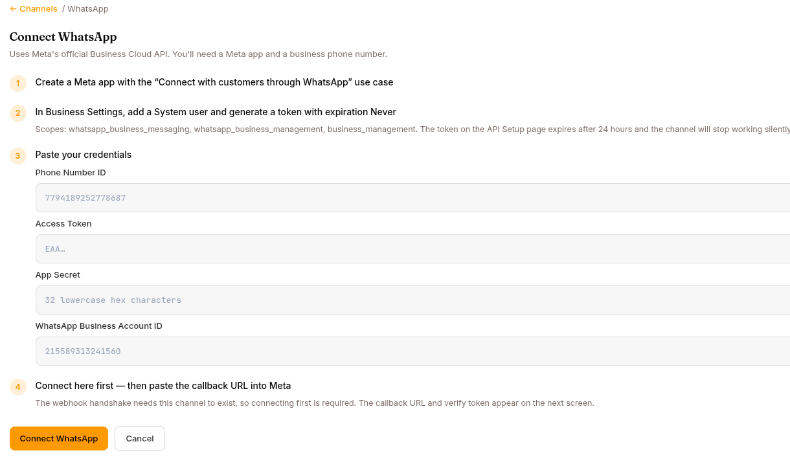

Puts the agent on a WhatsApp business number via Meta's official **WhatsApp Business Cloud API**. Conversations are one-to-one (no groups, no threads). Inside the 24-hour window that a person's last message opens, the agent writes freely. Outside it, Meta lets a business open a conversation only with a **template** it approved, which is how [Programs](/work/tools/programs/) and team alerts reach people first — see [Templates](#templates-the-opener) below.

## What you need

A Meta app with a business phone number on it:

1. Create a Meta app with the **"Connect with customers through WhatsApp"** use case. Meta creates a **WhatsApp Business Account** (WABA) along with it.
2. In **Business Settings**, add a **System user** and generate a token with expiration **Never**, scoped to `whatsapp_business_messaging`, `whatsapp_business_management`, and `business_management`. Don't ship the token from the API Setup page — that one expires after 24 hours and the channel stops working silently.

You will also need the app's **App Secret** and the **WhatsApp Business Account ID**; the table below says where to find each. You never need the phone number's ID — Surogate reads it from the business account.

## Configuration in Surogate

Open the agent → **Publish** in the left nav → the **Channels** tab → find **WhatsApp** ("Reply to people on WhatsApp") under **Add a channel** → **Connect**. The wizard has five steps.

**1. Create the Meta app** — as described above.

**2. Set the Meta app's webhook.** The wizard shows a **Callback URL** and a **Verify token**, each with a **Copy** button. In Meta, open **WhatsApp › Configuration › Edit webhook**, paste both, and click **Verify and save**. Then click **Manage** on the webhook fields and subscribe to **`messages`**.

This is needed once per Meta app, and the two values are the same for every agent. Meta refuses to connect a number until the app has this webhook — see [When WhatsApp stops working](#when-whatsapp-stops-working).

:::note[Self-hosted Surogate]
Meta calls the callback URL from the internet. On a self-hosted deployment, the URL's host needs a public DNS record and must accept HTTPS from outside your network. If **Verify and save** fails, ask your administrator to check that first.
:::

**3. Generate the system-user token** — as described above.

**4. Paste your credentials:**

| Field | Where it comes from |
|---|---|
| **Access Token** | The system-user token (`EAA…`) |
| **App Secret** | 32 lowercase hex characters, from **App settings › Basic**. It must belong to the same Meta app as the token |
| **WhatsApp Business Account ID** | Shown on **WhatsApp › API Setup**, and in Business Settings under **Accounts › WhatsApp accounts** |

**Find phone numbers** is optional: it lists the numbers on the business account. If the account holds more than one, pick the one the agent should answer on; with a single number, connecting picks it for you.

**5. Connect.** Connecting subscribes the business account to your Meta app and points it at this agent's own callback, which Meta verifies on the spot. If Meta refuses, the channel stays off and the wizard shows Meta's reason.

While your Meta app is in development mode, Meta only delivers messages from numbers on its recipient list (five maximum, under **API Setup › To**) — that's a Meta restriction, separate from the agent's own access rules.

## Options (the WhatsApp "Manage" screen)

The **Webhook** card checks with Meta that your app is still subscribed to the business account; **Re-check** asks again. If it says the app is not subscribed, Meta delivers nothing — **Reconnect** to fix it.

One option, auto-saved:

| Option | What it does |
|---|---|
| **Mode** | **Team member** — every sender talks to a shared agent identity. **Personal assistant** — each user links their own account; unlinked senders are prompted with a pairing code (same [linking flow](/work/channels/users/#identity-across-channels) as Slack/Telegram). |

Photos, voice notes, and documents are ingested automatically as attachments (up to 10 files / 20 MB per message). Note: voice notes arrive as audio files — there's no speech-to-text on this channel.

The agent can send files back as native WhatsApp attachments, within Meta's caps: **5 MB** for images, **16 MB** for video and audio, **100 MB** for documents. Attachments arrive uncaptioned — any sentence that goes with a file is sent as its own message just before it. Long replies are split at natural boundaries to fit WhatsApp's 4,096-character message limit.

## Templates (the opener)

Meta only lets a business send the *first* message of a conversation, or any message outside the 24-hour service window, as a **message template** it has approved. That is what a journey step, a team alert or your message to someone uses to open a closed conversation, so the **Manage** screen has a **Templates** button.

The list shows every template on the account, including ones created outside Surogate, with **Meta's real status** — `APPROVED`, `PENDING`, `REJECTED`, or whatever else Meta reports, passed through unchanged. A rejected template shows Meta's reason. Only an `APPROVED` template can be sent.

**New template** opens the form:

| Field | Notes |
|---|---|
| **Name** | Lowercase letters, digits and underscores, e.g. `daily_checkin`. Meta rejects anything else. |
| **Language** | A Meta language code, e.g. `en_US` or `ro`. A step names the template *and* the language. |
| **Category** | `UTILITY` for follow-up messages. |
| **Header (optional)** | Up to 60 characters. |
| **Body** | Fixed text, no variables, up to 1,024 characters. Example: *Time for a quick update. Reply to begin.* |
| **Footer (optional)** | Up to 60 characters. |
| **Quick-reply buttons (optional)** | Up to 10 buttons, 25 characters each. |
| **Form button** | Optional: a button that opens one of your published [forms](#forms), with its **Button text** and the screen it **Opens on**. |

**Submit for approval** sends it to Meta. If Meta finds problems, the form lists every one of them.

**The questions do not go in the template.** Meta reviews template text, so every wording change means another approval round. Keep the opener short and stable; what the agent asks lives in the step's [skill](/work/library/skills/), where you can edit it freely. Once the person replies, the agent carries on in its own words inside the 24-hour window that the reply opens.

Meta's review usually takes minutes to hours, sometimes longer; come back to this screen to see whether it was approved. A journey refuses to go live while one of its WhatsApp steps has no approved template. Pick which templates open a closed chat for team alerts, your messages and welcomes under **Programs → Settings → Channels**.

## Forms

The **Forms** button on the **Manage** screen lists the account's native WhatsApp forms (Meta calls them Flows). **New form** takes a **Name** and the **Flow JSON**; with **Publish if Meta finds no errors** ticked it is published straight away, otherwise it is saved as a draft with Meta's problems listed. A draft has **Publish**; a published form has **Deprecate**.

On a published form, tick **Agent may send this form** and fill in:

- **When to send it** — the agent reads this to decide, e.g. *Send when someone asks to change their appointment.*
- **Button text** — the button the person taps to open the form.

The agent then sends the form in conversation when it fits, and reads the answers when the person submits it. A template can also open a form directly, through its form button, and a journey step can pass values into it (**Data passed to the form**).

## What users see

If the agent's **AI disclosure** is on (Configure → Governance), the disclosure text arrives as the first message of every new conversation — see [Governance & AI disclosure](/work/workflow/governance/).

Users message your business number and just type. When the agent asks a question (`ask_user_question`), it renders as plain text with bulleted choices — the user replies by typing; a reply matching a choice label (case-insensitively) selects it. `/stop` (or `/cancel`) interrupts the agent's current run.

**No progress updates on this channel.** WhatsApp doesn't allow a sent message to be edited, so — unlike Slack, where the bot posts a "Thinking…" message and keeps editing it — the agent stays quiet while it works. It marks the user's message read and shows the typing indicator, and that's the only signal until the answer arrives: a long turn looks like nothing is happening, which is expected rather than a fault.

On monetized agents, WhatsApp is a **sellable channel** — a buyer whose package excludes it gets a short notice with their buy link (see [Monetize](/work/monetize/)).

## When WhatsApp stops working

- **Connecting fails with `(#100) Before override the current callback uri, your app must be subscribed…`** — the Meta app has no webhook of its own yet, or it isn't subscribed to `messages`. Do step 2 of the wizard, then connect again.
- **Meta can't verify the callback URL** — in step 2 or when connecting. Meta either couldn't reach the URL or got a different verify token. Paste the token exactly as the wizard shows it; on a self-hosted deployment, check that the URL is reachable from the internet.
- **Connected, but messages never arrive** — the App Secret comes from a different Meta app than the access token, so Surogate can't verify Meta's signature and discards every message. **Reconnect** with the token and secret from the same app.
- **Worked for a day, then went silent** — you pasted the 24-hour token from API Setup instead of a permanent system-user token. Generate the system-user token and **Reconnect**.
- **Replies fail after a quiet day** — Meta's 24-hour customer-service window: the business can only message a user within 24 hours of that user's last message. The conversation resumes when the user writes again.
- **A step's sends all show "Failed" with a `132001` or template error** — the template named on the step no longer exists, or is not approved, on this account. Check its status under **Templates**, then pause the journey and **Review & activate** it again so the checklist re-checks it.
- **Templates button says WhatsApp is not configured** — the connection has no **WhatsApp Business Account ID**. **Reconnect** and fill it in.

## Reconnecting and disconnecting

- **Reconnect** reopens the wizard so you can paste new credentials.
- **Disconnect** stops the agent replying on WhatsApp. Your credentials stay in place — reconnect anytime.

## What's next

For embedding chat on your website: [Website widget](/work/channels/website-widget/). To have the agent reach people first: [Programs](/work/tools/programs/).
