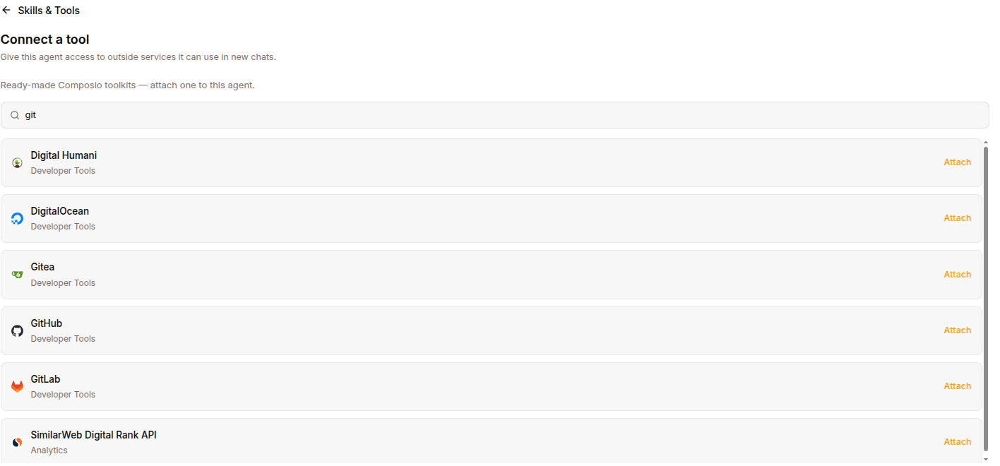

The **Integrations** page connects third-party services (via Composio) to an agent, so it can use tools like Gmail, Slack, GitHub, and more.

Open it at `/work/agents/<agentId>/integrations`, reached from the agent's chat: click the **Connect your accounts** strip under the message box. The strip shows only when the agent has integrations assigned. The page header reads "Integrations" with the subtitle "Connect third-party services to enhance your agent's capabilities." A **Back** link returns you to the chat.

## Layout

- **Search box** — "Search integrations…" filters the list by name.
- **Category sections** — available toolkits are grouped under headings (the toolkit's category, or "Other").
- **Toolkit rows** — one row per integration, each with an expand toggle, a logo (or a letter fallback), the name, and a **Connect** / **Disconnect** button.

Expanding a row shows its description and an auth-mode badge — **API Key** or **OAuth** — depending on how the toolkit authenticates.

## Connecting a tool

1. Open the **Integrations** page for the agent.
2. Find the service (search or browse by category).
3. Click **Connect** on its row. The button shows "Connecting" while it works.
4. If the toolkit uses OAuth, a popup window opens for you to authorize with the provider. Complete the consent flow there.
5. The page polls for the connection and, once the provider reports it as connected, closes the popup and marks the row **connected**. The button flips to **Disconnect**.

The list also refreshes whenever you return focus to the window, so a connection completed in another tab is picked up automatically.

## Disconnecting a tool

1. Find the connected toolkit's row.
2. Click **Disconnect** (it shows "Disconnecting" while it works).
3. The row returns to the disconnected state and the button flips back to **Connect**.

## Errors

If starting a connection or disconnecting fails, an inline error message appears near the top of the page (for example, "Failed to start the connection" or "Failed to disconnect"). Retry the action after resolving the underlying issue.

## Notes

- Integrations are managed per agent — the connections you make here apply to the agent whose page you're on.
- The catalog and connection state come from Composio through the agent runtime; if no integrations back end is configured for the agent, the page has nothing to show.
