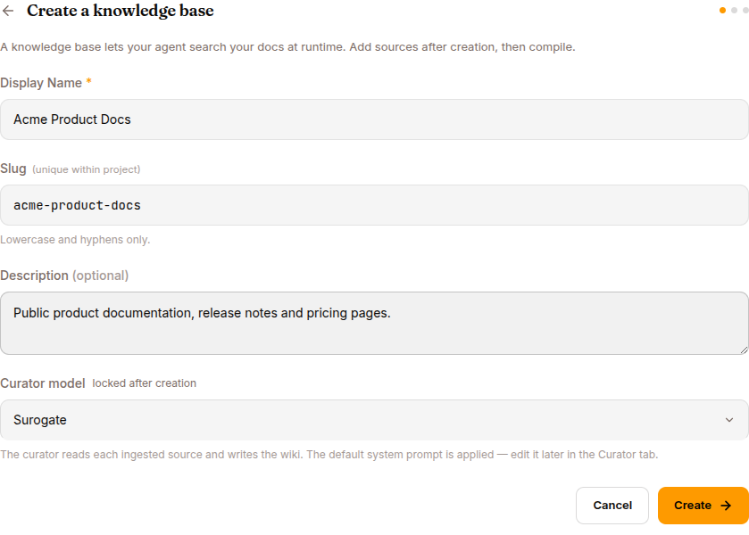

A **knowledge base** (KB) is the agent's searchable library. Where a skill teaches the agent *how* to do something, a KB tells it *what it knows*.

## When to use a KB

✅ Good fits:

- Product documentation, user guides, FAQ articles
- Internal wikis (Notion, Confluence, GitHub markdown)
- Past customer-support tickets and their resolutions
- Policy documents, SOPs, contracts
- Domain reference material (legal, medical, regulatory)

❌ Bad fits:

- **Real-time data** — use a tool or MCP server instead (current weather, current stock price)
- **Per-user history** — that's what session memory is for, not the KB
- **Behaviour rules** — that's a skill
- **The agent's identity** — that's SOUL.md

## How a KB works

```
You add SOURCES (files, URLs, etc.)
              ↓
   ┌─────────────────────────────┐
   │   Curator (an LLM)          │
   │   reads every doc,          │
   │   extracts structured       │
   │   knowledge, deduplicates   │
   └─────────────┬───────────────┘
                 │ COMPILE
                 ↓
   ┌─────────────────────────────┐
   │   WIKI — searchable index   │
   │   per-source pages + a      │
   │   cross-source synthesis    │
   └─────────────┬───────────────┘
                 │
                 ↓
   Agent calls kb_list_pages / kb_read_page at runtime
```

The **curator** is an LLM that reads your raw documents and produces a structured wiki. At runtime the agent doesn't read the raw documents — it searches the curated wiki. Much cleaner than naive chunk-retrieval RAG.

## Creating a KB



**Library → Knowledge Bases → NEW KNOWLEDGE BASE**

Fields:

- **Display Name**: `Acme product docs`
- **Slug**: `acme-product-docs`, filled in from the display name until you edit it. It can't be changed later.
- **Description** — what's in here, who should use it
- **Language**: the language the wiki is written in. It also picks the OCR model for scanned PDFs, so choose it now.

Click **CREATE**. The KB starts in `error` status — that's normal until you add sources and compile.

:::tip[Curator model]
You don't pick a curator model at creation. The default is fine for most uses. To use a smarter model for highly technical content, change it later in the KB's **Configure** tab, then use **Rebuild knowledge base** to redo pages already written. See [Develop mode](/develop/features/knowledge-bases/#configure) for the Configure tab.
:::

## Adding sources

Open the KB → **SOURCES** tab → **ADD SOURCE**.

Five source types are listed in the picker. **Only File works in the current build** — the others (S3, GitHub, Notion, URL crawling) are coming soon.

So: drop your most important `.md`, `.pdf`, `.txt`, `.docx`, or `.csv` files in one at a time. Each one becomes a row in the SOURCES table with its own status.

:::tip[Smaller is more reliable]
Very large documents compile better in chapter-sized chunks. Big PDFs route through a long-document indexer; a very large *non-PDF* file (one huge Markdown, say) is summarised from a head-and-tail excerpt with the middle omitted — splitting it is the fix.
:::

## Compiling

Click **COMPILE NOW** (or the COMPILE button at the top of the KB detail).

What happens:

1. The curator job starts.
2. Each source is read, parsed, and analysed.
3. The curator extracts structured knowledge — facts, definitions, procedures.
4. Duplicates are merged.
5. A per-source wiki page is generated, plus a cross-source synthesis index.
6. KB status: `error` → `compiling` → `active`.

Compile takes 30 seconds to a few minutes per source.

### When compile fails

A single bad file **no longer takes the whole compile down**: healthy sources continue through the pipeline and a wiki is still produced from them, while each failing file shows **its own error message inline in the SOURCES list** with a per-file retry.

Read the status carefully, though: the KB still reports `error` when *any* file failed. That now means "at least one source failed", not "nothing was built": open the wiki from the **Wiki pages** card ([below](#browsing-the-wiki)), it's often already usable.

If a file shows an error:

1. **Retry it** — many failures are transient, and files a dead compile left locked are requeued automatically, so retry never dead-ends.
2. **Reduce source size** — split big documents.
3. **Check format** — corrupt PDFs and non-UTF-8 markdown sometimes choke the parser.
4. **Read the inline error** — it names the actual reason per file.

If failures persist, switch to **Develop mode** for the deeper troubleshooting steps.

## Browsing the wiki

After a successful compile, the **Wiki pages** stat card on the KB detail becomes clickable (whole card, amber hover) and opens the wiki. The wiki view shows:

- **Synthesis pages** — cross-source ("Pricing across all products", "All known issues by severity")
- **Per-source pages** — organised by content, not by original file boundaries
- A **search box** — same one the agent uses

The page list highlights the selected page in amber, and the reader renders pages as a full-width selectable document. Preview what the agent will see before attaching the KB. Search for what a real user might ask. If the right page surfaces, the agent will too.

On monetized agents, KBs are also a sellable package dimension — a buyer whose package excludes a KB can't see or search it. See [Monetize](/work/monetize/#whats-included-packages).

## Attach a KB to an agent

Open the agent → **Configure** in the left nav → the **Knowledge Bases** tab → **+ ATTACH KNOWLEDGE BASE** → pick the KB.

The agent's system prompt grows by:

```

## Available Knowledge Bases

- acme-product-docs: Product documentation, runbooks, known-issues database.
  Browse via kb_list_pages("acme-product-docs"), then kb_read_page(path).
```

Plus the agent gains `kb_list_pages` and `kb_read_page` as available tools. The LLM uses them automatically — you don't need to write a skill to invoke them.

## Updating a KB

Two patterns:

**Append a new source**: SOURCES → ADD SOURCE → upload → COMPILE.

**Replace existing content**: delete the old source (row action → Delete), add the new file, COMPILE.

Sources don't auto-sync from their origin. For frequently-changing content, wait for the S3 / GitHub / Notion / URL source types to ship — they'll have continuous-sync.

## Detach and delete

- **Detach from an agent** — agent's Configure → Knowledge Bases tab → DETACH. The agent loses KB-tool access for this KB on the next session.
- **Delete the KB entirely** — KB detail → DELETE. A pre-flight check warns you if any agent has it attached.

## A worked example

You have a product, `acme-shop`, and you want a customer-support agent to know your product cold.

1. Create a KB `acme-product`.
2. Add sources: `getting-started.md`, `pricing.md`, `faq.md`, `known-issues.csv`.
3. COMPILE. Wait. Status: `active`.
4. Open the wiki from the **Wiki pages** stat card → confirm relevant content surfaces for typical questions.
5. Deploy a new agent (Templates page → **Start from scratch** → fill in the dialog) or pick an existing one.
6. Open the agent → Configure → Knowledge Bases tab → attach `acme-product`.
7. Open a chat → ask: *"What's included in the Pro plan?"*
8. Watch the EVENTS tab — you'll see a `tool.call` for `kb_read_page`, then a grounded answer.

For the full multi-step recipe with screenshots, see [Use cases → Product-support agent with a KB](/work/use-cases/).

## What's next

If you have an MCP-protocol external system to connect to, read [MCP servers](/work/library/mcp-servers/). Otherwise jump to [Use cases](/work/use-cases/) for end-to-end recipes.
