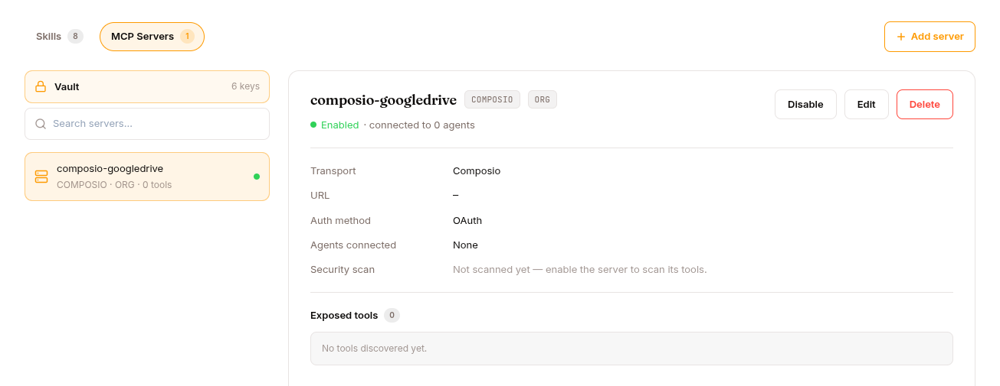
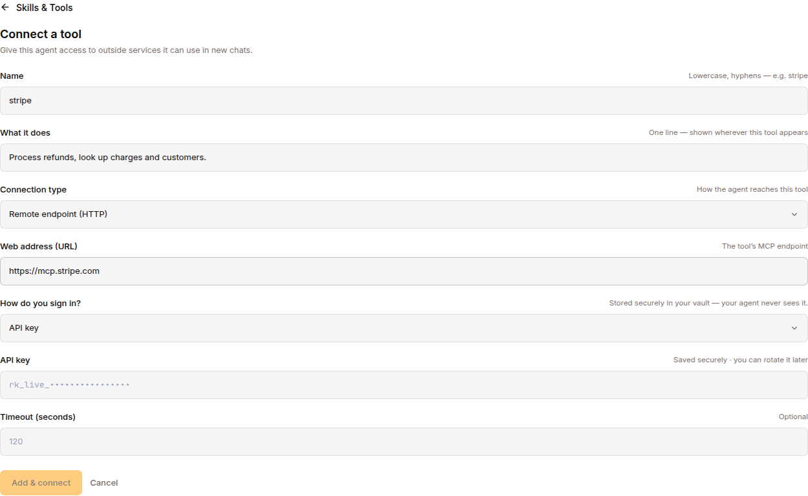

The **Model Context Protocol (MCP)** is an open standard for connecting LLMs to external systems — your CRM, your ticketing tool, GitHub, internal APIs, anything that speaks MCP.

You wire a server up once in the Library; any agent in your workspace can then attach it and use its tools.

## The MCP Servers tab

**Library → Skills & Tools → MCP Servers tab.**

- **Left rail**: a **Vault** entry at the top (a lock icon, marked **In Settings**, which opens **Settings → Vault**), a search box, then the list of every server. Each row shows the server name and a `TRANSPORT · LAYER · N tools` line, with a green dot when the server is enabled.
- **Right pane** — the selected server's detail: name + transport/layer chips, an Enabled/Disabled status with the number of connected agents, **Disable/Enable · Edit · Delete**, the connection details, the auth method, the security-scan result, and the list of exposed tools.

Click any server to open its detail panel; click **Add server** (top right) to create one.

## Adding a server

Click **Add server**. The form ("Add a server — connect an MCP endpoint, its tools become available to your agents"):

| Field | Notes |
|---|---|
| **Name** | Lowercase, hyphens (e.g. `stripe`, `github`). |
| **What it does** | One line, shown wherever the tool appears. |
| **Connection type** | **Remote endpoint (HTTP)** or **Local command (stdio)**. |
| **Web address (URL)** *(HTTP)* | The tool's MCP endpoint, e.g. `https://mcp.stripe.com`. |
| **How do you sign in?** *(HTTP)* | **API key** (stored in the Vault) or **OAuth** (sign in in a new window). |
| **API key** *(HTTP + API key)* | The key itself — saved securely to the Vault, your agent never sees it. |
| **Command** *(stdio)* | The full command that starts the server, e.g. `npx -y @modelcontextprotocol/server-filesystem /workspace`. |
| **Environment** *(stdio)* | Optional, one `KEY=value` per line. |
| **Timeout (seconds)** | Optional, defaults to 120. |

The submit button reads **Add & connect** (HTTP + API key), **Connect** (OAuth), or **Add server** (stdio). New servers are created **enabled**, at the **user** layer, and are mirrored into the runtime's MCP registry so the proxy picks them up on its next discovery cycle.

### What happens to your API key

When you add an HTTP server with an API key, Studio does two things: it stores the key in the **Vault** (keyed by the server name), and it saves the server with a *reference* to that Vault entry — not the key itself. At runtime the MCP proxy resolves the reference and injects the key. The agent's sandbox never sees the secret. See [MCP & Vault](/develop/features/mcp-and-vault) for the full trust model.

### Choosing a connection type

- **Remote endpoint (HTTP / StreamableHTTP)** — for cloud-hosted MCP servers (SaaS connectors, your internal API, third-party MCP services). The most common choice.
- **Local command (stdio)** — for tools that launch as a subprocess (CLI-like tools, MCP servers shipped as npm packages).

## Authentication

- **API key** — a static key, passed as a header. Stored in the Vault, injected by the proxy.
- **OAuth** — for servers that require an OAuth 2.1 sign-in (Salesforce, Slack, GitHub, most enterprise SaaS). You sign in in a browser window; the platform stores the resulting connection (refresh token), not your password.

The proxy also supports **Bearer token** and **no auth** for servers configured directly; the Studio "Add server" form surfaces the two you'll reach for most. Whatever the method, secrets live in the Vault and are injected by the proxy — never handed to the sandbox.

## The Vault

The **Vault** entry at the top of the left rail opens **Settings → Vault**, where the keys the proxy needs live and values are never shown again; see [Vault](/work/settings/vault/).

:::note[Credentials never reach the sandbox]
The agent's sandbox is the most untrusted component in the platform. Credentials live in the Vault and are injected by the MCP proxy as it forwards each call — even a fully prompt-injected agent can't exfiltrate them.
:::

Full detail — reference syntax, encryption at rest, config layers — is in [MCP & Vault](/develop/features/mcp-and-vault).

## Enabling, disabling, and security scanning

The **Enable / Disable** button toggles whether the server is live. Enabling doesn't run a synchronous scan in Studio — instead, the **MCP proxy scans every tool a server advertises when it discovers them** (at attach/connect time). The scanner:

1. Runs each tool definition through checks for **invisible Unicode** (zero-width, bidi marks), **hidden HTML comments**, **prompt-injection patterns**, **tool-poisoning descriptions**, and **schema abuse**.
2. Computes a SHA-256 fingerprint for each tool (for rug-pull detection).
3. Drops any tool that fails; only passing tools are registered and offered to the agent.

The detail panel reflects the result under **Security scan**: **Passed** / **Failed** with a scan timestamp, or *"Not scanned yet — enable the server to scan its tools."* until the proxy has connected.

## Attaching to an agent

Open the agent → **Configure** → **Skills & Tools** → **Connect a tool**. Three tabs:

- **From your Library** — the custom MCP servers you've added. **Attach** the one you want.
- **Toolkits** — the live **Composio** catalog (searchable, can be 1000+ toolkits). Attaching one provisions a shared `composio-{toolkit}` server for the project, with OAuth auto-provisioned by the broker under the agent's own account.
- **Add server** — the same "Add a server" form inline, so you can connect a brand-new server and attach it in one step.

Attaching a server grants the agent its **full (scanned) toolset** — there's no per-tool checkbox in Studio; the security scanner is the gate (it removes unsafe tools before they ever reach the agent). Builders who need a tighter allow/deny list can pin one in the agent config (`tools` / `disallowed_tools`).

To remove a server from an agent, detach it from the same section.

## Editing and deleting

- **Edit** — the same form, pre-filled. For an HTTP + API-key server, leaving the API-key field blank keeps the current key.
- **Delete** — a pre-flight dependency check lists any agents attached to the server; stop those agents first. (System-agent servers are protected and can't be deleted.)

## Rug-pull detection

The scanner fingerprints every tool definition. If a server returns a *different* definition on reconnect (the same tool name with different behaviour), it's flagged as a **rug-pull** — the fingerprint no longer matches. The common cause is a legitimate upstream update; review the change before trusting the new definition.

## What MCP gives you in practice

| You want to… | Add an MCP server / toolkit for… |
|---|---|
| Create / read GitHub issues | `@modelcontextprotocol/server-github` (stdio) or the GitHub toolkit |
| Look up customer accounts in Salesforce | A Salesforce MCP server (OAuth) |
| Read internal docs from Confluence / Notion | Confluence / Notion MCP servers |
| Get current data from your data warehouse | A SQL MCP server (Postgres, Snowflake, etc.) |
| Send messages to Slack from inside an agent | A Slack MCP server (outbound — distinct from the Slack channel) |
| Integrate your internal API | A custom HTTP MCP server (see [MCP & Vault](/develop/features/mcp-and-vault)) |

## What's next

If you've covered the Library, head to [Channels](/work/channels/web/) to publish the agent. Or jump to [Use cases](/work/use-cases/) for end-to-end recipes.
