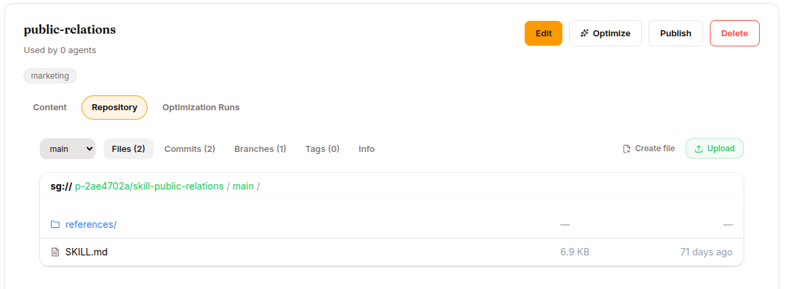
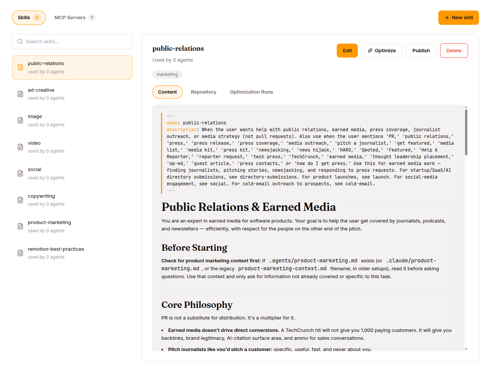
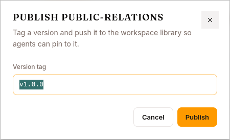

A **skill** is a small markdown file (a `SKILL.md`) that tells the agent how to handle a specific kind of request. Think of skills as reusable mini-prompts — procedural memory the agent loads when a request looks relevant.

> Builders write skills more deeply — frontmatter, conditional activation, the override model. You'll find that in [Develop mode → Skills](/develop/features/skills-and-experts). This chapter is the operator's view: how to find, add, edit, publish, and attach skills.

## Where skills live





**Library → Skills & Tools → Skills tab.** (The page is titled "Skills & Tools" and carries two tabs: **Skills** and **MCP Servers**.) Layout:

- **Left rail** — a search box (`Search skills…`), a **New skill** button, then the list of every skill in your workspace. Each row shows an icon, the display name, and a `version · used by N agents` line.
- **Right pane** — detail for the selected skill: the display name + a version chip, a **Used by N agents** line, **Edit / Publish / Delete**, its tags, and inner **Content / Repository** tabs.

The **Content** tab renders the skill's frontmatter (name / description / trigger) above the rendered markdown body. The **Repository** tab (shown once the skill has been provisioned in the Hub) opens a file browser over the skill's git-backed repo.

Platform-default skills that the runtime loads on its own (the built-in process skills like `brainstorming` or `systematic-debugging`) don't appear in this list — it shows only the skills your workspace has created.

You can still change how one behaves: create your own skill with **the same name** and attach it to the agent. An attached skill shadows the platform default of the same name for that agent — the built-in isn't deleted, just superseded. Detach yours and the original comes back.

## The SKILL.md format

A skill is YAML frontmatter followed by a markdown body:

```markdown
---
name: tldr
description: Summarize text into one tweet-length sentence
trigger: tldr, tweet-length, one-sentence summary
tags: [summarize, writing]
---

When asked to give a tldr, produce exactly one sentence of 240
characters or fewer that captures the most important fact. No
preamble, no "Sure!" prefix, no quotation marks. Just the sentence.
```

Frontmatter fields:

| Field | Required | Notes |
|---|---|---|
| **name** | Yes | Unique slug used to reference and invoke the skill (agent catalog, slash commands). Lowercase letters, digits, `-`, `.`, `_`; must start with a letter/digit; ≤ 64 chars. **Fixed after creation.** (The Studio **From scratch** form is stricter — lowercase letters, digits, and hyphens only — so use hyphens there; `.`/`_` names come in via import or the API.) |
| **description** | Yes | One line — what the skill does and when to use it. The agent reads this to decide whether to apply the skill, so be specific and action-oriented. |
| **trigger** | No | Comma-separated keywords describing when the skill is relevant. Surfaced to the agent as a hint. |
| **tags** | No | Labels for organizing and filtering in the studio. |
| **tools** | No | The tools this skill is allowed to invoke. |

The body must be non-empty — it's the actual instruction set the LLM follows. Only `name` and `description` are mandatory.

## Adding a skill

Click **New skill** in the Skills tab. This opens an **Add a skill** panel with a three-way segmented control:

| Tab | What it is |
|---|---|
| **Browse** | The curated **template** library. A category rail on the left, a searchable template list in the middle, and a read-only preview on the right (description, triggers, "View full content"). Click **Add to Library** to import a template as your own editable copy. |
| **From scratch** | A form: Name, Display Name, Description, Trigger, Tags, and a markdown editor for the content. |
| **Import** | Drop in a `SKILL.md` file or a `.zip` archive (e.g. one exported from [agentskills.io](https://agentskills.io)). Every file in the archive is uploaded to the skill's repository. |

All three land the skill in your workspace Library; from the agent's own Skills & Tools tab (see below) they additionally auto-attach it to that agent.

:::note[Templates are real, not empty]
The Browse tab is backed by a live template registry (`/api/skill-templates`) organized into categories. Importing one gives you a full, working starting point you then customize — you're never editing the original.
:::

### Create a skill from a chat

You don't have to use the form at all. Agents ship with a built-in `skill_manage` tool: when you finish a difficult, multi-step task in a session, the agent can offer to **save the approach as a skill** (`skill_manage(action='create')`), and can `patch` an existing skill when it finds it stale or wrong. Skills created this way go to the user's skills directory and follow the same `SKILL.md` format. This is often the easiest way to grow a good skill library — let the agent capture procedures it just worked out.

## Writing a useful skill

The minimum skill (see the `tldr` example above) is a working skill: fill in **From scratch**, click **Create skill**, then **Publish** and attach it.

### Rules of thumb

1. **Be specific about output, not vibes.** "Produce 3-5 bullets, each under 20 words" beats "be thorough."
2. **Show one example.** A concrete example saves a paragraph of prose. LLMs are much better at imitating than inferring.
3. **List forbidden behaviours explicitly.** "Never include the internal ticket ID" beats hoping the agent figures it out.
4. **Keep triggers precise.** `trigger: refund request, refund policy, customer wants money back` is better than `trigger: help, refund`. Loose triggers cause cross-contamination — the skill fires on unrelated messages.

### What NOT to put in a skill

- The agent's **identity** ("You are a friendly support agent…") — that's SOUL.md (see [Improve your agent](/work/workflow/improve-agent/)).
- **Long lists of facts** — those are knowledge base material (see [Knowledge bases](/work/library/knowledge-bases/)).
- **Workflow that touches many features** — that's a use case (see [Use cases](/work/use-cases/)).

## Editing a skill

Skill detail → **Edit**. You can change everything except the **name** (the slug is locked once the skill exists). Saving rewrites the skill's `SKILL.md` on the Hub and republishes the bundle of every agent that has the skill attached, so an edit reaches the runtime — but only on the **next** session.

## Publishing — versioning your skill



Every skill is stored in a small git-backed repo in the Hub under your project. Click **Publish** on a skill to create a tag such as `v1.0.0`. Why this matters:

- **Immutability**: once published, the tag doesn't change. Editing creates new commits; you have to Publish again to cut a new tag.
- **Rollback**: if a new version regresses, you can re-attach the previous tag.
- **Audit**: sessions record which skill version they used.

The Publish dialog asks for a **Version tag** (it pre-fills the current version, or `v1.0.0` for a first publish). Use semantic versioning if you like; nothing enforces a format.

Note that attaching a skill to an agent pins the `main` branch by default (always-latest), not a specific tag — tags exist for when you want to pin.

## Attach to an agent

Open the agent → **Configure** in the left nav → the **Skills & Tools** tab. Two ways in:

- **Attach from your Library** — pick one or more existing skills and attach them in a batch.
- **Add skill** — the same Browse / From scratch / Import flow, which creates the skill *and* attaches it to this agent in one step. (In the agent view these appear as three cards: **Start from a template**, **Write from scratch**, **Import a file**.)

The agent hot-reloads on the next session. Existing in-progress sessions keep their old skill list. To remove a skill, use **Detach** on the skill row — it stays in your Library and can be reattached anytime.

## When the agent isn't using your skill

A common frustration: you wrote and attached a skill, the agent should be using it, it isn't. Three things to check:

1. **Did you start a NEW session?** Skill changes (and edits) don't apply to in-progress sessions.
2. **Are the triggers specific enough?** The LLM compares the user's message against the description and triggers. Vague triggers fire on everything; overly specific triggers fire on nothing.
3. **Does the skill need a tool the agent doesn't have?** If the skill's `tools` list names a tool the agent's config denied, the skill can't run it. Either grant the tool or drop the requirement.

The session's **Skills** panel shows which skills loaded into context. If yours isn't there, the filter is hiding it.

## Expert skills

Flip the **Is Expert** switch (in the From-scratch/Edit form) to turn a skill into an **expert** — a skill backed by its own **deployed model** that the base LLM can delegate to. Instead of just injecting instructions into the base model's context, an expert runs its own mini agent loop on its own model and hands the answer back. This is how you attach an LLM that's specialised in one thing (a fine-tuned coder, a domain classifier) inside an ordinary agent.

An expert skill carries extra configuration beyond the standard frontmatter:

- **Deployed model** — the model that backs the expert. Its endpoint is derived from the selected model; the skill can't be activated until that model is actually serving.
- **Max iterations** — how many tool-call rounds the expert may take before giving up.
- **Allowed tools** — the tools the expert may use during delegation (e.g. `read_file`, `search_files`, `list_files`, `patch`, `write_file`, `terminal`, `web_search`, `web_extract`).
- **Generation parameters** — optional sampling overrides (temperature, top_p, top_k, max_tokens, repetition_penalty); blank means use the model default.

In the `SKILL.md` this surfaces as `type: expert` in the frontmatter plus the model / endpoint / `max_iterations` / `expert_status` / `generation` fields. The skill's markdown body doubles as the **expert model's system prompt**.

### Lifecycle

Experts have a status: **draft → active → retired**. The expert detail panel shows the backing model, a usage tally, and an **Activate** / **Retire** button. Don't trust the tally — it isn't wired up and reads zero no matter how much the expert has run. Judge an expert by reading the sessions that used it.

- **Activate** publishes the expert as live. It's refused unless the backing model has a working serving endpoint — otherwise `consult_expert` would fail at runtime with "no endpoint configured." Deploy/serve the model first.
- **Retire** takes it out of rotation: the base LLM stops delegating to it.

When the base LLM sees a request matching an active expert's `trigger`, it calls `consult_expert`; the expert runs its loop and returns an answer, which the base model reviews and either accepts or adjusts. For operators, the practical read: experts cost money to serve, so they earn their keep when a specific task recurs often and the default model gets it wrong often enough to matter.

## Delete a skill

Skill detail → **Delete**. A pre-flight check warns you if any agent currently has the skill attached (and blocks the delete while it's actively in use — detach it first). The confirmation is deliberate: you have to click **Delete** to proceed. Deleting also drops the skill's Hub repo.

## What's next

If you've never built a knowledge base, read [Knowledge bases](/work/library/knowledge-bases/). For the tool side of this tab, see [MCP servers](/work/library/mcp-servers/). If you want a worked end-to-end example, jump to [Use cases](/work/use-cases/).
