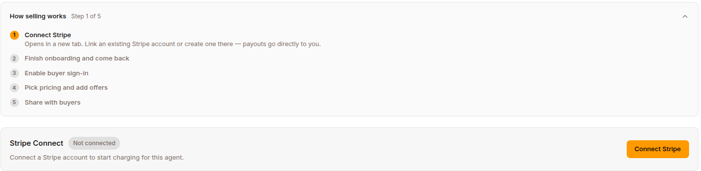
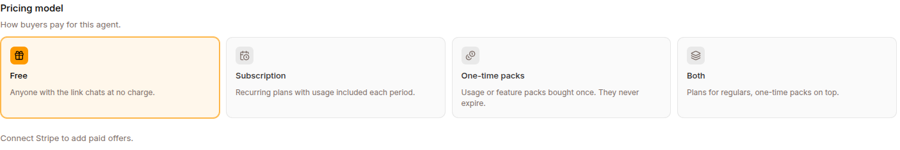
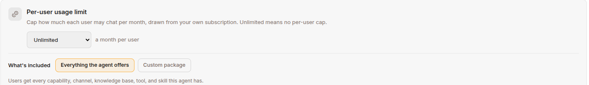

Charge end users for access to one of your public agents. You decide the price and what each purchase includes — usage, channels, capabilities, knowledge bases, tools, skills, even the model tier. The payment goes straight into your Stripe account; Surogate keeps a 5% platform fee per sale.

## What it is

Three roles:

| Role | What they do |
|---|---|
| **You** (the builder) | Created an agent and want to charge for it. |
| **Your buyer** | Pays you to use the agent. Doesn't need a Surogate account. |
| **Surogate** | Hosts the agent, brokers the payment via Stripe, and enforces the buyer's usage and package on every message. |

Six things you'll work with:

| Term | Meaning |
|---|---|
| **Pricing model** | How your agent charges: Free, Subscription, One-time packs, or Both. |
| **Offer** | A specific plan or pack you sell — a price plus what it includes: usage, browsing time, media credits, and a package. |
| **Package** | What a purchase unlocks beyond usage: capabilities, channels, knowledge bases, connected tools, skills, and the model tier. |
| **Entitlement** | What a specific buyer holds — subscription status, balances, and their effective package. |
| **Message** | The usage unit shown everywhere: 1 message ≈ 1,000 tokens (a question plus the agent's answer). Amounts are stored in tokens; the UI authors and displays messages. |
| **Per-user allowance** | The usage budget each end user draws from — funded by their purchases, your free-trial grant, or your per-user limit on a free agent. |

## Who can use it

**Selling requires the Pro plan or higher** — but *spending* is never gated: buyers keep using balances they already paid for regardless of your plan.

| Plan | Agent commerce |
|---|---|
| Free | — |
| Standard | — |
| Pro | ✅ |
| Max | ✅ |
| Enterprise | ✅ |

If you drop below Pro, your agent's paid offers drop out (an agent with a [Free plan](#the-free-plan) keeps offering it, on the buy page and in the app); without a Free plan the storefront degrades to **free mode**: the buy page shows no offers ("This agent is not currently accepting purchases."), the Monetize panel collapses to an **Upgrade to Pro** prompt, and the agent behaves as a free agent. Takedown actions still work below the gate — you can always set the mode to Free, deactivate or delete offers, and disconnect Stripe. Stripe keeps charging and granting existing subscriptions the whole time, and re-upgrading restores your catalog intact.

Upgrade under [Settings → Billing](/work/settings/billing/).

## Set up your agent

You'll need a project on the **Pro plan or higher** with **BYO Firebase Auth** configured (see [Self-registration](/work/channels/self-registration/)). The platform operator must have completed the platform-side Stripe Connect setup; if Stripe Connect isn't enabled platform-wide, the Monetize tab reports that Stripe Connect is not available on this deployment.

### Step 1 — Connect your Stripe account



Open the agent's **Publish** page and click the **$ Monetize** tab. A **How selling works** guide walks the five steps (Connect Stripe → Finish onboarding → Enable buyer sign-in → Pick pricing and add offers → Share with buyers) and dismisses itself once selling is live.

Click **Connect Stripe** and follow Stripe's Express onboarding:

- Verify your identity (passport / driving licence depending on country).
- Link a bank account (Stripe uses Plaid-style instant verification where available).
- Answer a short questionnaire about your business.

Stripe redirects you back to Surogate when you're done. The status pill flips to **Active** once Stripe has cleared you for charges, and the **Open dashboard** button becomes active. If anything is still pending you'll see exactly which step to finish.

A few things worth knowing:

- **One Stripe account per project**, not per agent. If you monetize more than one agent in the same project they all share the same Stripe account and the same payout schedule.
- Your buyers' payments land in **your** Stripe balance, not Surogate's. Stripe pays you out on your normal schedule (daily by default).
- The buyer's card statement shows **your** business name — you're the merchant of record on each charge.

### Step 2 — Set up buyer sign-in

Your buyers need a way to sign in before they can pay. Surogate uses **Firebase Authentication** for this — the same setup you use to let end users [self-register](/work/channels/self-registration/).

Under **Settings → Authentication tab → BYO Firebase auth**, configure your project's Firebase account. Choose which sign-in providers to offer (email/password, Google, GitHub). You can use the same Firebase project for both agent self-registration and commerce.

If you skip this step the buyer paywall shows *"buyer authentication is not configured."*

### Step 3 — Pick a pricing model



Back on the Monetize tab, the **Pricing model** cards offer four choices:

| Mode | When to use it |
|---|---|
| **Free** | No charge. The default. |
| **Subscription** | Buyers must hold an active subscription. Best for *all you can eat* pricing. |
| **One-time packs** | Usage or feature packs bought once. They never expire. Best for casual users and add-ons. |
| **Both** | Buyers subscribe, and packs top up their plan: a buyer needs a plan first, and the Free plan counts. Until they hold one, the buy page locks the packs (*Packs top up a plan. Pick a plan above first — the Free plan counts.*). Subscription usage is spent first; pack usage kicks in when it runs out. |

You can change the mode at any time. Offers of a kind the current mode doesn't sell are collapsed in the list behind a note — *"N live plans hidden — not sold under this pricing model, but still active for existing buyers"* — and can be revealed (dimmed) so **Edit / Deactivate stay reachable** without flipping the mode back, which would put them on sale again. Existing buyers keep billing either way.

### Step 4 — Create offers

Once you've picked a paid mode, the offer composers appear (disabled until Stripe is connected). You can keep up to **5 live offers of each kind**; exact duplicates (same price, usage, interval, *and* package) are refused.

Fields, for plans and packs alike:

- **Name** — defaults to `Monthly access` / `Top-up pack`; shown on the buy page and the buyer's statement.
- **Price** and **Currency** — seven currencies: USD, EUR, GBP, RON, CHF, CAD, AUD. **New offers default to EUR.**
- **Usage included** — authored in **messages** from a preset ladder (~100 up to ~10,000 messages) or **Custom**. Packs can also pick **No extra usage (feature only)** — a pack that sells only features is valid, as is a plan with no usage (`Access included`).
- **Interval** — Monthly or Yearly (plans only; packs are one-time).
- **Browsing time included** — a dedicated **Browser use** block (only when the agent's Browser use capability is on): none, 30 min / 1 h / 2 h / 5 h, or custom minutes. Browsing is metered by the wall clock while the buyer's browser is open. See [How browsing time works](#browsing-time-and-media-credits).
- **Media credits included** — a **Media generation** block (only when the agent has an image or video model wired): none, $1 / $3 / $10 / $25 of generation, or custom cents. See [Media credits](#browsing-time-and-media-credits).
- **Description (shown on your buy page)** — up to 2,000 chars, local-only (never mirrored to Stripe). A **Generate description** button drafts it with AI from the offer's contents; an **Instructions** field steers the draft (e.g. *"friendly tone, write it in Romanian"*).
- **What's included** — the package. See the next section.

**Editing offers.** Name, usage, minutes, media, package, and description edit **in place**. Changing the price, currency, or interval **replaces** the offer in one step — a new Stripe Price is minted, the old offer retires, and the toast confirms *"Offer updated — new buyers see the new terms."* Current subscribers keep their price until they cancel.

Two guard rails you may hit on save:

- *"this offer sells browsing time but its package excludes Browser use — include it or remove the minutes"* (same rule for media credits vs. Image/Video generation).
- *"this agent's browser capability is off — enable it before selling browsing time"* (and *"this agent has no image or video model configured — wire one before selling media credits"*).

## What's included: packages

Every offer carries a package — what the purchase unlocks beyond usage. A segmented control offers **Everything the agent offers** (plans) / **Extra usage only** (packs) versus **Custom package**. A custom package picks from:

| Group | Sellable items |
|---|---|
| **Capabilities** | Browser use, Coding agents, Deep research, Research missions, Loops and scheduling, Missions, Goals, Brainstorming, Image generation, Video generation |
| **Channels** | Slack, Telegram, Website widget, WhatsApp — the agent's own **web app is always included** and can't be excluded |
| **Knowledge bases** | The agent's attached KBs, by name |
| **Connected tools** | The agent's enabled MCP servers and Composio toolkits |
| **Skills** | The agent's attached skills (built-in platform skills are always available and not sellable) |
| **Model** | Plans: a **Basic** / **Pro** radio, seeded from the agent's own tier. Packs: an optional **Include the Pro model** checkbox — unchecked, the pack carries no model opinion |

Notes:

- **Compress and multi-session always ship with every purchase** — they're deliberately not sellable.
- You can only sell what the agent actually has switched on; items turned off for the agent disappear from the composer (staying visible only if already stored, so you can remove them).
- An amber warning appears when a custom package omits a capability the offer's minutes or media credits depend on.

### How packages combine

- A **subscription with no custom package** includes everything the agent offers. A **pack with no custom package** is pure extra usage — it never widens a restricted plane.
- Within a custom package, a dimension you don't restrict is unrestricted; a dimension with nothing ticked grants nothing.
- Each buyer holds two planes: the **subscription plane** (reset to the offer's package on every renewal, counts only while the subscription is active) and the **pack plane** (the union of every pack ever bought — it accumulates and never expires). Their effective package is the union, and the **strongest model tier wins** — a Pro pack outlives a basic plan's resets.
- **Packages are snapshotted at purchase.** Editing an offer changes future purchases and renewals only: *what a buyer already holds stays as bought.* Buyers who subscribed before packages existed read as unrestricted.

### What the package does at runtime

Enforcement is real, per turn, pinned from the payment receipt:

- A message on an **excluded channel** is refused *before any usage is spent*, with *"Your current plan doesn't include this channel."* and the buyer's buy link.
- **Excluded KBs** are invisible to the agent (a package with zero KBs drops the KB tools entirely), and each KB call re-checks.
- **Excluded capabilities** lose their tools — browser toolset, coding agent, image/video generation — and excluded MCP servers / Composio toolkits disappear from the toolset. Unresolvable tools fail closed.
- **Excluded skills** behave exactly like skills that don't exist; a slash command for an excluded capability answers *"/x is disabled for this agent."* (the same wording as an agent-level disable).
- A pinned **model tier** swaps the buyer's session onto the matching platform model.

## The Free plan and trials without a card

### The Free plan

In Subscription and Both modes, **Add a Free plan** (*People sign up with no card and get a monthly allowance; they can upgrade anytime.*) composes a plan at no price, with the same fields and **What's included** package as a paid plan. It has no Stripe product behind it, so it needs **neither a connected Stripe account nor the Pro plan**: you can pick a pricing model and offer a Free plan before connecting Stripe. Paid plans and packs still need both. An agent has at most one, listed first with a **Free** badge, priced *Free · renews monthly*.

On the buy page it comes first, marked *No card needed · upgrade anytime*. **Start free** puts the signed-in buyer on it at once, with no checkout. Inside the agent's web app, **Settings → Plan & Usage** lists it first with the same **Start free**. Their allowance renews each month, counted from the day they started, on their first use after the month ends. When a month's allowance is spent, the chat says *You have used this month's free allowance. Upgrade to keep chatting.* with the buy link.

Buying a paid plan replaces the Free plan. When a paid plan ends (cancelled, or a trial that ran out without a card), the buyer drops back to the Free plan if the agent still has one. A Free plan replaces the one-time **Free trial** allowance below: with a Free plan live, everyone signs up for it instead, and that card is hidden.

### People you bring in never need a plan

Your own team on [Programs](/work/tools/programs/), anyone in an active or paused journey on the agent, and their confirmed contacts pass every plan and package check on every channel, and their usage is not metered against a plan. Plans are for strangers who come to the agent on their own. When the agent has a Free plan, a stranger with no plan who writes first on WhatsApp, Telegram, Slack, Teams or a phone call is put on the Free plan with that message, and the conversation goes on. In the agent's web app they are offered it instead: *Choose a plan to keep chatting with this assistant; there is a free one.* with a **Start free** link. Without a Free plan, a stranger is told a subscription is needed. A refused message is kept, not lost: once they have a plan, their next message brings it along and the agent answers both. The AI disclosure is shown with that first answered turn, not with the refusal. *Your current plan doesn't include this channel* is kept for someone whose plan leaves the channel out.

### Trials on paid plans

A paid plan can offer **Free trial (days)**, up to 90 days. On the buy page the plan reads *N days free, no card needed* and its button **Start N days free**. Checkout starts the trial without asking for a card:

- While it runs, the buy page shows *Free trial · N days left* and *Add a card under Manage subscription to keep your plan when the trial ends.*
- A few days before the end, the buyer is reminded once on a channel the agent may write to them first on (one where they agreed to be contacted): *Your free trial of {plan} ends on {date}. To keep it, add a card here: {link}* (your own wording under Programs → Settings → Messages, where Programs is on).
- **With a card added**, the plan simply continues and is charged from then on.
- **Without one**, the trial is cancelled at its end and they move to your Free plan, or lose access if you have none. The buy page then says *Your free trial has ended. Pick a plan below to keep chatting.*

One trial per person per plan: a buyer who already had a plan's trial sees a plain **Subscribe** for it.

### Subscribers

The **Subscribers** card lists *everyone on a plan, on a trial, or holding extra usage*, each with their plan (or *Extra usage only*) and status: **Free**, **Trialing** with the days left, **Active**, **Past due**, **Unpaid**, **Canceled**, **Incomplete** or **Expired**.

## Free trial and per-user limits



Two cards on the Monetize tab, depending on your pricing model — both carry their own **What's included** composer, which sets the **default package** applied to users with no active purchase. These cards save the moment you change them.

- **Free trial** (Subscription and Both modes, when there is no Free plan): a switch plus a size picker (default **50,000 tokens ≈ 50 messages**). *One-time* — when a user's trial usage runs out they're prompted to subscribe (or buy usage) to keep going; it never refills, and a **lapsed subscriber gets no second trial**. The buy page advertises it: *"Try it free first: every new user gets ~N messages of one-time trial usage."*
- **Per-user usage limit** (Free mode): cap how much each user may chat per month, drawn from your own subscription. **Unlimited** (the default) means no per-user cap.

One rule worth reading twice: on a **monetized** agent, leaving the trial off means **zero free usage — a purchase is required before the first message**. Only free-mode agents default to uncapped.

One-time-packs-only mode shows neither card.

## Your buy page

Every monetized agent gets a hosted storefront at **`https://<host>/buy/<agent-slug>`** — the **Your buy link** card has **Copy link** and **Preview**, plus a **Storefront look** picker with six themes (Light, Dark, **Midnight** — the default, Ultraviolet, Midas, Surogate).

What buyers experience there:

1. **The storefront.** Your agent's description, the trial note if enabled, and your offers as cards — price, usage line (`~N messages every period`, `… of extra usage · one-time`, `Access included`, or `Feature add-on · one-time`), your description, and an `Includes: A · B · C` line for custom packages.
2. **Sign in.** With their Firebase account (whatever providers you enabled); the same flow registers new buyers.
3. **Checkout.** **Subscribe** / **Buy** lands on Stripe Checkout — card, Apple Pay, Google Pay, whatever you've enabled, auto-converted to their local currency. A buyer with an active subscription who clicks Subscribe again is refused: *"You already have an active subscription. Use Manage subscription to change plans."*
4. **Use the agent.** Right after purchase, a hint points them to messaging channels their package includes: *"Chat on Slack and Telegram: open the agent app and link your account under Settings, Connected Channels."*
5. **Manage subscription.** Takes them into Stripe's hosted Customer Portal — cancel, change plan, update card, download invoices.

Inside the agent's web app, buyers get a **Settings → Plan & Usage** tab: their plan and renewal date, **Included usage left this period**, **Extra usage** (top-ups, never expire), **Browsing time left** and **Media generation left** where metered, **"Your plan includes …"**, and your offers under **Plans** / **One-time packs**. In buyer chat, a balance chip shows what's left (e.g. `~120 messages · 45 min browsing · $2.40 media left`).

You don't have to build any of this UI.

## How usage is spent

Three layers stand between a buyer's message and your bill:

1. **Your project wallet is the hard ceiling.** Every end-user turn ultimately draws on your own subscription's token wallet. When it's empty, end users see *"This assistant is temporarily unavailable. Its owner has run out of credit."* — with no buy link, because buying can't help them. Top up under [Settings → Billing](/work/settings/billing/).
2. **The per-user allowance.** Each user's budget: the period grant (funded by their subscription tier, your trial, or your free-mode cap — resets on a 30-day cycle, or on the buyer's own billing cycle while a subscription is active) plus the top-up bucket (token packs — rolls over, never expires). Spend order: **period grant first, then top-ups**.
3. **The package gate.** Channel, tools, KBs, skills, and model tier — checked before any tokens are held.

The buyer's card is never charged per message — only at Checkout.

### Browsing time and media credits

Selling **browsing time** or **media credits** on *any* active offer makes that resource **metered for every buyer of the agent** — including buyers on offers that don't sell it. Leave the fields at zero on all offers and the resource stays unmetered.

- **Browsing time** is wall-clock: minutes accrue while the agent has a live browser open for that buyer (rounded up per minute, 1-minute minimum per browser — an idle open browser still costs, so `browser_close` is the cheap habit). A chunk of minutes is held before a browser opens and extended while it runs; when the balance can't cover the next chunk, the browser is closed within about half a minute and only actual time is billed. Period minutes reset each renewal and don't roll over; pack minutes never expire. Note the double meter: a buyer's browsing also draws your own project's web-browsing wallet, so price above your own cost.
- **Media credits** are dollars of provider spend: an image costs a few cents, a short video around fifty. Credits are held before generating and settled at the actual price — a failed generation charges nothing. Buyers without credits are asked to top up before the next generation; images and videos can also be gated per package (Image / Video generation capabilities).

Your own sessions (Studio chat, API calls, scheduled runs) are **exempt** from buyer metering — testing your agent never eats a buyer balance or shows you a paywall.

### What buyers see when they hit a limit

| Reason | Buyer-facing message |
|---|---|
| Allowance exhausted | *"You've reached your usage limit for this assistant."* + buy link |
| Subscription required | *"A subscription is required to keep chatting with this assistant."* + buy link |
| Channel not in package | *"Your current plan doesn't include this channel."* + buy link |
| Sign-in required | *"Please sign in to keep chatting with this assistant."* |
| Browsing time spent | The agent explains browsing is used up, links the buy page, and continues on non-browser tools |
| Media credits spent | The agent asks the user to top up or upgrade, with the buy link; nothing was generated or charged |
| **Your** wallet empty | *"This assistant is temporarily unavailable. Its owner has run out of credit."* — no buy link |

On web these render in the composer; on Slack / Telegram / WhatsApp as an inline notice.

## Let buyers embed your agent on their own site

Buyers with a **funded purchase** (an active subscription or a positive pack balance) can mint their own website-widget key from the buy page ("Embed on your website") and put the agent on their own site — their visitors' chats draw from the **buyer's** purchased usage. Preconditions: you must have the Website channel enabled, and a first-time mint requires your project to still be on Pro+ (refreshes keep working). Details in [Website widget](/work/channels/website-widget/#buyer-minted-embed-keys).

## Subscription lifecycle

| Event | What happens |
|---|---|
| **Renewal succeeds** | The buyer's period balances reset to the offer's amounts — usage, browsing minutes, media credits — and the subscription plane's package snapshot refreshes to the offer's current package. Top-up balances untouched. |
| **Renewal fails** | Stripe marks the subscription `past_due` and retries on a schedule (typically up to 3 weeks). The buyer's package stops counting immediately; the paywall tells them to update their card via the Customer Portal. Service resumes automatically once Stripe charges successfully. |
| **Buyer cancels** | Active until the end of the period. Then period balances drop to zero (usage, minutes, media) and the subscription plane stops counting. Top-up balances and pack-plane features are preserved. |
| **Buyer disputes a charge** | Stripe Smart Disputes auto-submits a counter using the payment metadata. You can override with your own evidence before the deadline. |

## Fees

| Charge | Who pays |
|---|---|
| Surogate platform fee | You — **5% of each sale** (subscription renewals and pack purchases), split off automatically. Per-seller overrides are possible (set by a platform admin). |
| Stripe processing fees | You. Standard Stripe rates — typically 2.9% + $0.30 in the US, with discounts for SEPA / EU recurring. |
| Tax (VAT / GST / sales tax) | Buyers, where applicable. Stripe Tax (free, built in) tells you when you cross a registration threshold. You register and remit; Stripe gives you the data. |
| Currency conversion | Buyer pays ~1% when Stripe converts to their local currency at checkout. |
| Chargeback fees | You (~$15 per chargeback). Smart Disputes reduces how often you lose them. |
| Buyer support | You. Buyers pay you, so support questions reach you, not Surogate. |

## FAQ

**What if I downgrade off Pro after creating offers?**
Your storefront degrades to free mode — no offers are shown and the agent behaves as free. Existing subscribers keep being charged and granted (Stripe doesn't stop), takedown actions stay available, and re-upgrading restores the catalog intact.

**Can I use a single Stripe account across multiple Surogate projects?**
No — one connected Stripe account per project. If you want to share payouts across projects you'd need to handle that on the Stripe side (e.g. consolidate to a single business bank account).

**Can a buyer try the agent before paying?**
Yes — turn on the **Free trial** card (Subscription and Both modes). Every new user gets a one-time trial of the size you pick, advertised on the buy page, and is prompted to buy when it runs out. A separate free demo agent remains an option if you want a permanently free tier.

**Can I let some buyers use the agent for free?**
There's still no per-buyer override, but the **default package** and the trial / per-user limit shape what non-payers get — on a free-mode agent you can leave the limit at Unlimited.

**A buyer says a command or feature is "disabled for this agent."**
Check their package first — an excluded capability answers with the same wording as an agent-level disable.

**A buyer paid but has no access.**
Almost always the Connect webhook: if no Stripe webhook endpoint targets `/api/commerce/stripe/connect/webhook`, checkouts succeed but grants never arrive. The server warns loudly about this at startup.

**I sold the Pro model but the buyer's answers didn't change.**
Older agents need one server restart after the platform upgrade (a one-shot backfill projects the tier model slots); agents on a BYO model don't support tier swaps.

**What if my buyer asks for a refund?**
You handle refunds directly via your Stripe dashboard. Stripe refunds the buyer; the corresponding grant on Surogate isn't automatically clawed back, so it's your call whether to disable that buyer's access.

**How fast do I get paid?**
Stripe's default is daily payouts with a 2-day rolling reserve in most countries. You can change the schedule in your Stripe dashboard.

**Can I sell in currencies other than EUR?**
Yes — USD, EUR, GBP, RON, CHF, CAD, and AUD, per offer. Stripe auto-converts to the buyer's local currency at checkout regardless (the buyer pays in their currency, you settle in yours).

**Where do I see how much I've earned?**
In your Stripe dashboard (Express). It shows every charge, payout, dispute, and refund. Surogate doesn't aggregate this — your Stripe account is the source of truth.

## Platform setup (one-time, by the Surogate operator)

This section is for the operator running the Surogate platform — it covers turning the agent-commerce feature on for the entire platform so individual builders can use it. **Skip if you're a builder configuring your own agent** — the platform operator has already done this.

The setup happens in two places: the Stripe Dashboard (one-time Stripe Connect config) and the Surogate server config. About 20 minutes end-to-end.

### A. Enable Stripe Connect

1. **Stripe Dashboard → Connect → Get started.**
2. **Business model:** pick **Platform** (the left option — *Merchants will collect payments directly*). The Marketplace option does **not** match the architecture and will not work.
3. **Account type:** pick **Express**. Gives builders a slim Stripe-hosted dashboard scoped to their own funds; you keep platform-level Dashboard access.
4. **Platform public details:** fill in your platform's name, logo, and support URL. Builders see these during Express onboarding and on emails Stripe sends about their payouts.

### B. Configure onboarding options

**Settings → Connect → Onboarding options:**

| Tab | Setting | Value |
|---|---|---|
| **Countries** | Tick every country you want to onboard builders in. | Be generous — adding later forces re-verification of existing builders. |
| **Capabilities** | Payments + Transfers | **Both required.** Direct charges fail without either. |
| **OAuth** | OAuth toggle, redirect URIs | **Skip both.** OAuth is the legacy *connect existing Stripe account* flow; we use Account Links instead. The *you must define a redirect URI* warning is misleading and safe to ignore. |
| **Tax** | Show tax during signup | **ON** (default). Free Stripe Tax for Connect — monitors each builder's tax registration thresholds. Zero conversion impact per Stripe data. |
| **Regional → Singapore** | Connected-account declaration | *"None of my platform's connected accounts are used to facilitate financial services, rewards-based crowdfunding or receive donations."* |
| **Regional → Japan** | Installment Sales Act question | **No** unless Surogate has actually lost a Japanese consumer-protection lawsuit. |
| **Climate programs** | Optional Stripe Climate contribution | Off by default; flip on later if you want. |
| **Public details** | Collect public details | **ON** with all four fields (statement descriptor, support email, support phone, support address). Buyer receipts/invoices show the builder's contact info, not Surogate's. |

### C. Configure Connect-wide settings

**Settings → Connect:**

| Section | Setting | Value |
|---|---|---|
| **Connect → Settings → Branding** | Logo + brand colour | Shown on every Express onboarding screen and Customer Portal. |
| **Connect → Settings → Branding → Statement descriptor** | Platform-side descriptor | `SUROGATE` (≤22 chars). Appears on the platform half of split charges. |
| **Connect → Payment methods** | Allow connected accounts to customize their own | **ON**. Set defaults to Card + Apple/Google Pay + SEPA + iDEAL + Bancontact. Builders override per-account. |
| **Connect → Adaptive Pricing** | Enable for connected accounts | **ON**. Auto-converts prices to the buyer's local currency at checkout — ~30% conversion lift on non-domestic buyers. Allow builders to toggle. |
| **Connect → Disputes** | Smart Disputes auto-respond | **ON**. Free safety net — Stripe auto-submits a counter at the deadline. ~25% win-rate improvement vs no response. Allow builders to toggle. |
| **Connect → Payouts → External accounts** | Require at least one bank account | **Yes**. Forces builders to supply a payout destination during onboarding. |
| **Connect → Payouts → External accounts** | How to collect bank details | **Financial Connections + Allow saved bank accounts**. Instant Plaid-style verification; cuts payout failures ~15×. |
| **Connect → Payouts → External accounts** | Allow debit cards | **No**. Bank-only is the legitimate-merchant default. |
| **Connect → Payouts → Statement descriptor** | What builders see on their bank statement | `SUROGATE PAYOUT` or similar. |

### D. Configure the Customer Portal defaults

**Connect → Settings → Customer portal defaults.** This is the Portal config every new Express account inherits — your buyers' *Manage subscription* button drops them into this Portal scoped to the builder's connected account.

| Feature | Enable? |
|---|---|
| Update payment methods | ✓ |
| Update billing address | ✓ |
| View invoices | ✓ |
| Cancel subscriptions | ✓ |
| Switch plans | Optional |
| Pause subscriptions | ✗ |

Builders can override these per-account from their Express dashboard.

### E. Add the connected-account webhook endpoint

**Stripe Dashboard → Developers → Webhooks → + Add endpoint.**

- **Endpoint URL:** `https://<your-host>/api/commerce/stripe/connect/webhook`
- **Listen to:** **Connected accounts** (this is what separates this endpoint from the platform-billing one)
- **Events to subscribe to:**
  - `account.updated`
  - `checkout.session.completed`
  - `customer.subscription.created`
  - `customer.subscription.updated`
  - `customer.subscription.deleted`
  - `invoice.paid`
  - `invoice.payment_failed`

Stripe shows the webhook signing secret (`whsec_…`) after you create the endpoint. You'll need it for the next step.

This endpoint matters more than it looks: **without it, checkouts succeed while grants never arrive.** The server verifies at startup that the platform account has an enabled webhook endpoint targeting the Connect path, and warns loudly when none exists (a running `stripe listen` session is undetectable, so the warning is expected during local dev).

### F. Add the secrets and flags to your Surogate config

Add to `~/.surogate/config.yaml` (or wherever your `ServerConfig` lives):

```yaml
# The same Stripe secret key the platform billing already uses.
stripe_secret_key: sk_live_xxx

# The signing secret from the webhook you just created in step E.
stripe_connect_webhook_secret: whsec_xxx

# Optional — platform fee percentages, defaults are 5.0 each.
# Per-seller overrides live on users.commerce_fee_percent.
stripe_connect_subscription_fee_percent: 5.0
stripe_connect_token_pack_fee_percent: 5.0

# Enforcement and metering switches (all default false — flip deliberately):
end_user_allowances_enabled: true      # per-user allowances, trials, per-user limits
website_commerce_enforcement: true     # the website widget gates and meters buyers
browser_minutes_commerce_enabled: true # per-buyer browsing-time metering
media_allowance_enabled: true          # owner-plane media wallet billing
media_credits_commerce_enabled: true   # per-buyer media metering; flip only after media_allowance_enabled

# Optional tuning
browser_minutes_reserve_chunk: 10      # minutes held per browser authorize/extension
media_credits_reserve_chunk: 100       # media cents held per video authorize

# If the platform's base LLM is a reasoning model, disable thinking for
# server-side completions (AI offer blurbs time out otherwise):
base_llm_extra_body:
  enable_thinking: false               # DashScope shape; vLLM wants chat_template_kwargs
```

Restart the server. The boot log line `Stripe Connect agent commerce enabled` confirms it's wired correctly. Two more startup signals worth knowing: the Connect **webhook delivery warning** (step E) and a one-shot **LLM tier-slot backfill** that resyncs older agents so sold Pro-model packages actually take effect (agents on BYO models are excluded).

### Smoke test

Once enabled, the fastest end-to-end test:

1. As an admin, bump a test project to **Pro** plan via `/api/billing/projects/{id}/plan`.
2. Open the project's agent → **Monetize** tab → click **Connect Stripe** and complete Express onboarding with Stripe's test-mode dummy data (SSN `000-00-0000`, routing `110000000`, account `000123456789`).
3. Set the pricing model to **Both** and create one subscription offer with a **custom package** (exclude one channel and one KB) and one pack.
4. Turn on the **Free trial**; as a signed-out visitor, confirm the buy page shows the trial note and the `Includes:` line.
5. As a buyer, sign in via Firebase and complete a subscription checkout with test card `4242 4242 4242 4242`.
6. Verify the buyer can chat, the balance chip decrements, and a message on the excluded channel is refused with the channel copy.
7. Exhaust or shrink the trial for a second user and confirm the buy prompt appears in the composer.
8. Click **Manage subscription** → land in the connected account's Customer Portal → cancel → confirm the subscription goes to `canceled` and top-up balances are preserved.

If all eight steps work, the platform is set up correctly.
