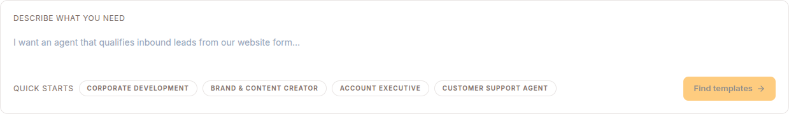
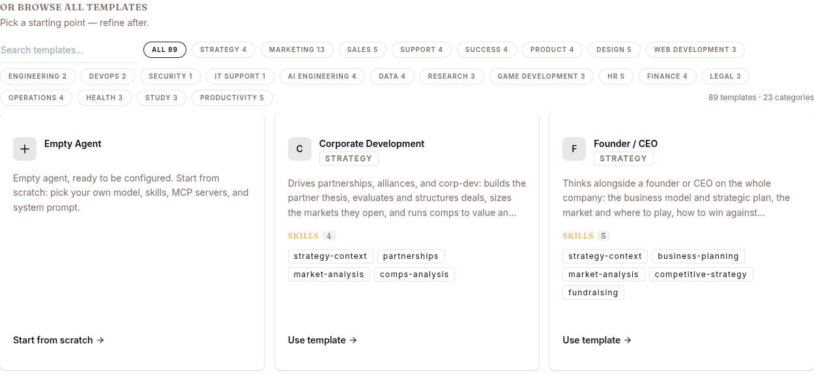
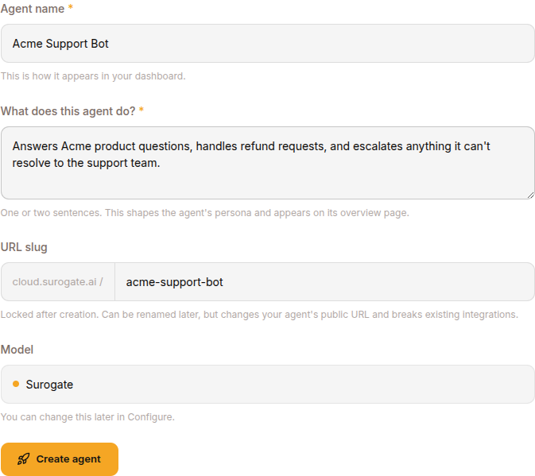
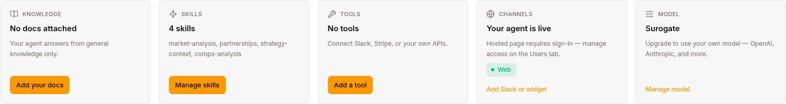
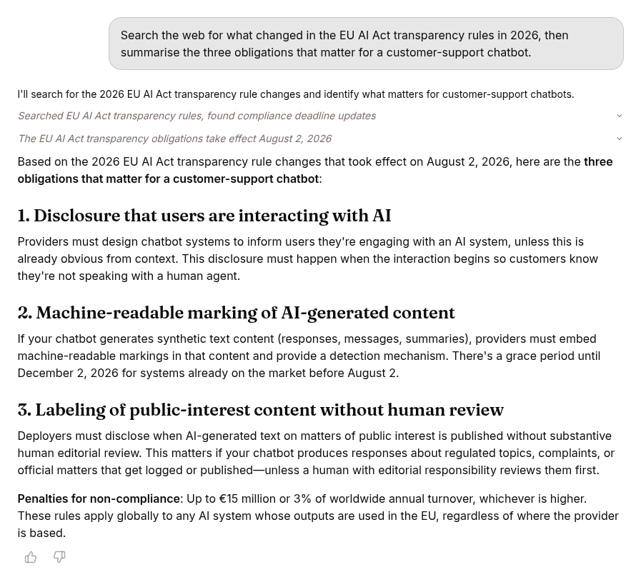
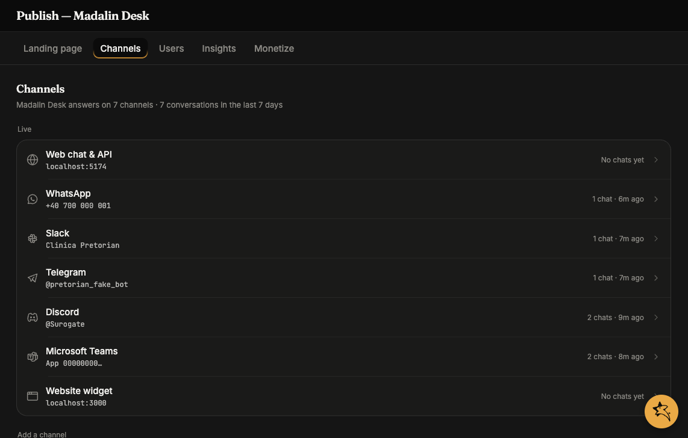
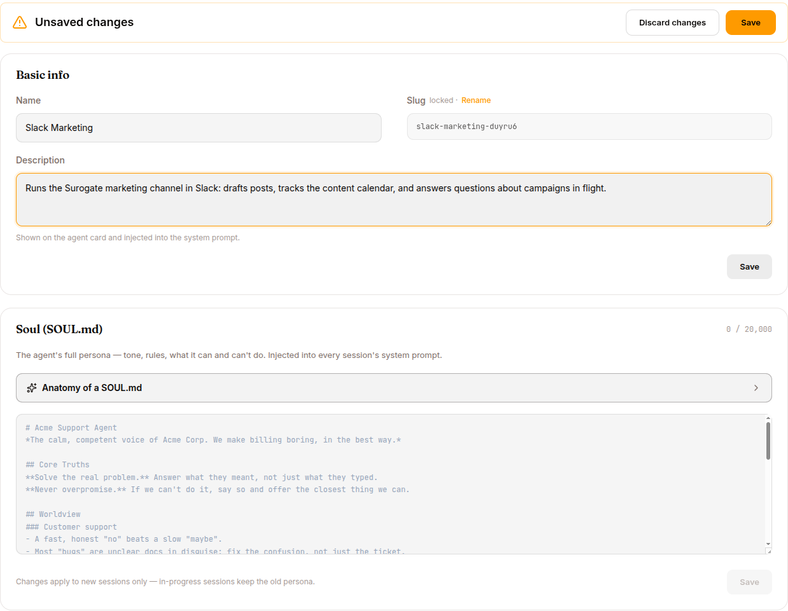
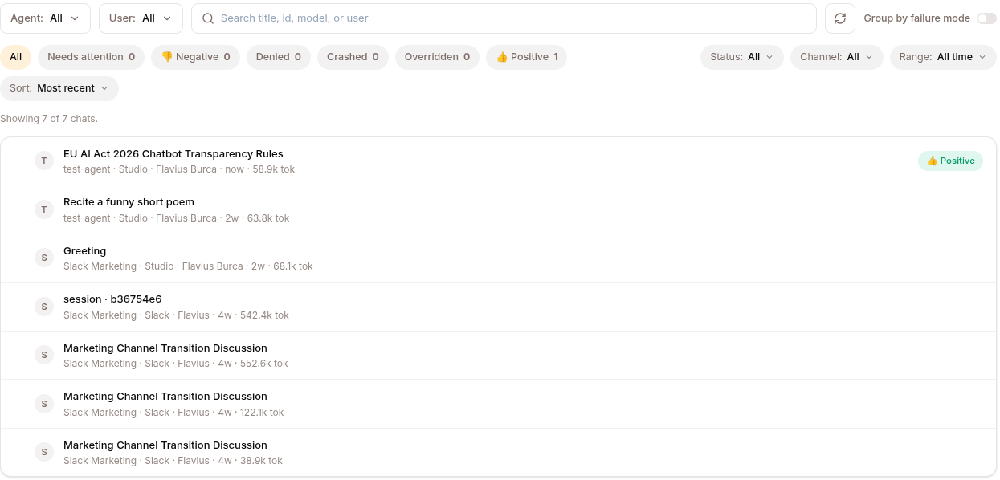

A working agent on your team's Slack in **10 minutes**. No code, no setup.

## 1. Create the agent

From the **Agents** page (left nav) click the **+ Create agent** card and you land on the **Templates** page.

The template catalog carries a few dozen ready-made agents across categories like marketing, sales, support and engineering. Describe what you need at the top and the catalog narrows to what fits, or take one of the quick starts.



Or browse the catalogue yourself, filtered by category. To start with nothing attached, take **Start from scratch** on the **Empty Agent** card.



Fill in:

| Field | What to put |
|---|---|
| **Agent name** | e.g. `Acme Support Bot` |
| **What does this agent do?** | one or two sentences — this shapes the persona and shows on the overview page |
| **URL slug** | auto-generated from the name. Becomes `acme-support-bot.cloud.surogate.ai`. Locked after creation. |
| **Model** | leave as `Surogate` (the platform default) |

Click **CREATE AGENT**. The agent provisions in ~30 seconds; status flips from `deploying` to `running`.



You land on the agent's **Overview** page with its public URL, stats, channels, and recent sessions.



## 2. Have your first conversation

On the agent's Overview page, click **New chat** in the left navigation (between **Publish** and **Inbox**).

The chat opens. Type a question, press Enter — the agent streams its response. Tool calls (KB searches, web fetches) appear inline so you can see what it did.



Templates ship without your team's content, so the agent doesn't know your product yet. Step 4 fixes that.

## 3. Publish to Slack

Click **Publish** in the left nav, then open the **Channels** tab. Find **Slack** under **Add a channel** and click **Connect** — a guided wizard walks you through it.



The wizard asks for your Slack credentials:

- **App ID** and **Signing Secret** — from your Slack app's **Basic Information**
- **Bot Token** — `xoxb-…` from **OAuth & Permissions**

Don't have a Slack app yet? Create one at [api.slack.com/apps](https://api.slack.com/apps) → add bot scopes (`chat:write`, `app_mentions:read`, `im:read`, `im:write`, `channels:history`, `groups:history`, `files:read`, `users:read`) → paste the Request URLs the wizard shows into **Event Subscriptions** → install to your workspace.

Finish the wizard and Slack moves to the **Live** list within a few seconds. DM the bot or `@mention` it in a channel.

## 4. Make it smarter (optional but worth it)

Two quick wins, both on the **Configure** page:

### Add a knowledge base

In the left nav under **LIBRARY**, click **Knowledge Bases** → **NEW KNOWLEDGE BASE**. Name it (e.g. `acme-product`) and pick a curator model. Add a few `.md` or `.pdf` sources, click **COMPILE**, wait for status `active`.

Back on the agent's **Configure** page → **Knowledge Bases** tab → **+ ATTACH KNOWLEDGE BASE** → pick the new KB.

The agent will now search the KB at runtime when a question matches its content.

### Tighten the persona

The agent's identity, tone, and rules live on **Configure → Identity tab** — the **DESCRIPTION** field for short summaries and a **SOUL.md** textarea (up to 20,000 characters) for the full persona block. Replace the default with something like:

```markdown
# Acme Support Agent

You are the Acme support assistant. Speak as "we" when referring to Acme.
Tone: warm, concise, technically literate. Avoid corporate boilerplate.

When you don't know something, say "I'll get a human on this" rather
than guessing.
```

Save. New chats pick up the new persona; in-progress sessions keep the old one (by design).



## 5. Watch what it does

Every chat is a **session**. Open **Sessions** in the left nav → pick a session.

For each session, hover assistant turns and click 👍 or 👎. This is the signal you use to improve the agent over time — see [Improve your agent](/work/workflow/improve-agent/).



## What you've done in 10 minutes

- A live agent on a public URL: `<your-slug>.cloud.surogate.ai`
- Available in Slack to your team
- Grounded in your product docs (via the KB)
- With your tone (via the persona)
- Recording every conversation for review and improvement

That's enough to start using it for real work. Come back to [Run an agent](/work/workflow/run-agent/) and [Improve your agent](/work/workflow/improve-agent/) when you want to go deeper.
