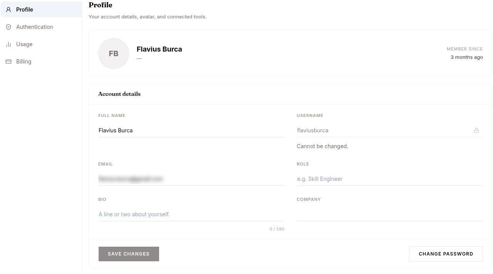
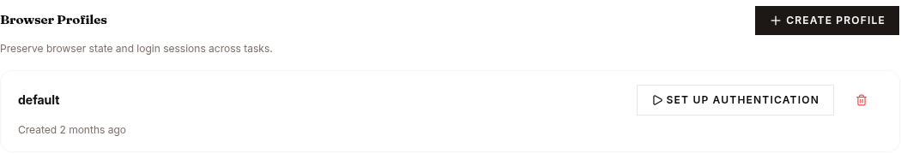

The tab opens with "Your account details, avatar, and connected tools." — the account fields sit in an **Account details** card with the action row (**Save changes** / **Reset** / **Change Password**) pinned in its footer.

| Field | Notes |
|---|---|
| **Full name** | Display name. Editable. |
| **Username** | Locked. Cannot be changed. |
| **Email** | Login. Changing requires re-verification. |
| **Role** | Free-form. Shows next to your avatar in the platform header. |
| **Bio** | Short freeform, capped at 180 characters. |
| **Company** | Optional. |
| **Avatar** | Upload a new photo, choose a preset avatar, or remove the current one. |
| **Change Password** | Sends a reset link by email. After setting a new password you're signed out and need to sign in again. |

The **USERNAME** field is locked and shows "Cannot be changed." next to it. Everything else (full name, email, role, bio, company) is editable inline; click **Save changes** to persist.

The same tab also carries **Coding Agents** — connect your own Claude Code or Codex plan, see [`/code`](/work/tools/code/) — and **Browser Profiles**, where a saved profile keeps browser state and logins across tasks.

