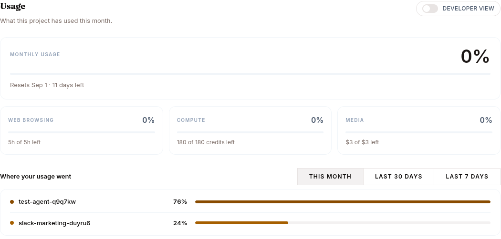
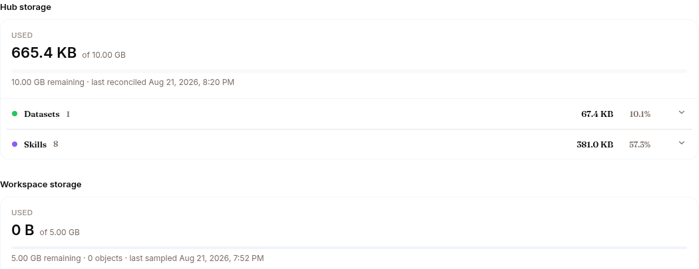

The **Usage** tab shows what your project has consumed this billing period, how much of each wallet is left, and a breakdown per agent and model. It's the real-time meter behind your plan — no end-of-month surprises. Balances refresh silently every minute while the tab is visible.

## Wallet balances

Each consumable resource is a prepaid **wallet** (your plan grants a monthly balance; top-ups add more; usage drains it in real time). Each card shows the remaining balance with a progress bar against your plan's grant and a detail line — `of <grant> monthly · renews <date>`, plus `· N from top-ups` when a rolled-over top-up balance exists:

| Wallet | What it meters |
|---|---|
| **Tokens** | LLM tokens (prompt + completion), across every agent |
| **Web-browsing minutes** | Agent browser time (shown in hours), wall-clock while a browser is open, summed per session |
| **Compute credits** | GPU time for training runs and datasets. Evaluations don't use credits |
| **Media** | Image & video generation, in dollars of provider spend — a flat few cents per image, a video at its real provider cost |

Grants come from the live plan catalog, so the cards can't drift from what's enforced. Unlimited (internal/enterprise) allowances render as **"Unlimited"** with no bar. On **BYO LLM**, the tokens card keeps showing the balance but drops the grant framing and the progress bar — the monthly token grant is deliberately zero because you pay your own provider.

Note for monetized agents: your buyers' browsing and media usage drains **both** their purchased balances and these project wallets — see [Monetize](/work/monetize/#browsing-time-and-media-credits).

## Usage breakdown

A table breaks consumption down for the selected range — presets **This month / Last 30 days / Last 7 days / Custom** (with From/To dates) — with a totals strip and a daily token chart above it. Group it by:

- **Agent × Model** — one row per (agent, model) pair
- **Model** — totals per model
- **Agent** — totals per agent

Each row shows token columns **Prompt**, **Completion**, and **Total**, so you can see exactly which agent and which model is spending your allowance. An **Include non-agent usage** switch adds platform calls made outside agent sessions. Traffic from agents on a non-Surogate model is excluded from this view.

## Hub storage

A separate section reports your project's **Hub storage**: used vs quota, remaining, when it was last reconciled, a per-type share bar, and per-repo rows (models, datasets, skills, knowledge bases, and other). An **estimate** badge means the Hub hasn't reconciled the project yet — the figure is a fast estimate that may lag the authoritative count. See [Data Hub](/develop/features/hub) for what lives in each repo.

## When you hit a limit

When a wallet reaches zero, new requests that would draw on it are refused with `402 insufficient_credits` until the next cycle. Running agents stay up — they just refuse new traffic on the exhausted resource, and each resource fails independently: an empty media wallet doesn't stop chat, an empty browsing wallet just means no new browser opens.

What people see:

- **You / your team**: the agent reports the exhausted resource with guidance (e.g. `media_budget_exhausted` — top up or wait for the monthly reset).
- **Your end users**, when the **token** wallet is dry: *"This assistant is temporarily unavailable. Its owner has run out of credit."* — your wallet is the hard ceiling on every end-user turn, checked before their own per-user allowance.

To keep going, upgrade the plan, add a recurring add-on, or drop in a wallet **top-up** — all from [Billing](/work/settings/billing/).
