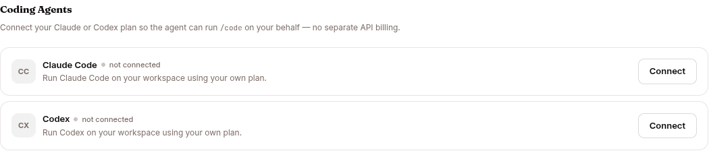

`/code` runs a real vendor coding agent — **Claude Code** or **Codex** — inside the session's sandbox, working on the session workspace using **your own** subscription or API plan.

The platform never runs an OAuth flow for you and never calls the coding-agent providers itself. You connect a credential that the vendor CLI minted on your machine, and the agent runs the genuine vendor binary in your own per-session sandbox.

## Sub-commands

```
/code                          show help
/code status                   show which providers are connected
/code login <claude|codex>     how to connect your plan
/code logout <claude|codex>    disconnect (deletes the stored credential)
/code claude "<task>"          run Claude Code on the workspace
/code codex "<task>"           run Codex on the workspace
```

`login` and `logout` accept either the agent name (`claude` / `codex`) or the provider name (`anthropic` / `openai`).

## Flags

Flags go after the task on a run command:

| Flag | Values | Meaning |
|---|---|---|
| `--model <m>` | provider model id | Pick the model the coding agent uses |
| `--effort <level>` | `low` / `medium` / `high` / `xhigh` | Reasoning/effort level |
| `--allow read-only` | — | Run without write access. The default is the agent's normal (bypass) mode |
| `--repo <name>` | a configured repo name | Target a specific configured repository (see [Repository runs](#repository-runs)) |

Example:

```
/code claude "add retry logic to the HTTP client" --model claude-sonnet-4-6 --effort high
```

## Connecting your plan



Connections are stored **per user**, encrypted in the credential vault, one entry per provider. There is deliberately no shared fallback — if you personally haven't connected a plan, `/code` reads as "not connected" and never borrows anyone else's.

Run `/code login <claude|codex>` for instructions, then paste the credential in **Settings → Coding Agents**:

| Provider | On your machine, run | Paste |
|---|---|---|
| Claude (subscription) | `claude setup-token` (needs a Claude Pro/Max plan) | the `sk-ant-oat…` token |
| Claude (API) | — | an `sk-ant-api…` key |
| Codex (subscription) | `codex login` (needs a ChatGPT plan) | the contents of `~/.codex/auth.json` |
| Codex (API) | — | an `sk-…` OpenAI key |

The pasted secret travels only over the dedicated credential route, never through a chat message or the event log. `/code status` lists which providers are connected and in which mode. `/code logout <provider>` deletes the stored credential.

Operators can also connect **agent-owned** Claude Code / Codex plans (under the agent's own service account) from the CONFIG → **Coding** tab — see [Configure an agent](/work/workflow/configure-agent/). The **Coding** tab only appears when the `/code` capability is enabled in **Capabilities**.

## How a run works

A run emits a start event, streamed progress, and a final result you see in the chat. The credential is injected **only** into the spawned CLI's process environment inside your own sandbox, conflicting provider environment variables are scrubbed first, and the credential is removed after the run. Credentials never appear in any event payload or log. `/code` command text is also exempt from the prompt-injection screen, because it is a command to your own coding agent and never reaches the platform's chat model.

Runs are bounded by the sandbox's pod deadline (roughly one hour). Connecting a plan works on any deployment; **running** requires the sandbox image that bundles the `claude` / `codex` CLIs.

### Workspace runs

By default `/code` operates on the session `/workspace` only. The coding agent reads and edits files there and reports back in chat. Add `--allow read-only` to prevent it from writing.

### Repository runs

If the agent has configured repositories (set on the CONFIG → **Coding** tab) and you pass `--repo <name>`, the run instead checks out that repository, makes its changes on a fresh branch, and **opens a pull request**.

Repository runs have a few extra requirements:

- A repo run must write, so `--allow read-only` is rejected — re-run without it.
- A GitHub token must be connected for the agent (on the **Coding** tab). Without one, the run asks you to connect it first.
- If `--repo` names a repository that isn't configured, the run reports the mismatch instead of guessing.

## Related pages

- [Slash commands](/work/tools/commands/) — the full command reference.
- [Configure an agent](/work/workflow/configure-agent/) — the **Capabilities** toggle and the **Coding** tab (repositories, agent-owned plans, GitHub token).
