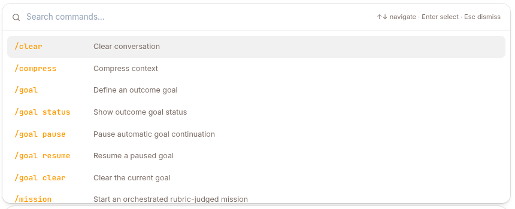

Slash commands are shortcuts you type into the chat composer to steer the agent's next turn — start a goal, force a compression, run a coding agent, kick off research, and more.

## Typing a command



In any chat with an agent, type `/` as the **first character** of a message, then the command name and any arguments:

```
/goal Fix every failing test in tests/ and report the command that passes
```

Press Enter to send it like a normal message. A few rules:

- The `/` must be the very first character — a slash mid-sentence is treated as plain text.
- Everything after the command name is passed as arguments; arguments can span multiple lines (useful for a `Rubric:` block).
- If a command name isn't one of the built-ins below, the agent tries to run it as a [skill](#running-a-skill) of the same name.

## All commands

| Command | What it does | Capability toggle | Details |
|---|---|---|---|
| `/clear` | Wipes the conversation history for this session **and destroys the session sandbox**, giving you a clean slate. | Always on (no toggle) | — |
| `/compress` | Forces context compression right now instead of waiting for the automatic threshold. Refuses when the conversation has 5 messages or fewer. | `/compress` | — |
| `/code` | Runs a coding agent (Claude Code or Codex) in the session sandbox using your own plan. Sub-verbs for login, status, and runs. | `/code` | [Coding agents](/work/tools/code/) |
| `/deep-research <topic>` | Delegates once to a research sub-agent that produces a cited report. Single-shot. | `/deep-research` | [Deep research](/work/tools/deep-research/) |
| `/auto-research …` | Starts an autonomous optimization run (Arbor) that iterates over a hypothesis tree against a measured baseline. | `/auto-research` | see below |
| `/mission …` | Rubric-judged orchestration — a strict coordinator that decomposes and drives an objective to completion. | `/mission` | [Missions](/work/tools/missions/) |
| `/goal …` | A session outcome the agent keeps iterating toward until an evaluator says it's met. | `/goal` | [Goals](/work/tools/goals/) |
| `/loop …` | Schedules a prompt to run on a recurring interval, or self-paced when you give no interval. | `/loop` | [Scheduled work](/work/tools/scheduled-work/) |
| `/stop` (or `/cancel`) | Interrupts the turn that's running right now. Messaging channels only. | Always on (no toggle) | — |
| `/<skill-name> [args]` | Runs an attached skill (or consults an active expert) by name. | Per skill attachment | [below](#running-a-skill) |

`/clear` and `/stop` are **always available** — neither has a capability toggle. Every other built-in is gated by a per-agent toggle on the CONFIG page's **Capabilities** tab (see [Configure an agent](/work/workflow/configure-agent/)). A master switch there turns all built-in commands on or off at once, with individual toggles below it. When a command is turned off, typing it has no special effect.

## `/clear` in detail

`/clear` does two things at once:

1. Replaces the entire conversation history with an empty context — the next turn starts fresh.
2. Destroys the session's sandbox if one exists, so any files, processes, or checkouts from this session are gone.

It confirms with `Conversation cleared.` Use it when the current context is no longer useful and you want to keep working in the same session with a clean start. The durable event log is untouched; only the model-visible context is reset.

## `/stop` in detail

`/stop` (or `/cancel`) is how you interrupt an agent from Slack, Telegram or WhatsApp. Send it on its own, with nothing else in the message. It travels **out of band** — it doesn't queue behind the turn it's cancelling, which is why a long run can still be stopped mid-flight. The bot acknowledges with `⏹ Stopping the current run…`; nothing is added to the conversation history.

On Web there is no `/stop`. While a turn is running the send button becomes a **stop** control that does the same thing (see [Chatting with an agent](/work/tools/chat/)).

On Slack, typing `/stop` opens Slack's own command menu instead of sending a message — put a single space before the slash so Slack passes it through.

## `/compress` in detail

`/compress` runs the configured context compressor immediately rather than waiting for the automatic threshold, then replies with a short summary of what happened. If the conversation has 5 or fewer messages it refuses with "Context is too small to compress" — there is nothing meaningful to compact yet. Use it before continuing a long session that's approaching its context limit.

## `/auto-research` in detail

`/auto-research` creates a **research-kind mission**: an autonomous, long-horizon optimization run that grows a hypothesis (Idea) tree, dispatches experiments into isolated worktrees, and only merges an improvement after an independently re-run held-out evaluation. It is a specialized variant of [`/mission`](/work/tools/missions/) — for the single-shot literature-style variant, use [`/deep-research`](/work/tools/deep-research/) instead.

Don't hand-write the tokens on your first run. If the `arbor-research` skill is attached to the agent, send `/arbor-research <goal>` first: that intake skill finds the repo, works out the dev and held-out eval commands, measures both baselines, and hands you a complete, ready-to-send `/auto-research …` line with a rubric anchored to the measured numbers. It never starts the run itself — you review the command and send it.

Leading `key=value` tokens configure the run (all optional except `repo=` on create):

| Token | Meaning |
|---|---|
| `repo=` | Workspace repo path the run operates on (required to create; must be under `/workspace/`) |
| `max_iterations=` | Iteration budget for the run |
| `baseline=` | The measured dev-split baseline score |
| `baseline_test=` | The measured held-out baseline — the reference the merge gate compares against |

Everything after the tokens is the objective, which **must** be followed by a `Rubric:` block defining when the run counts as satisfied; a command with no rubric is rejected outright ("a research run needs a repo and a Rubric"). Bound the work with `max_iterations=`; the `Budget:` line and the `budget` sub-verb are `/mission`-only and have no effect here. Control an active run with:

| Command | Behavior |
|---|---|
| `/auto-research status` | Show the run's status and last verdict |
| `/auto-research pause` | Pause automatic continuation |
| `/auto-research resume` | Resume a paused run |
| `/auto-research cancel [--cascade]` | Cancel the run (and, with `--cascade`, its running experiments) |

`/auto-research` requires an authenticated user or service-account session — anonymous channel sessions cannot own a research run. It also needs the **`arbor-executor` sub-agent** to be available to the agent: that is what every dispatched experiment runs as, implementing and evaluating one hypothesis in its own isolated copy of the repo. Without it the coordinator has nothing to dispatch experiments to — see [Sub-agents](/work/tools/sub-agents/). Missions started this way show up on the agent's **Missions** page alongside `/goal` and `/mission` runs.

## Running a skill

Any slash command that isn't a built-in is resolved as a **skill** attached to the agent:

```
/research vector databases
/babysit-prs
```

When the command name matches an attached skill, the agent inlines that skill's instructions (its `SKILL.md`) into your message before the model acts on it, and stages any supporting files the skill ships. Anything you type after the name is passed to the skill as its request. If the matched skill is an **active expert**, the command instead runs an expert consultation and hands the expert's deliverable back into the conversation.

If no attached skill matches the name, your message reaches the agent unchanged (it just looks like text that starts with `/`). Built-in command names are reserved and are never treated as skill names. Which skills are attached — and therefore which `/<skill-name>` commands exist — is configured per agent on the [CONFIG → Skills](/work/workflow/configure-agent/) tab.

## Related pages

- [Goals (`/goal`)](/work/tools/goals/) — iterate toward a session outcome.
- [Missions](/work/tools/missions/) — the dashboard for `/goal` and `/mission` runs.
- [Scheduled work](/work/tools/scheduled-work/) — the `/loop` schedules an agent runs.
- [Coding agents (`/code`)](/work/tools/code/)
- [Deep research (`/deep-research`)](/work/tools/deep-research/)
