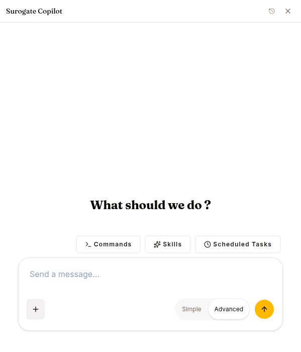

The **Copilot** is an AI agent that drives the platform itself. Press **⌘+/** (Mac) or **Ctrl+/** (Windows/Linux) anywhere in `ops.surogate.ai`.

A drawer opens with a chat composer. Ask in natural language; the Copilot calls the platform's tools and reports back.

## What it can do

Look things up:

- *"What agents do I have running?"*
- *"Find my agent Customer Helper."* It finds things by the name Studio shows, not only the internal name.
- *"Which agent had the most sessions this week?"*
- *"Find conversations where people got stuck on pricing."*
- *"Show me the latest training run for sql-writer."*
- *"Show me what's in the support-chats dataset."*
- *"How's the loss going on my last run?"*
- *"Which GPUs can my project train on, and what did compute cost across my projects in the last 30 days?"*
- *"What skills does my customer-support-bot have attached?"*
- *"What failed this week?"*

Build and change things:

- *"Create a skill called `weekly-summary` that produces 5-bullet summaries."*
- *"Attach the `acme-product` KB to my customer-support-bot as reference material."* It attaches a knowledge base as Grounding (answer from it and cite it), Grounding, no quotes (the same, without citations) or Reference (consulted when useful).
- *"Connect this MCP server to my agent."*
- *"Switch customer-support-bot to the `qwen-support` model."*
- *"Start a training run with the conversations dataset."*

The Copilot calls the platform's own tools on your behalf. You see the same effects as if you had clicked through the UI. For the list of tools by area, see [Develop mode → Copilot](/develop/tools/copilot/).

## Building an agent, skill or knowledge base

When you ask it to make something, it does not just start. It interviews you one question at a time (purpose, audience, tone, sources, tools, boundaries), looks at what you already have so it does not duplicate it, and shows a plan for your approval. Only then does it build, one piece at a time, reads each piece back to check it, and ends with links to everything and a few first messages to test with.

It follows a written build guide for each kind of thing: agents, skills, knowledge bases, sub-agents, MCP server connections, Programs, datasets, training runs and model deployments.

## Datasets, training and models

- *"Turn this file into a dataset."* It uploads one JSONL, JSON, CSV or Parquet file you attach in chat (up to 50 MB), reshaping it first when the change is mechanical. Building a dataset from your agents' chats, generating a synthetic one, importing a Hugging Face repository and scrubbing PII are done on the Datasets page; it sends you there.
- *"Fine-tune a model on these support conversations."* It interviews you, plans the run and, after your yes, starts an SFT, DPO or distillation run. It follows the run's loss and can cancel it. A Hugging Face dataset can be trained on directly, without a copy in the project.
- *"Move my saved run to the RTX PRO 6000 and start it."* A refused run stays saved; it can edit that run (settings, a GPU on the run's own compute, Hugging Face subset; GRPO runs are edited in Studio), start it, or delete runs you no longer need, each after your yes to the exact change.
- *"Serve my fine-tuned model."* It starts serving a model that is already on the Models page, checks that it serves, stops it, and switches an agent onto it. A finished run is not on Models until you add it (see [Local Hub](/develop/features/models/#local-hub)); it tells you how.

## Asking the docs

You can ask it how the platform works: *"What does the Compute page do?"* It looks the answer up in the product documentation instead of answering from memory. When you ask from a page, it knows which page you have open and, for pages that have one, which doc covers it.

## Phone lines

- *"What's the phone line of my support agent?"* It reads the agent's number, how it answers and its recent calls, and what a line can be set to.
- *"Give my support agent a phone number."* It shows the free numbers and takes one only after your yes to that number.
- *"Change its greeting to 'Salut!'."* It changes only what you name and keeps the rest.
- *"Disconnect its phone line."* The number goes back to the pool and the settings are kept.

Every change to a line, even a small settings edit, needs your yes to that exact change first. It can't switch a line to another speech provider, which needs your provider key, so for that it sends you to the [Voice](/work/channels/voice/) screen. Surogate's own speech is Romanian only.

## Your project: billing, usage and members

- *"What plan is this project on, and how many credits are left?"* It reads the plan and its limits, the credit balances and the workspace storage. Paying, changing the plan and buying credits stay in [Settings → Billing](/work/settings/billing/); it sends you there.
- *"What did compute cost this month?"* It reads the project's platform-credit spend per workload and your own token usage across your projects, for up to the last 90 days. Runs billed to your own cloud or Modal account are not in that number; it reads those from the compute costs instead.
- *"Who is in this project?"* It lists the members and their roles.
- *"Add maria@acme.com as an editor."* If you are an owner, it adds someone who already has an account, by their exact username or email, changes a member's role or removes a member, each after your yes. It sends no invitation or email. Making someone a viewer, or removing them, pauses their running work, and the question tells you so. See [Members](/work/settings/members/).
- *"Make me a new project for the pilot."* It creates a project you own, after your yes. In an enterprise deployment only administrators can create projects.

## Missions, scheduled work and reports

- *"What is my research agent working on?"* It lists an agent's [missions](/work/tools/missions/) and reads one with its tasks, workers and last evaluation. It can pause, resume or cancel one after your yes. Pausing leaves running workers to finish; cancelling can't be undone and refunds nothing.
- *"Which of my loops failed last night?"* It lists an agent's [scheduled work](/work/tools/scheduled-work/) with its status, schedule and last error, and after your yes runs one now or cancels it. Running one now is a real run: whatever its prompt does, messaging people included, happens.
- It sees only the missions and scheduled work you started yourself from Work chat, the same ones those pages show you.
- *"Focus Ana's report on billing questions and refresh it."* It sets what a user's next report should focus on, starts a fresh activity report for one of the agent's users, and reads or, after your yes, rebuilds the overview across up to 200 users. Reports use the platform's own model and spend no credits.

## Programs, people and the team

The Copilot works across these areas:

- **Programs:** run an agent's [Programs](/work/tools/programs/). List and build journeys and their steps, review a journey and dry-run it, send a test, activate or pause it, read its stats, and register WhatsApp templates.
- **People:** find and add people, rename them, make a Telegram start link, enrol people, change their follow-up, link their contacts, read their timeline and message them. After your yes it changes whether someone may be messaged first on a channel, binds their Slack member or WhatsApp number (replacing the one they had; one already bound to someone else is refused), or removes them from the agent. Removing keeps their account and history, unless they are bound to no agent at all, not even this one, which deletes the account for good; the question says which.
- **WhatsApp forms:** build a [WhatsApp form](/work/channels/whatsapp/#forms) for a journey. After your yes it creates the form as a draft; it fixes the problems Meta finds, and after another yes publishes it and lets the agent send it. A published form can't be edited, and forms can be retired but not deleted, so it asks before each of those steps.
- **Team:** set up the team (what each member gets told about, can do and handles, and a Slack channel picked from the workspace as its shared alert place), change the wording and channels on Settings, and claim or resolve escalations.
- **Also:** read and answer your Inbox, read an agent's Insights, manage the plans on Monetize, and build the agent's [landing page](/work/workflow/landing-page/), including formatted text and image framing. Publishing or taking the page offline needs your yes. On a page that is already live, its edits are public at once: they don't wait for **Publish changes** as edits in Studio do.

It knows what you are looking at: on the Programs page it is told which tab, journey and person you have open, so *"why didn't this step go out?"* needs no further context.

**`/build-program`** is a playbook for setting a program up end to end. The Copilot interviews you one question at a time (who is followed and why, the date day 0 counts from, the rhythm, what each answer means and which is urgent, the channels, the team, the language of every message), inspects what the agent already has, and writes a plan for you to approve. Only then does it build: the step skills, any missing WhatsApp forms and templates, the journey as a draft, the team and the wording. It reviews and dry-runs the journey and summarises what is live and what is still a draft, with a test script.

Activating a journey, sending a test, enrolling, messaging a person, changing the team, and changing a person's contact permission, binding or removing a person need an explicit confirmation step, which the Copilot is instructed to take only after you say yes to that exact action. Called without it, the tool refuses and changes nothing.

## How it asks before acting

It asks with a question in the chat and waits for your answer before it:

- spends GPU time or model usage (training, deploying a model, compiling a knowledge base), deletes anything, starts an agent that is in an error state, or changes an agent's environment variables, policy or browser setting;
- overwrites a skill or sub-agent that already has that name, or connects an MCP server that runs a command on the runtime.

Building a new thing inside a plan you approved does not ask again. The plan was the yes.

Anything that reaches real people, real money or who can do what is stricter: activating a journey, sending a test, enrolling or messaging a person, changing the team, changing plans on Monetize, giving an agent a phone number, changing its line or disconnecting it, changing a person's contact permission, binding or removing a person, creating, publishing or retiring a WhatsApp form, letting the agent send one or taking that back, creating a project, adding, changing or removing a member, publishing or unpublishing the landing page, pausing, resuming or cancelling a mission, running or cancelling scheduled work, and rebuilding the users overview report. The tool itself refuses to run until the Copilot calls it again with the confirmation code the tool gave it, which its instructions allow only after you say yes to that exact action. The question shows the values that will be set (the message text, the plan's price, the team member's settings), and the yes covers only those: anything different needs a new yes. A yes to the plan does not cover it. A viewer is refused before any question is asked.

Answer an open question in its question card: in Studio, a reply typed in the chat box is not taken as the answer. A question that closes unanswered (see [Inbox](/work/tools/inbox/#when-nobody-answers)) is neither a yes nor a no: the Copilot doesn't act, says it is waiting, and asks again when you write.

Governance approvals in the Inbox are never the Copilot's to decide. It sends you to the Inbox page. For the exact tools and how each check works, see [Develop mode → Copilot](/develop/tools/copilot/#how-it-asks-before-acting).

## If you're a viewer

A viewer can use the Copilot to look things up, from the side panel or from the Work page, where its sessions are listed too. Ask it to change something and it tells you straight away that a viewer can only read. It can't change your role: a project owner does that in [Settings, Members](/work/settings/members/).

## Conversation history

The Copilot drawer keeps a history menu in its header (the clock/history icon). Open it to switch between past Copilot conversations, rename them, or start a new chat. Each conversation is its own session and resumes where you left off.

## What the Copilot can't do

- **It has no browser.** It works from the platform's own tools, not the open web. If you want to scrape or navigate a site, use a regular agent with `browser_*` tools.
- **It can't make images or videos.** Use a regular agent for media.
- **It won't set up things that need secrets or money for you.** Its instructions have it explain the steps and link the page instead: connecting channels (WhatsApp, Slack, Telegram, Discord, Microsoft Teams), creating or revoking API keys and webhook secrets, Stripe Connect onboarding, and paying, changing the plan or buying credits. It can read the plan, credits and usage, and add people who already have an account, but it can't invite someone new. The same goes for an agent's API keys and the OpenAI-compatible API, the WhatsApp number and its Meta webhook, the Teams app package, connecting apps through Composio, git, SSH and coding-agent access, browser profiles, and saved keys in the Vault. It can still change an agent's environment variables, where channel keys live; its instructions have it ask you first and never repeat secret values back.
- **It can't change your password** or other account settings. Those go through Settings.
- **It can't scale agents.** Agents run on the shared runtime with no replicas, CPU or memory to set; it can start and stop them.
- **Some knowledge-base, template and skill work happens in Studio.** It can't change a knowledge base's settings, remove a source or file, or stop or rebuild a compile; it can't create an agent from a [template](/work/workflow/templates/) (it can build a similar one with you, without the template's skills); and it can't publish skill versions, open the skill canvas, or run skill tests or optimization.
- **More is done in Studio:** which channels are live, an agent user's password and memory, the agent-wide report prompts (it can set one person's report focus), turning Programs on or off, the usage limit and **Free trial** card for people who haven't bought (it can set a paid plan's trial days), answering a question an agent asked in the Inbox, the Programs API and webhook, and sending a held outreach message now. It tells you the page and the button.
- **It can't yet read a whole past conversation or tell you who bought.** It links the conversation's **Thread** tab, and the **Stripe Connect** and **Subscribers** cards on Monetize.
- **It can't add phone numbers to the pool** or switch a phone line to another speech provider.
- **It can't change models beyond starting, stopping and redeploying them.** It can't add, edit, scale or delete one.
- **It can't browse or change the [Data Hub](/develop/features/hub/).**
- **It can't create RL environments or start GRPO runs.**
- **It can't start a mission or scheduled work, or change one's schedule.** Start those from Work chat with `/goal`, `/mission` or `/loop`.
- **It can't run evaluations.**

For the Studio work in this list, it tells you where in Studio to go instead; see [Develop mode → Copilot](/develop/tools/copilot/#what-the-copilot-wont-do).

## When the Copilot misbehaves

If the Copilot returns 401 ("Invalid base LLM token"), it's an admin-side config issue. Contact whoever runs your tenant.

If a tool returns an error, it tells you what went wrong instead of retrying blindly. Read the error, fix the cause, and ask again.

## Keyboard shortcuts

- **⌘+/** (or **Ctrl+/**) — open the drawer
- **Esc** — close the drawer
- **Enter** — submit the current message
- **Shift+Enter** — newline in the composer

## What's next

Other tools: [Goals (`/goal`)](/work/tools/goals/), [Inbox](/work/tools/inbox/), [Programs](/work/tools/programs/).
