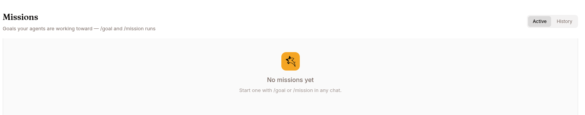

`/goal` is a slash command you type in the chat composer. Use it when the agent should **keep working until a specific outcome is reached** — not just answer one question.

## The basic shape



In any chat session:

```
/goal Fix every failing test in tests/ and report the command that passes
```

Press Enter. The agent:

1. Saves the goal on the session.
2. Starts working on it as if you'd asked normally.
3. After each final response, a **separate evaluator LLM** reads the response and decides: did this satisfy the goal?
4. If not, the evaluator's feedback becomes the next prompt and the agent keeps going.

Up to 20 iterations by default. Then it stops.

## Adding a rubric (recommended)

The evaluator does a much better job when you give it concrete acceptance criteria:

```
/goal Build a DCF model for Costco

Rubric:
- Produces an .xlsx file
- Uses five years of historical revenue
- Includes WACC and terminal value assumptions
- Includes a sensitivity analysis
- Final response names the generated file
```

Write rubrics as **observable outcomes**. Bad: "try hard to test everything." Good: "the final response includes the passing pytest command."

## Verdicts

After every assistant turn the evaluator returns one of:

| Verdict | What happens |
|---|---|
| `satisfied` | Goal stops. The rubric is met (with concrete evidence). |
| `needs_revision` | Continuation queued. Iteration count bumps. |
| `blocked` | Goal stops. The agent says it needs external input it can't get. |
| `failed` | Goal stops. The rubric is unreachable. |

The evaluator is instructed to require **concrete evidence** — a file excerpt, an output line, a test command result — before saying `satisfied`. Generic claims like "all requirements met" trigger `needs_revision` and the agent keeps working.

If the evaluator itself fails — a provider error, or a verdict that comes back empty or unreadable — the goal falls back to `needs_revision` and the agent keeps going, so one blip never ends a run early. After three unreadable verdicts in a row the goal pauses itself; `/goal resume` restarts it.

## Controlling a running goal

```
/goal status        # See current goal, iteration, last verdict
/goal pause         # Stop automatic continuation. Saved goal stays.
/goal resume        # Continue after pause.
/goal clear         # Remove the goal.
```

Only **one goal** can be active per session. While active, sending `/goal <new text>` is rejected — pause or clear first.

A session is allowed only **one evaluator loop**, so `/goal` and `/mission` can't both run in the same chat — and the block works both ways: starting a `/goal` while a mission is active or paused is refused, and starting a [`/mission`](/work/tools/missions/) while a goal is set — active *or* paused — is refused too. Clear the goal (`/goal clear`) or cancel the mission (`/mission cancel`) before starting the other — or start it in a new chat.

## Iteration budget

Default: 20 turns. When exhausted, status becomes `max_iterations_reached`. Use `/goal resume` to give it more turns, or `/goal clear` to stop.

## When NOT to use `/goal`

- One-shot questions ("what's the refund policy?") — `/goal` adds overhead with no benefit.
- Exploration ("help me brainstorm names") — no fixed outcome to evaluate against.
- Work you want to steer manually each turn — `/goal` keeps the agent autonomous.

## `/loop` — for recurring work

A close cousin. `/loop` schedules a prompt to run on a recurring basis:

```
/loop 5m /babysit-prs             # every 5 minutes, run the babysit-prs skill
/loop every 1 minute get btc price
/loop check deploys every 20m
/loop check queue health           # no interval = dynamic, agent picks
```

- Fixed interval → expires after 3 days
- Dynamic (no interval) → agent picks delay between 60s and 1h after each run → expires after 7 days

Manage with `/loop list` and `/loop cancel <id>`.

## What's next

Other conversation tools: [Copilot](/work/tools/copilot/), [Inbox](/work/tools/inbox/).
