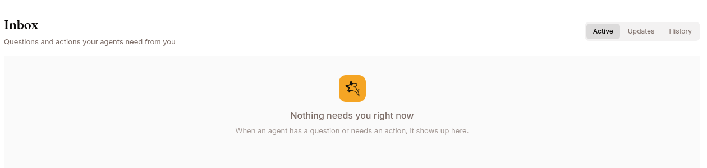

The inbox surfaces items the agent has explicitly raised to *you*. If it's empty, no agent has called `ask_user_question` or asked you to complete an external action — that's normal.

## The five item kinds

### `input_required` — the agent called `ask_user_question`

Up to 5 multiple-choice questions; you submit answers. Example:

> "Which Stripe environment should I target?" [Live] [Test] [Other…]

You can also answer by simply **typing a reply in the chat session** (web and Telegram) — a plain text message while the question is pending is consumed as the answer; an exact choice-label match selects that choice, anything else is recorded as "Other". Messages with images or attachments don't count as answers, and neither does deleting the item — the session stays blocked. If you don't answer within 30 minutes the agent gets a `cancelled` signal and decides what to do next; after that, a typed reply is delivered as an ordinary message rather than an answer.

### `action_required` — the agent needs you to do something outside the chat

Browser login walls, MFA, CAPTCHA, OAuth approval, file pickers, manual web actions. Open the session to interact with the agent's browser; click **I completed this** when done. The session wakes up.

A check-in [Program](/work/tools/programs/) escalation lands here too, titled **Check-in needs your attention**, with the agent's reason as the body. It is addressed to the operator who activated the Program. Open the session to read the user's answers; the check-in itself keeps going.

### `task_complete` — long-running session finished

Informational. Producers: `/goal`, `/mission`, `/loop`. Acknowledge or open to inspect.

### `progress_checkin` — long-running session update

Pure status update mid-run. No action required.

Off unless the session was created with a check-in interval — nothing in Studio sets one, so in practice these appear only on sessions started through the API.

### `governance_gate` — the agent needs your approval for a tool call

Raised when the agent calls a tool your governance policy marks as approval-required. The item names the tool, the reason it was blocked, and an excerpt of the call's arguments, with **Approve** / **Reject**.

Either decision is posted back into the session, so the agent picks it up straight away. See [Tools that need approval first](/work/workflow/governance/#tools-that-need-approval-first) for what an approval covers and how long it lasts.

## Statuses

`pending` → `acknowledged` / `responded` / `expired` (terminal). Default views hide expired.

## Triage order

`input_required` → `action_required` → `governance_gate` → informational items. The first two block the agent outright; an unanswered `governance_gate` leaves it without a tool it asked for; the rest are informational.
