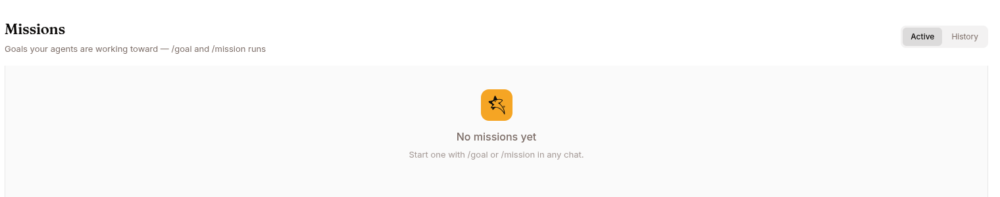

The **Missions** page is a dashboard for every goal your agent is working toward — the runs you start with the `/goal` and `/mission` slash commands.

Open it from an agent's left navigation (**Missions**, under the Sessions group) or go to `/work/agents/<agentId>/missions`. The **Missions** link only appears when missions are enabled for the agent.

## What a mission is

A mission is a saved goal the agent keeps iterating on until an evaluator decides it is met. You don't create a mission from this page — you start one from a chat with `/goal` or `/mission` (see [Goals](/work/tools/goals/)). This page is where you watch and manage the missions that already exist.

## Layout



The page has a header and two panes:

- **Header** — the title "Missions" with a subtitle, plus an **ACTIVE** / **HISTORY** toggle on the right.
- **Left list** — one row per mission. Each row shows the mission description, a relative "last updated" time, a status badge, and the agent name.
- **Right pane** — the full mission dashboard for the selected mission. When a mission is selected you can open the transcript of the session it ran in.

The newest mission is selected automatically so the dashboard is never blank while missions exist. Selecting a row on the left swaps the dashboard on the right. The list refreshes every few seconds.

## Active vs. History

The **ACTIVE** / **HISTORY** toggle filters the list:

| View | Shows |
|---|---|
| **ACTIVE** | Missions that are still running or paused. |
| **HISTORY** | Missions that finished or were cancelled. |

When there are no missions in the current view, the page shows an empty state. In **ACTIVE** it reads "No missions yet — Start one with /goal or /mission in any chat." In **HISTORY** it reads "No past missions — Finished and cancelled missions show up here."

## Mission status

Each mission row carries a status badge:

| Status | Meaning |
|---|---|
| **Running · _n_/_max_** | Actively iterating; shows the current iteration out of the maximum. |
| **Needs revision** | The last evaluation asked for another pass. |
| **Paused** | Automatic continuation is stopped; the mission is retained. A mission also pauses **itself** when the evaluator returns unreadable output three times in a row, when its token budget runs out, or when it is [waiting for you to accept or reject a new rubric](#when-the-rubric-is-the-problem). |
| **Satisfied** | The goal was met. |
| **Blocked** | Stopped — the agent needs external input it can't get. The evaluator is also told to return this instead of repeating the same guidance round after round, so *Blocked* can mean the run was going in circles. A coordinator that goes quiet and stays quiet is blocked too, after three unanswered nudges. Before settling on *Blocked*, the evaluator may [propose a new rubric](#when-the-rubric-is-the-problem) instead. |
| **Failed** | Stopped — the goal was judged unreachable. |
| **Max iterations** | The iteration budget was exhausted. |
| **Cancelled** | The mission was cancelled. |

Running, needs-revision, and paused missions count as **active**; the rest are **history**.

## How a mission is judged

A run started with `/mission` **must** carry a `Rubric:` block. Without one the command is rejected with "missing Rubric: block" and no mission is created — stricter than `/goal`, where the rubric is optional and falls back to a generic default.

The evaluator grades evidence, not prose. It sees the agent's latest reply, but only the structured results the finished tasks reported back count as evidence — so write the rubric against something the work can measure and report: "satisfied when the failing-test count is 0", not "satisfied when the code is clean". A *satisfied* verdict is demoted back to *needs revision* when the mission spawned tasks and none of them completed; task status is recorded by the platform, never claimed by the agent. A mission that spawned no tasks at all is exempt.

The evaluator also doesn't read every reply. It runs when a task the mission spawned reaches a terminal state, or when the agent explicitly marks the objective complete, and at most once every 30 seconds per mission. A mission sitting on the same iteration for a while usually means no task has finished yet — not that it is stuck. A run started with `/goal` is different: there the evaluator reads every final response (see [Goals](/work/tools/goals/)).

## Starting and tracking a mission

1. In any chat with the agent, type `/goal <what you want>` (or `/mission …`) and press Enter. See [How a mission is judged](#how-a-mission-is-judged) for what a `/mission` rubric has to look like. `/mission` needs a signed-in user or a service-account session — anonymous website-widget visitors can't own one.
2. Open the **Missions** page. The new mission appears at the top of the **ACTIVE** list.
3. Click the mission to open its dashboard on the right, where you can follow its progress and open the underlying session transcript.
4. When the mission is satisfied, blocked, failed, cancelled, or hits its iteration cap, it moves into **HISTORY**.

## Control commands

Missions are steered from the chat, not from this page. Which verbs apply depends on which command started the run:

| Command | Effect |
|---|---|
| `/mission` or `/mission status` | Status, current iteration, and the latest verdict. |
| `/mission pause [reason]` | Stop automatic continuation. Workers already running keep running. |
| `/mission resume` | Resume a paused mission and wake the agent. |
| `/mission cancel [reason]` | End the mission. Running workers finish what they're on; their results are no longer graded. |
| `/mission cancel --cascade [reason]` | End the mission **and** interrupt every worker still running. |
| `/mission budget <count>` | Set or change the token ceiling; replies with the new ceiling and how much is already spent. |
| `/mission budget none` | Remove the ceiling (`off`, `clear` and `unlimited` also work). |
| `/mission accept` | Approve a [proposed rubric](#when-the-rubric-is-the-problem) and put the mission back to work. |
| `/mission reject [reason]` | Turn the proposal down. The mission ends with the verdict that was waiting behind it. |

A run started with `/goal` uses `/goal status`, `/goal pause`, `/goal resume` and `/goal clear` instead.

The families don't share verbs: `/mission` has no `clear`, `/goal` has no `cancel`, and `accept` / `reject` are `/mission`-only. An unrecognised verb is read as the text of a *new* run — `/mission clear` fails with a missing-rubric error, and `/goal cancel` would start a goal called "cancel".

## When the rubric is the problem

Sometimes a mission stalls not because the work is going badly but because the **rubric was written wrong** — it asks for a file the build never produces, contradicts itself, or names something that was never part of what you asked for. A rubric like that can't be satisfied by any amount of work.

When the evaluator is about to end a mission as *Blocked* or *Failed* and judges the rubric itself to be the defect, it can propose a replacement instead of giving up. The mission **pauses** and the agent shows you three things: the rubric you have now, the rubric it proposes, and the evidence from the finished work that convinced it. Nothing is graded and no evaluator time is spent while it waits.

You then decide:

| You type | What happens |
|---|---|
| `/mission accept` | The proposed rubric replaces the old one and the mission resumes. Work already completed still counts — the mission does not start over. |
| `/mission reject [reason]` | The proposal is declined and the mission ends with the verdict it was holding (*Blocked* or *Failed*). Your reason is recorded. |
| `/mission resume` | Also declines the proposal, and puts the mission back to work against the **original** rubric. |

Three rules keep this from becoming a way for the agent to grade itself:

- **Only the evaluator writes the proposed rubric**, and only the evaluator — the agent relays it to you word for word and cannot change a character of what `/mission accept` commits.
- **Only you approve it.** There is no automatic path; a mission sits paused until you answer.
- **What you originally asked for never changes.** Only the rubric — how the work is checked — can be amended. A mission accepts at most **two** amendments in its lifetime, so it can't negotiate its way down to something trivially easy.

Accepting does not hand the mission more runway: its iteration count carries over, so a mission that nearly exhausted its budget getting the target wrong may need `/mission budget` to finish the job.

## The token budget

A `/mission` can carry a ceiling on the tokens it is allowed to spend. Set it when you start the run by putting a `Budget:` line on a line of its own in the command body, or at any point afterwards with `/mission budget <count>`:

```
/mission Audit every test file for tests that pass for the wrong reason.

Budget: 20M
Rubric: every directory under tests/ has a completed task, and each finding
names a file, a test, and a demonstrated reason the test is vacuous.
```

Write the count the way you'd say it — `20M`, `500k`, `1.5M`, `2_000_000`, or a plain number. A count that can't be read is rejected rather than quietly meaning "no ceiling". The budget covers the whole run: the coordinating session plus every session its tasks run in, counted from the tokens those sessions actually used.

When the allowance is gone the mission **pauses** at the next judging point — it is never cut off mid-task. Raise the ceiling with `/mission budget <count>` and `/mission resume` to carry on. With no `Budget:` line the mission is unbounded.

See [Slash commands](/work/tools/commands/) for the rest of the command set.
