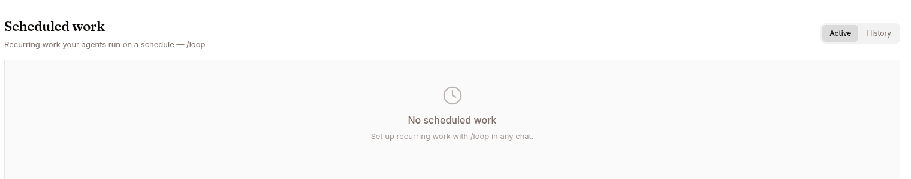

The **Scheduled work** page lists the recurring runs an agent performs on a schedule — the loops you set up with the `/loop` slash command.

Open it from an agent's left navigation (**Scheduled work**, under the Sessions group) or go to `/work/agents/<agentId>/scheduled-work`. The link only appears when loops are enabled for the agent.

## How recurring work is configured

You don't create a schedule from this page. Recurring work is set up from a chat with `/loop` (see the `/loop` section of [Goals](/work/tools/goals/)):

```
/loop 5m /babysit-prs             # every 5 minutes, run the babysit-prs skill
/loop every 1 minute get btc price
/loop check queue health          # no interval = dynamic, the agent picks the delay
```

Each `/loop` becomes a row on this page. This page is where you review those schedules, see when they run next, and cancel them.

### Who can create a loop

A loop needs an owner that outlives the chat, so `/loop` works only for a signed-in user or an API service account. Anonymous sessions — website-widget visitors — are refused.

Every schedule is scoped to your organisation, the principal that created it, and the agent it was created on. `/loop list` and `/loop cancel <id>` reach only your own loops on that agent.

### Writing the interval

The interval can lead the prompt (`/loop 5m check deploys`), trail it (`/loop check deploys every 20m`), or be spelled out (`/loop every 1 minute get btc price`). Four units are accepted:

| Unit | Example | How it actually runs |
|---|---|---|
| Seconds (`s`) | `/loop 30s …` | Rounded **up** to whole minutes — once a minute is the fastest a loop can run. |
| Minutes (`m`) | `/loop 5m …` | Under an hour, snapped to the nearest cadence that divides evenly into an hour (1, 2, 3, 4, 5, 6, 10, 12, 15, 20, 30, or the full hour), so `7m` becomes every 6 minutes and `50m` becomes hourly. An hour or more rounds up to whole hours, so `90m` becomes every 2 hours. |
| Hours (`h`) | `/loop 6h …` | Runs on the hour. Over 23 hours, rounds up to whole days. |
| Days (`d`) | `/loop 2d …` | Runs at midnight, every N days. |

When your cadence is adjusted the confirmation says so — "Requested cadence: …; using …". Check it before assuming the exact interval you typed was kept.

### Prompt safety check

The prompt is checked before the schedule is saved. Prompts carrying prompt-injection phrasing, invisible Unicode, secret-exfiltration commands, or destructive shell commands are refused at creation, rather than saved and re-run on every tick. Reword and send `/loop` again.

## Layout



The page has a header with an **ACTIVE** / **HISTORY** toggle, over a table of schedules.

| Column | What it shows |
|---|---|
| **NAME** | The schedule's name, or the prompt if it has no name. |
| **INTERVAL** | The schedule display (e.g. an interval) for fixed schedules, or **Dynamic** for agent-picked loops. |
| **NEXT RUN** | When the next run is due. Dynamic loops show an approximate ("~") time. |
| **EXPIRES** | When the schedule expires, if set. |
| **STATUS** | Active, Paused, Completed, or Failed. |
| _(action)_ | A **Cancel** button on active/paused rows. |

The table refreshes every few seconds.

## Active vs. History

The **ACTIVE** / **HISTORY** toggle filters the table:

| View | Shows |
|---|---|
| **ACTIVE** | Schedules that are active or paused. |
| **HISTORY** | Completed and cancelled/failed schedules. |

When a view is empty, the page shows a clock icon with a message. In **ACTIVE**: "No scheduled work — Set up recurring work with /loop in any chat." In **HISTORY**: "No past runs — Completed and cancelled schedules show up here."

## Interval vs. dynamic, and expiry

Schedules come in two kinds, and they expire on different timelines:

- **Fixed-interval** — runs on a fixed cadence (e.g. every 5 minutes). Expires after **3 days**.
- **Dynamic** — you gave no interval, so the agent picks the delay between runs. Expires after **7 days**.

A note at the bottom of the table restates this: "Fixed-interval schedules expire after 3 days; dynamic (agent-picked) schedules after 7. Cancel anytime."

## Cancelling a schedule

1. Open the **Scheduled work** page and stay on **ACTIVE**.
2. Find the schedule's row.
3. Click **Cancel** at the right of the row. It reads "Cancelling…" while it works, then the schedule moves to **HISTORY**.

You can also manage loops from the chat with `/loop list` and `/loop cancel <id>`.
