The **Configure** page — reached from an agent's left navigation (`/work/agents/{id}/settings?tab=...`) — is the core agent-building surface: nine tabs that control who the agent is, what it can do, which model runs it, and where people reach it.

Getting the agent *to* people — its landing page, end-users, usage insights and pricing — lives on the sibling [Publish](/work/workflow/publish-agent/) page instead.

Each tab saves independently. Most tabs surface a **SAVE** button (which flashes a green **Saved** confirmation) or an amber **Unsaved changes** bar with **Save** / **Discard changes** when a field is dirty; a few toggles save the moment you flip them. Where noted, changes apply to **new sessions only** or reach live sessions on their next turn.

| Tab | What you set here |
|---|---|
| **Metrics** | Read-only dashboard: traffic, errors, latency, tokens, conversations, connected resources |
| **Identity** | Name, slug, description, and the SOUL.md persona |
| **Capabilities** | Brainstorming gate, live browser, multi-session, Programs, the built-in slash commands, and Saga where the deployment enables it |
| **Knowledge Bases** | Attach KBs the agent can search, in grounding or reference mode |
| **Skills** | Attach, write, import, and edit skills |
| **Tools** | Connect MCP servers, Composio toolkits, and manage the key vault |
| **Coding** | GitHub repos and coding-agent plans (only when `/code` is enabled) |
| **Model** | Serving model plus summary / vision / image / video role models |
| **Governance** | Policy enforcement, tool allow/deny, web & browser egress, SSH, EU AI Act AI disclosure |

System agents (like the platform copilot) hide the **Identity**, **Capabilities**, and **Governance** tabs, and non-admins see a "managed by platform administrators" notice instead of the tabs. The **Coding** tab appears only when the agent's coding capability (`/code`) is turned on in **Capabilities**.

## Metrics

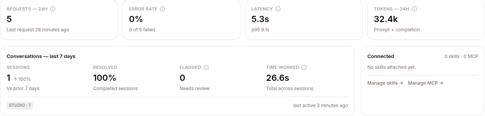

A read-only overview of the agent's health and footprint — no editable fields. It refreshes itself every minute while visible and shows:

- **Four 24-hour stat cards**, each with an ⓘ tooltip: **Requests — 24h** (count, last-request time; the tooltip shows the derived hourly rate), **Error rate** (share of model-gateway calls with HTTP ≥ 400, "N of M failed"), **Latency** (average round-trip, with **p95** in the detail line), and **Tokens — 24h** (total; the tooltip breaks out prompt/completion and average per call).
- **Four hourly bar charts** mirroring the cards: requests per hour, errors as % of requests, average latency (tooltip adds p95), and tokens stacked in/out. Quiet hours render as real gaps and read "no requests" — distinct from "0% errors".
- **Conversations — last 7 days** — Sessions (with ↑/↓ vs the prior 7 days), Resolved %, **Flagged** (a policy denial, a crash, or a thumbs-down), and Time worked (total model processing time, not wall-clock waiting), plus per-channel chips and last-active time.
- **Deployment** / **Resources** (self-deployed dedicated agents only) — replicas, model, image, endpoint, CPU/memory requests and limits.
- **Connected** — attached skills and MCP servers (with per-server enabled dots) and **Manage skills →** / **Manage MCP →** shortcuts into those tabs.

Empty states are honest: an agent on a **self-deployed model** points you to that model's own Models page instead of showing empty cards, and a zero-traffic agent says charts appear after the first conversation. A **BYO model active** banner appears when the agent runs on your own model, noting that token traffic isn't billed by Surogate.

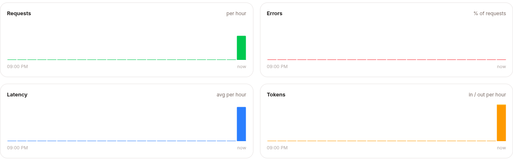

## Identity

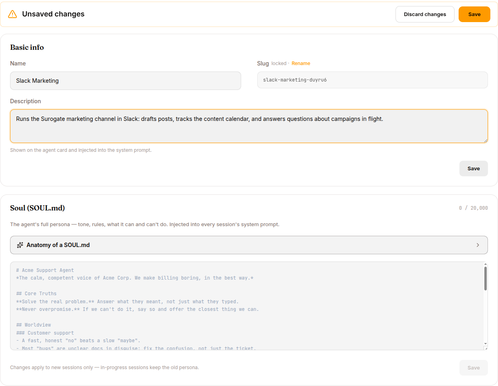

Who the agent is. Two cards, each with its own **SAVE**.

**Basic info**

| Setting | What it does |
|---|---|
| **Name** | Display name shown on the agent card and in the UI |
| **Slug** | The URL/routing identifier. Locked by default — click **Rename** and confirm the dialog to change it, since renaming breaks channel routes, saved URLs, and integrations |
| **Description** | Shown on the agent card and injected into the system prompt |

**Soul (SOUL.md)** — the agent's full persona (tone, rules, what it can and can't do), injected into every session's system prompt. A character counter caps it at **20,000** characters, and a **SoulAnatomyGuide** can drop in a starter template. Changes apply to new sessions only — in-progress sessions keep the old persona.

## Capabilities

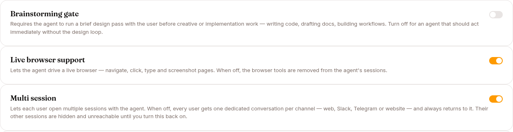

Toggle the agent's built-in behaviors. The Brainstorming gate, Live browser, Multi session and slash-command switches save the moment you flip them; the Saga card, where present, collects its toggle and number fields behind its own **Save** button. Changes reach live sessions on their next turn.

| Capability | What it does |
|---|---|
| **Brainstorming gate** | Forces a short design/brainstorm pass with the user before creative or implementation work. Turn off for an agent that should act immediately |
| **Live browser support** | Lets the agent drive a real browser (navigate, click, type, screenshot). Off removes the browser tools — and hides the end-user Browser Profiles tab |
| **Multi session** | Lets each user open multiple sessions with the agent. When off, every user gets one dedicated conversation per channel — web, Slack, Telegram or website — and always returns to it; their other sessions are hidden until you turn this back on. End users see a **Chat** button instead of "New chat" |
| **Programs** | Scheduled WhatsApp check-ins. Each Program sends an approved opener on a cadence, runs a skill when the person replies, and records the outcome. Turning it on adds **Programs** to the agent's navigation. It cannot be turned off while a Program is active — pause them first, because the runtime stops running the agent's Programs the moment the capability is off. See [Programs](/work/tools/programs/) |
| **Saga** | Tracks multi-step tool chains and rolls back completed steps when a later step fails. Exposes **Step timeout (s)**, **Max retries**, and **Retry delay (s)**. **Hidden unless the deployment opts in** (`saga_ui_enabled` on the server) — it is off on the hosted platform and available on-prem |

**Slash commands** — a master switch turns all built-in chat commands on or off at once, with individual toggles below:

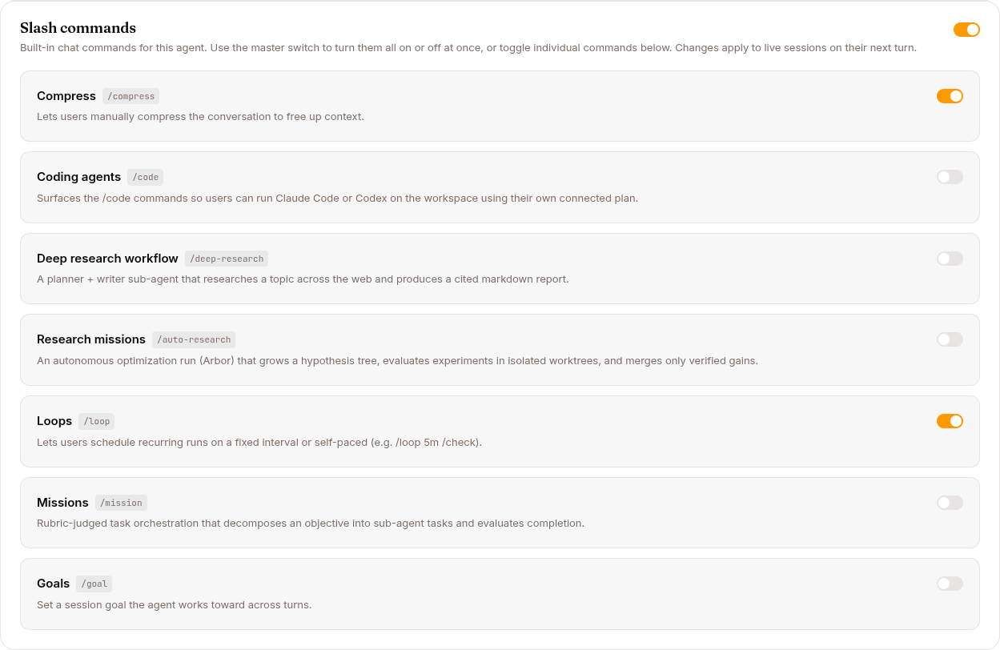

| Command | What it enables |
|---|---|
| `/compress` | Users manually compress the conversation to free up context |
| `/code` | The coding-agent commands (Claude Code / Codex on the workspace); also reveals the **Coding** tab |
| `/deep-research` | A planner + writer sub-agent that produces a cited markdown report |
| `/auto-research` | An autonomous optimization run (Arbor) over a hypothesis tree |
| `/loop` | Scheduled recurring runs on an interval or self-paced |
| `/mission` | Rubric-judged task orchestration that decomposes an objective |
| `/goal` | A session goal the agent works toward across turns |

## Knowledge Bases

Attach the knowledge bases this agent can search. The header reads **Attach a knowledge base**; from here you can **Create a knowledge base**, **Browse Library** to attach existing ones, or **Detach** attached KBs.

Each attached KB row shows its name, page count, compile status (active / compiling / queued / error), and a **mode** selector:

| Mode | What it does |
|---|---|
| **Grounding** | The KB is treated as authoritative source material for answers |
| **Reference** | The KB is available for lookup but not treated as ground truth |

The **Browse Library** view offers search and multi-select cards; **Attach selected (n)** pulls them in.

## Skills

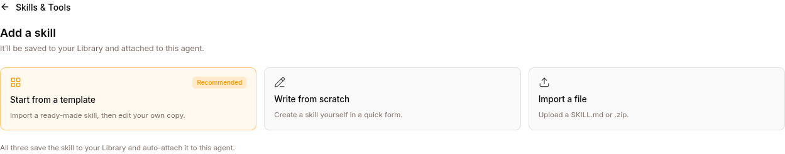

Attach reusable skills to the agent. The header reads **Attach a skill** with an **Add skill** button. Attached skills list their name and origin (e.g. "Your copy · from template"), an optional **expert** badge, and **Edit** / **Detach** actions.

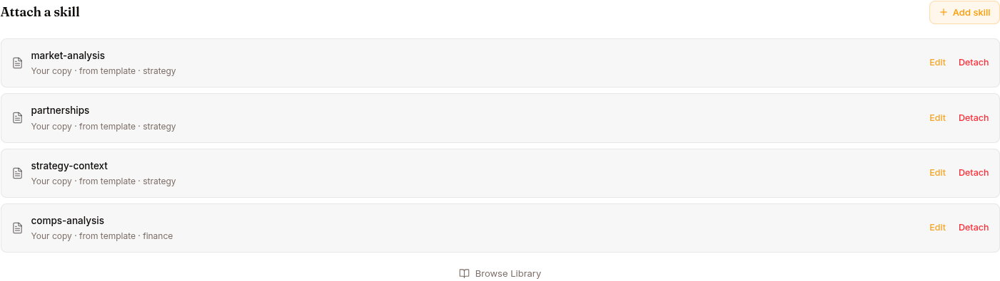

Adding a skill offers three routes: **Start from a template** (recommended, with a searchable category-filtered browser), **Write from scratch**, or **Import a file** (`.md` / `.zip` drag-and-drop). The scratch and edit forms expose **Name** (slug), **Display name**, **Description**, **Trigger** (comma-separated keywords), **Tags**, an **Is Expert** switch, and the **Content (SKILL.md)** body. **Browse Library** attaches skills you already have.

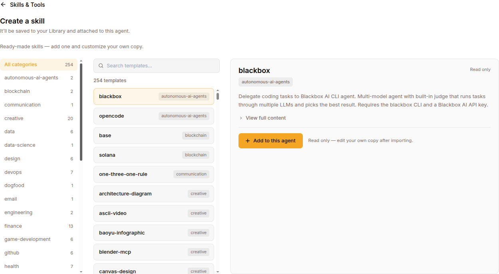

See [Skills](/work/library/skills/) for authoring guidance.

## Tools

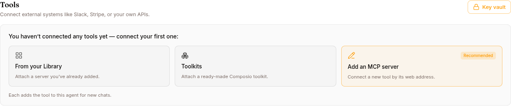

Connect external systems (Slack, Stripe, your own APIs) as MCP servers. The heading is **Tools**, with a **Key vault** button for stored credentials. Connected tools list their name, status, and **Manage** / **Disconnect** actions; Composio toolkits add a per-agent OAuth **Connect** control.

Three ways to add a tool:

- **From your Library** — attach an MCP server you already registered.
- **Toolkits** — attach from the searchable Composio catalog.
- **Add an MCP server** (recommended) — the **AddServerForm**: **Name**, **What it does**, and a **Connection type** of *Remote endpoint (HTTP)* (adds **Web address (URL)**, an **API key / OAuth** sign-in choice, and **API key**) or *Local command (stdio)* (adds **Command** and **Environment** KEY=value pairs), plus a **Timeout (seconds)**.

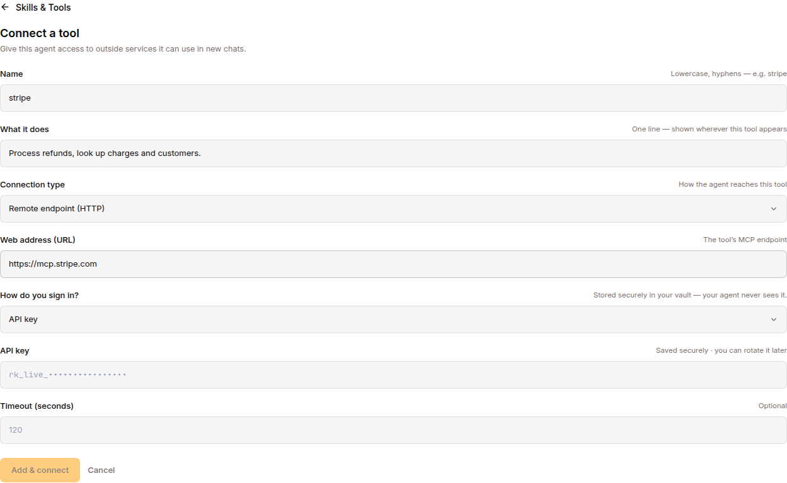

The **Key vault** stores API keys (masked, with **Update** and **Remove**). See [MCP servers](/work/library/mcp-servers/).

## Coding

Only visible when the agent's coding capability (`/code`) is enabled in **Capabilities**. Two sections:

- **Repositories** — agent-scoped GitHub repositories the coding agents can work in.
- **Coding agents** — agent-owned Claude Code / Codex plans connected under the agent's own service account.

## Model

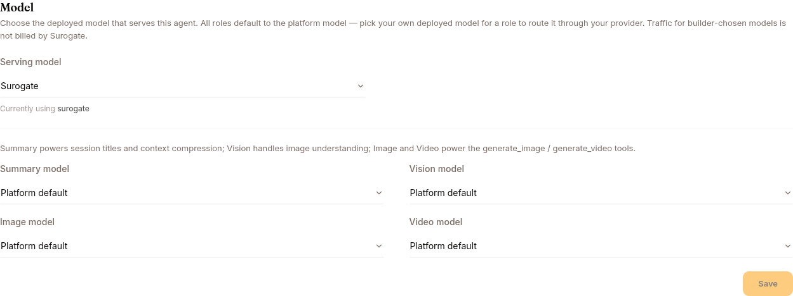

Choose which models power the agent. Every chooser except the serving model defaults to **Platform default**; dirty fields glow amber, and a single **SAVE** commits the tab.

| Setting | What it does |
|---|---|
| **Serving model** | The primary model the agent runs on (platform default is labelled "Surogate") |
| **Summary model** | Used for session titles and context compression |
| **Vision model** | Used for image understanding |
| **Image model** | Used by the `generate_image` tool. With neither a pick here nor a platform preset, the tool is hidden from the agent entirely |
| **Video model** | Used by the `generate_video` tool — same hiding rule |

Platform-model media generation draws on the project's **media wallet** (see [Usage](/work/settings/usage/)); BYO image/video models aren't metered by Surogate. A wired image or video model is also what allows selling **media credits** on the [Monetize](/work/monetize/) tab.

## Governance

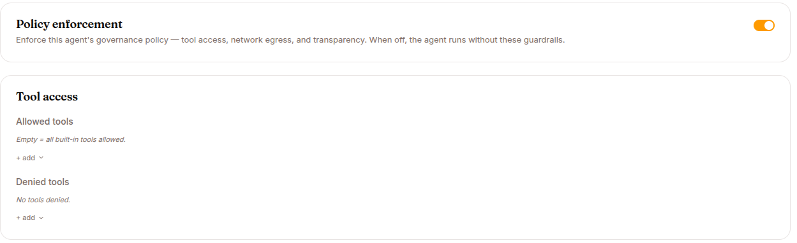

The agent's guardrails — and they are **enforced**: the composed policy is checked before every tool call the agent makes. An **Unsaved changes** bar collects edits across the cards and clears on a successful save ("Governance settings saved."). Edits reach live sessions on their **next wake** — no redeploy needed.

- **Policy enforcement** — the master switch. When off, the agent's own rules below are dropped, but the platform floor (workspace path containment, path-argument hygiene) still applies, and AI disclosure falls back to the deployment-wide default rather than turning off.
- **Tool access** — **Allowed tools** and **Denied tools** multi-selects, grouped by the built-in tool catalog. Empty "Allowed" means all built-in tools are allowed; the two lists are mutually exclusive, and unknown tool names are rejected on save. MCP tools are **not** governed here — restrict them by detaching the MCP server. A denied tool is still visible to the model and blocked at call time: expect the agent to try, get `Blocked: <reason>`, and report it. The coordination self-tools (`worker_*`, board tools, `unblock_task` / `cancel_task`) are deliberately not offered — denying them would strand blocked work.
- **Approval-gated tools** — a third list this form doesn't render, and **saving the form drops it**, so set it through the agents API and re-apply after each Governance save. Tools on it aren't refused: the call pauses for a human **Approve** / **Reject** in the [Inbox](/work/tools/inbox/), and it is the only list that accepts MCP tool names. See [Governance & AI disclosure](/work/workflow/governance/#tools-that-need-approval-first).
- **Web & browser egress** — a **Default action** of *Allow* or *Deny*, plus a rules table. Each **Add rule** row sets a **Domain** (glob patterns like `*.acme.com` work; CIDR ranges don't), **Ports**, **Proto** (tcp/udp), and **Action** (allow/deny). Scope: this governs the URLs the web-fetch and browser tools may open (`web_extract`, `browser_navigate`). It does **not** restrict `web_search` (a search query is not a URL), the terminal, coding agents, or MCP servers — restrict those by denying the tool or detaching the server. See [Governance & AI disclosure](/work/workflow/governance/) for the full network-controls picture.
- **SSH** — agent-owned SSH keys and remote targets (which hosts the agent can reach and under what credentials). Independent of the policy toggle.
- **EU AI Act transparency** — an **AI disclosure** toggle ("Tell end-users they are talking to an AI. Art. 50 of the EU AI Act requires this from 2 Aug 2026 on every channel.") and a **Disclosure level**: **Basic** (short AI notice before the first interaction), **Enhanced** (adds a capability and limitation summary), **Full** (complete Art. 50 disclosure with legal references), or **None** (no disclosure text — not compliant for end-user chat). How each channel delivers the disclosure is covered in [Governance & AI disclosure](/work/workflow/governance/).

A denial is returned to the model as a tool error and recorded as a `policy.denied` event, visible per session under **Sessions → POLICIES**.
