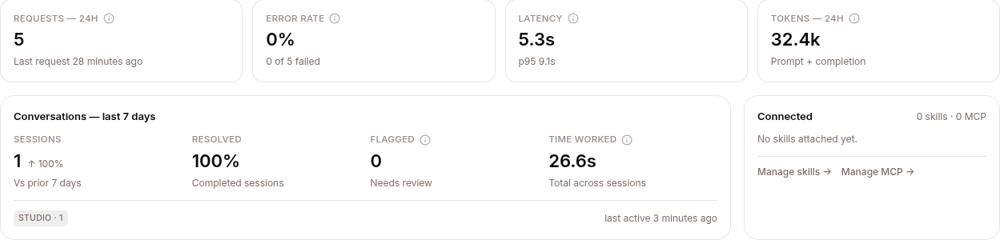
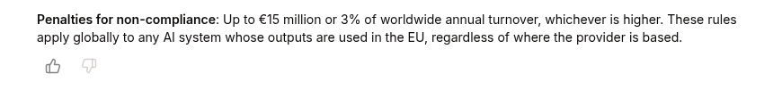

Start from the signal: the agent's **Metrics** tab ([Configure → Metrics](/work/workflow/configure-agent/#metrics)) shows error rate, latency, and a **Conversations — last 7 days** card whose **Flagged** count (a policy denial, a crash, or a thumbs-down) is the fastest pointer to the sessions worth triaging.

Three levers, in increasing order of effort:



1. **Mark sessions** — 👍 / 👎 the ones that matter
2. **Attach the right resources** — skills, KBs, or MCP servers for the gaps you're seeing
3. **Edit the persona** — SOUL.md changes how the agent behaves in every conversation

## 1. Mark sessions

In the THREAD view of any session, hover an assistant turn and click 👍 or 👎.



| Mark | What it becomes |
|---|---|
| 👍 | Training-data candidate, regression-test reference, evaluation positive |
| 👎 | Triage queue, evaluation negative, **excluded from fine-tuning datasets** |

Worth doing even if you're not training experts yet — it's free annotation now, valuable signal later.

## 2. Attach the right resources

Most "agent gave the wrong answer" problems are a missing skill or a missing fact in a KB.

- **Wrong facts** → add KB sources covering the gap. See [Knowledge bases](/work/library/knowledge-bases/).
- **Wrong procedure or format** → write a skill. See [Skills](/work/library/skills/).
- **Can't reach an external system** → add an MCP server with appropriate Vault credentials. See [MCP servers](/work/library/mcp-servers/).

## 3. Edit the persona (SOUL.md)

If the tone is off, the agent crosses boundaries it shouldn't, or it makes claims it can't back up — fix SOUL.md in the agent's CONFIG tab.

```markdown
# Acme Support Agent

You are the Acme Corp customer support assistant. Speak in the first person
plural ("we") when referring to Acme. Never disclose internal ticket IDs.

Tone: warm, concise, technically literate. Avoid corporate boilerplate.

## Things you can do
- Look up an account by email
- Explain product features and pricing
- Open a support ticket
- Refund up to $100 without human approval (use the refund tool)

## Things you must not do
- Disclose another customer's information
- Make legally binding statements
- Promise feature delivery dates

When in doubt, say "Let me get a human on this" and call the `escalate` skill.
```

Saved changes apply to **new sessions only**. In-progress sessions keep their old persona — policies are frozen at session start, by design.

**Don't put procedures in SOUL.md.** "When asked X, do Y, Z, then W" is a skill, not an identity. Rule of thumb: SOUL.md is *what* the agent is; skills are *how* it does specific tasks.

## When the agent is genuinely stuck

Three escalating options, only when something's actually broken:

1. **`/clear`** in the composer — wipes the conversation context and destroys the sandbox. Session row stays; the agent starts fresh.
2. **STOP → START** at the agent level. STOP lets work already in progress finish and refuses new sessions and new messages; START lets them in again. It restarts nothing, since agents run on the shared runtime, so use STOP to take the agent offline while you fix it.
3. **DELETE → re-deploy** — slug is preserved, everything else resets.

## Verifying changes

To try a change on made-up customers before real ones see it, run them through [Simulate](/work/workflow/simulate/): it reviews each run and can make the fix for you.

Start a new session, ask the same question that produced a 👎 in the past, compare. Don't continue an old session — it'll keep the old config.

For systematic regression checking, collect the 👎 sessions into a dataset and score a benchmark against it — see [Regression testing](/develop/loop/observe/#regression-testing).
