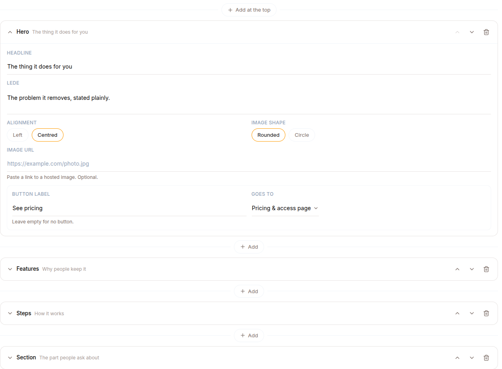

A public marketing page for an agent, at `/landing/<agent-slug>`. It is what you send people to before they buy or chat: a headline, your photo, what the agent does, and a button that leads to your pricing page.

Build it in **Publish → Landing page**. Nothing is public until you turn on **Live**.

## The link, and going live

The share card at the top of the tab holds everything about the page's existence:

- **Live / Off** — the switch that publishes. While it is off, `/landing/<slug>` returns "not found" to everyone, including you.
- **Copy link** and **Open** — the public URL. On a phone the URL itself is hidden (it is unreadable at that width) and the two buttons take its space.
- **Look** — one of six themes, shared with your [buy page](/work/monetize/) so an agent's two public surfaces match.

Saving follows what is at stake:

- **While the page is off**, nobody can see it, so your edits save themselves a moment after you stop typing (*Draft saved*).
- **Once it is live**, a save is what visitors see, so changes wait for **Publish changes**; until then visitors keep the last published version. If you leave with changes unpublished, they are kept in this browser and offered back next time (*You left changes unpublished*).

**Undo** and **Redo** cover the whole page: edits, deletes, moves and layout swaps (Ctrl+Z outside a text field).

## Editor and preview

The block forms sit on the left and the page itself on the right, live, at a real **Phone** (390 px) or **Desktop** (1440 px) width, so it lays out exactly as that device would. Clicking a section in the preview opens its form; opening a form scrolls the preview to it. On a narrow screen the two sides become an Edit / Preview toggle. **Full-screen preview** shows the page alone. The preview uses the same renderer as the public page, and its links are inert.

## Two tabs

- **Landing page** — the blocks your page is made of.
- **Layouts** — ready-made pages you can start from.

## Blocks

A page is an ordered list of blocks. **Add a block** inserts one where you want it, including **Add at the top**. Each block collapses to a single row so a long page stays navigable. Reorder blocks by dragging the grip, with Alt+arrow keys, or with the arrow keys on the grip; duplicate them; **Hide from page** keeps a block in the editor but off the public page (it is removed before the page leaves the server); delete one and the toast offers **Undo**.

| Block | What it is |
|---|---|
| **Hero** | Headline, a sentence, a photo, and one or two buttons. Left or centred; the photo can be rounded or a circle |
| **Portrait** | A person: round photo, name, role, short bio |
| **Section** | A heading and formatted text, optionally beside an image on the left or right |
| **Steps** | A numbered sequence |
| **Features** | A grid of reasons or services |
| **Quote** | One big pull quote with attribution |
| **Testimonials** | What people say, with their names |
| **Gallery** | Two to six photos in a grid, with optional captions |
| **FAQ** | Questions that open to their answers |
| **Video** | YouTube, Vimeo, or a video file played right on the page |
| **Contact** | Email, phone, WhatsApp, Telegram and an address, plus an optional **Start a chat** button — the agent is a way to reach you too |
| **Socials** | Icon links to X, Instagram, LinkedIn, YouTube, Facebook, TikTok, GitHub, WhatsApp, Telegram, email or a website |
| **Call to action** | A closing line and one or two buttons |

A page can hold **one hero**; everything else repeats freely. Blocks are added blank and filled in over time: anything empty is simply not rendered, and the page stays saveable throughout. A contact value that does not look like what it claims (an email without `@`, say) is not shown until it does; the page builds the `mailto:`, `tel:` and WhatsApp links itself from what you type.

### Images

Images are **linked, not uploaded**: drag an image from a web page or paste its link. Only `http://` and `https://` links are accepted, and a link that fails to load comes with tips on finding a working one.

**Adjust image** opens a framing tool: drag to set the focal point, **Zoom**, turn in quarter turns, mirror, or **Reset**. Framing is applied when the page is shown, so the image itself is never altered or copied. Give every image a description (**Image description (alt text)**) for screen readers and link previews.

### Text

Prose fields have a formatting toolbar: **Bold**, **Italic**, **Underline**, **Link (Ctrl+K)**, **Heading**, **Small heading**, **Bulleted list**, **Numbered list** and **Quote**, with Ctrl+B, Ctrl+I and Ctrl+U. The text is stored as Markdown. HTML is never rendered, deliberately: this page shares an origin with surfaces that hold sign-in tokens, so author-supplied markup is never executed. Only `http(s)`, `mailto:` and `tel:` links are emitted, and they open without passing your page on.

### Buttons

Every hero and call-to-action button (and the optional second one) chooses where it goes:

- **Pricing & access page** — your buy page, where offers, sign-in and chat live.
- **Chat with the agent** — the agent's own web app.
- **A link I choose** — any `http(s)` URL.

The first two are resolved from the agent itself, so they cannot be mistyped and keep working if the agent is renamed. A button with no label is not rendered.

## Layouts

Eight starting points, each a whole page with the copy written as prompts you type over, each shown as a thumbnail: **The practitioner**, **One screen**, **The product**, **The long read**, **The profile**, **The local service**, **The course** and **Link in bio**.

Selecting one opens a preview first, rendered in **your** chosen look — a layout never changes your theme. **Use this layout** replaces what is on the page (**Replace my page** asks first when you have work to lose), and **Undo** brings your page back. Afterwards it is just blocks: every one stays editable, movable and deletable.

## Sharing

The page carries OpenGraph tags, so a link posted to Slack, WhatsApp or LinkedIn unfurls with the agent's name, your hero's opening sentence (without its formatting) and your hero's photo (else the first portrait's) rather than a generic card. Unpublished pages produce no preview.
