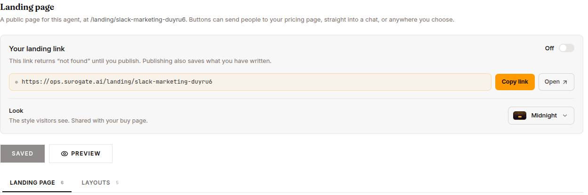
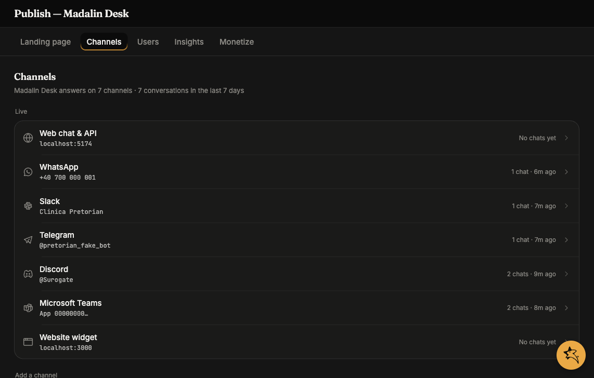
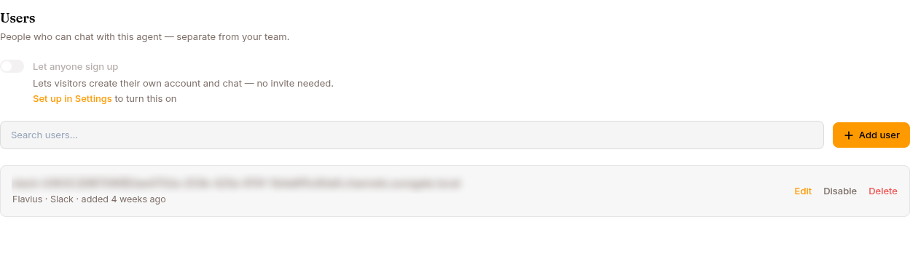
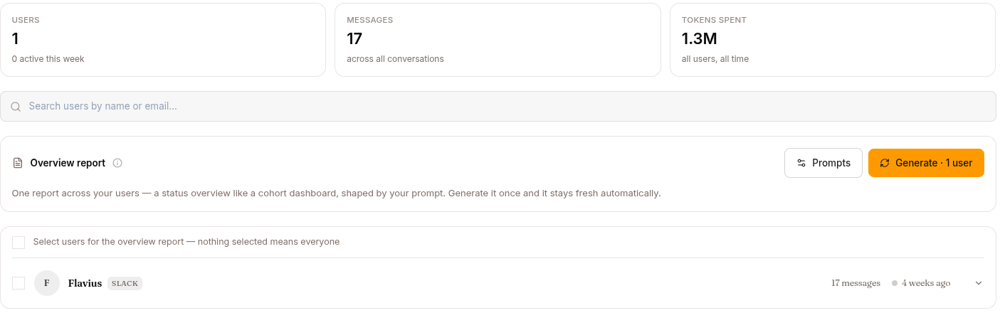

The **Publish** page — reached from an agent's left navigation, directly under **Configure** (`/work/agents/{id}/publish?tab=...`) — is the outward-facing half of an agent. Where [Configure](/work/workflow/configure-agent/) sets what the agent *is*, Publish covers its public face, the channels it is reachable on, and its audience.

| Tab | What you set here |
|---|---|
| **Landing page** | A public marketing page for the agent, composed from blocks |
| **Channels** | Web, WhatsApp, Slack, Telegram, Discord, Microsoft Teams, website-widget and voice connections |
| **Users** | End-users who can chat with this agent, and self-registration |
| **Insights** | How those end-users are actually using it |
| **Monetize** | Charge for access via Stripe Connect (Pro plan) |

Each tab remembers itself in the URL (`?tab=...`), so a refresh or a shared link lands on the same tab. System agents (like the platform copilot) have no Publish page.

On a phone the page is a drill-down: an index names the tabs, and tapping one opens it with a way back.

## Landing page

A public page at `/landing/<agent-slug>`, built from an ordered list of blocks. It is the page you send people to; its buttons lead to your pricing page or straight into a chat. See [Landing page](/work/workflow/landing-page/) for the full builder.

## Channels

Connect the agent to where your people already work. The tab opens with a one-line summary (how many channels the agent answers on, and its conversations in the last 7 days) and two lists:

- **Live** — each connected channel with what it is connected to (the number, the Slack workspace, the bot, the site) and its activity, such as *12 chats · 6m ago*. Click a row to manage it.
- **Add a channel** — everything not connected yet, each with a **Connect** button.

Every manage screen has **Try it**: a link that opens a real chat with the agent on that channel, and for WhatsApp and Telegram a QR code to open it on your phone.

- **Web** — the always-on hosted chat page; copy its endpoint URL once the agent is deployed. See [Web](/work/channels/web/).
- **Slack** — a guided **Connect Slack** wizard (bot scopes, event subscriptions, signing secret, bot token). The **Manage** view auto-saves options: **Require @mention**, **Mode** (Team member / Personal assistant), **Allow Bots** (None / Mentions only / All), **Reply in thread**, **Reply broadcast**, **Free-response channels**, plus **Surogate Mate** follow-the-channel and ambient-mode toggles. See [Slack](/work/channels/slack/).
- **Telegram** — a **Connect Telegram** wizard (BotFather token). **Manage** options: **Require @mention**, **Mode**, **Reply Threading** (First chunk only / All chunks / Off), **Message Reactions**, and **Per-User Group Chats**. See [Telegram](/work/channels/telegram/).
- **WhatsApp** — a **Connect WhatsApp** wizard: set the Meta app's webhook from the callback URL + verify token it shows, then paste the Meta Cloud API credentials (Access Token, App Secret, WABA ID). **Manage**: a webhook check and the **Mode** option. See [WhatsApp](/work/channels/whatsapp/).
- **Discord** — a **Connect Discord** walkthrough (one bot token), then an **Add to a server** install link. **Manage**: **Require @mention**, **Free-response channels**, **Read every message**, **Mode**. See [Discord](/work/channels/discord/).
- **Microsoft Teams** — a **Connect Microsoft Teams** walkthrough (Azure Bot App ID, tenant ID, client secret, and the messaging endpoint to paste), then **Download app package** to upload in Teams. See [Microsoft Teams](/work/channels/teams/).
- **Website** — an embeddable chat bubble. Set **Allowed origins**, copy the **Embed code**, cap **Messages per chat**, and reveal the **Publishable key** under Advanced. See [Website widget](/work/channels/website-widget/).

## Users

Manage the people who can chat with this agent — separate from your Surogate team. A **Let anyone sign up** toggle controls self-registration (available only when the project has Firebase auth configured and is on a paid plan).

A searchable list shows each user's email and auth provider (Email & password / Google / GitHub), with **Edit** and **Delete** row actions. **Add user** opens a form with **Email**, an optional **Display name**, and an optional **Password** (leave empty for SSO). See [Per-agent users](/work/channels/users/) and [Self-registration](/work/channels/self-registration/).

## Insights

The end-user intelligence view: one row per provisioned end-user, with totals for users, messages and tokens across the top. Rows with conversations expand into **Stats** (an activity chart, message and token cards) and **Report** (an LLM-written activity report) panels.

An **Overview** card holds the two report prompts — one for the cross-user overview, one for per-user reports, tuned independently — and generates an overview across the users you select; each user row can carry its own guidance override. Reports are generated once by hand and then kept fresh automatically as users keep talking.

This tab is where the old per-agent **Users** page lived (`/work/agents/{id}/users`); that URL now redirects here, `?userId=` deep links included.

## Monetize

Charge people for access to this agent. Requires the **Pro** plan (lower tiers see an **Upgrade to Pro** gate).

Connect billing via **Stripe Connect** (status pill: Not connected / Onboarding / Active / Restricted / Disconnected), then pick a **Pricing model**: **Free**, **Subscription**, **One-time packs**, or **Both**. Offers carry a **Name**, **Price** and **Currency** (defaults to EUR), **Usage included** (authored in messages), an **Interval** for plans, optional **Browsing time** and **Media credits**, an AI-draftable **Description**, and a **What's included** package (capabilities, channels, KBs, tools, skills, model tier). Most fields edit in place; price/currency/interval changes replace the offer with a new Stripe Price. **Free trial** and **Per-user usage limit** cards control what non-payers get. See the [Monetize](/work/monetize/) guide.

Monetize is hidden entirely on an enterprise deployment, which sells nothing.
