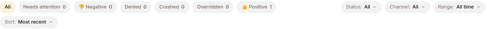
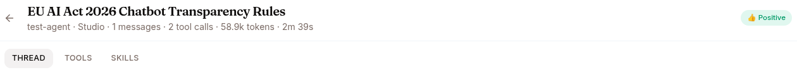
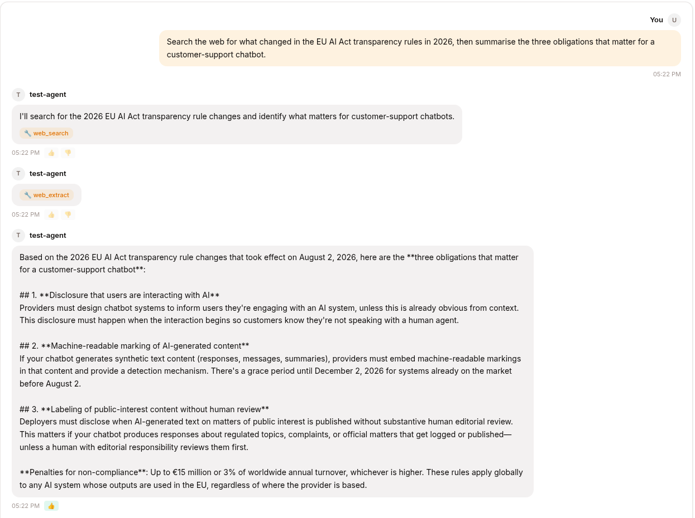
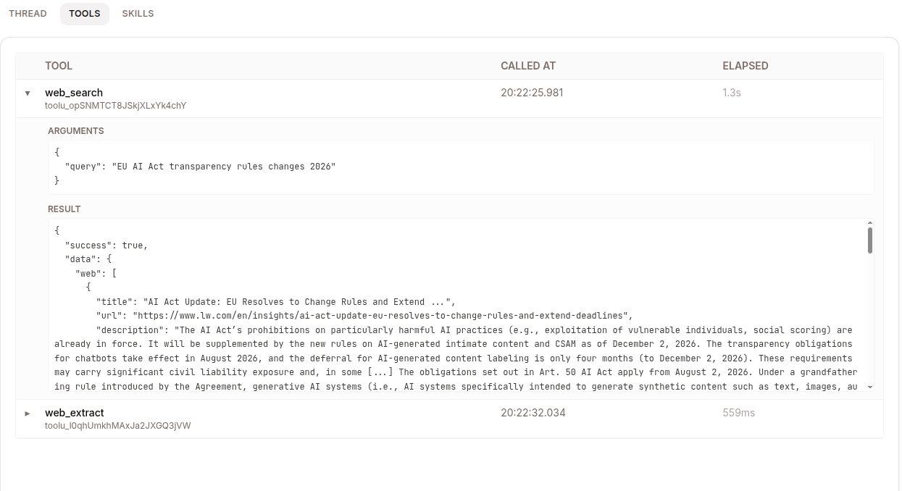

Every conversation is a **session** — fully recorded and inspectable. Open the **Sessions** page to review what your agent did: when something looks wrong, or to find good examples for improving your agent.

## Find a session

Two paths:

- **Per-agent**: open an agent → click into past sessions on the left sidebar.
- **Global**: the **Sessions** nav item shows every session in your tenant.

In the global view:

```
Left rail: pick an agent (or "All agents")
Top filters: Status combobox (All / Active / Completed / Failed / Archived)
             Filter chips: Denied · Overridden · Crashed · 👎 · 👍
Search box: title, ID, model
```

The filter chips are your shortcut to finding **specific kinds** of sessions:



- 👎 — sessions a user thumbed-down (problems)
- 👍 — sessions a user thumbed-up (good examples)
- **Denied** — sessions where the governance gate blocked a tool call
- **Crashed** — sessions where the agent's runtime crashed
- **Overridden** — sessions where a rater thumbed-down an expert's answer

## The session detail page



Click a session → the detail view, with its tabs across the top. **Work mode shows three**:

| Tab | What it shows |
|---|---|
| **THREAD** | The conversation as the user saw it. Markdown renders, artifacts display, files are downloadable. |
| **TOOLS** | Only the tool calls and their results. |
| **SKILLS** | Which skills loaded into the session, and which the agent actually used. |

The three audit tabs — **EVENTS**, **POLICIES** and **METADATA** — are deliberately Develop-mode-only. Open the same session from **Dev → Sessions** to get them, along with multi-select and **Add to dataset**. They're documented in [Sessions (Develop mode)](/develop/features/sessions/).

### THREAD — what the user saw

The cleanest view. If you want to share a session with a teammate, copy the link from this tab.



You can also click 👍 / 👎 on any assistant turn. The mark becomes a quality flag on the session and feeds into training-data extraction later.

### EVENTS — the full story

When the THREAD doesn't tell you why something happened, switch to EVENTS:

```
12:43:01  user.message       "What's the refund policy?"
12:43:02  llm.request         model=surogate-default, tokens_in=1247
12:43:04  llm.response        "Let me check that..."  tokens_out=18
12:43:04  tool.call           kb_read_page("billing/refund-policy")     tool_call_id=tc_1
12:43:05  tool.result         "Refunds within 30 days..."    tc_1
12:43:06  llm.request         tokens_in=1429
12:43:08  llm.response        "Our refund policy is..."      tokens_out=146
12:43:09  session.complete
```

The user-visible answer is the **last** `llm.response` — the earlier ones narrate before a tool call.

You'll spot whether the LLM understood the question, whether it searched the right KB, whether tool calls succeeded.

### TOOLS — just the calls



When you specifically care about what the agent **did** (not what it said), this tab filters out everything except tool calls and results.

Each row shows tool name, arguments (the JSON the LLM sent), result, duration, and status (success / error / denied by governance / saga-compensated).

### SKILLS — what loaded vs what fired

A subtle but useful distinction:

- **Loaded** — the skill appeared in the agent's context (its description was visible to the LLM)
- **Invoked** — the LLM actually triggered it

If a skill loaded but never fired, the LLM didn't think it was relevant. Possibly the `description` is too vague or the `trigger` keywords don't match how users actually phrase requests. You can fix those in the Skills library — see [Skills](/work/library/skills/).

### POLICIES — governance decisions

Every `policy.denied` event — a tool call the governance gate blocked — is listed here with the tool, reason, and timestamp. Not every one is a hard block: a call held for [human approval](/work/workflow/governance/#tools-that-need-approval-first) is denied first and shows a matching `policy.allowed` once someone approves it. Allowed calls are logged too (as `policy.allowed`) when the deployment enables `governance.log_allowed`. Useful for compliance audits ("which agents tried to do destructive things, and were any of them allowed through?").

The AI-disclosure evidence trail (`disclosure.presented` when a messaging channel posts the notice, `disclosure.confirmed` when a web user accepts the banner) lives in the session's **EVENTS** tab — see [Governance & AI disclosure](/work/workflow/governance/).

### METADATA — counters and quality flags

```
Counters
  Turns: 6
  User messages: 3
  Assistant messages: 3
  Tool calls: 7
  Tokens in: 12,841
  Tokens out: 1,203
  Cost: $0.024
  Duration: 2m 14s

Quality flags
  ✓ thumbs_up
  ✗ thumbs_down
  ✗ policy.denied
  ✗ harness.crash
  ✗ saga.compensated
  ✗ expert.override
  ✗ expert.endorse
```

The seven quality flags drive everything downstream:

- 👍 / 👎 — user feedback you set
- `policy.denied` — governance blocked something
- `harness.crash` — the runtime died mid-session
- `saga.compensated` — a multi-step rollback fired
- `expert.override` — an expert's answer was thumbed-down, by a person in the UI or by an automated judge
- `expert.endorse` — an expert's answer was thumbed-up, by either of the same two

Filter the Sessions list by any combination of these to slice your traffic.

## Export

**Copy session URL** from the THREAD tab to share a session with a teammate — only people in your tenant can open it.

The rest lives in Develop mode. **Dev → Sessions** adds a checkbox per row and an **Add to dataset** action that captures the selected transcripts into a dataset; the full event log is on that view's **METADATA** tab. See [Datasets](/develop/features/datasets/) for what to do with them.

## Sessions across channels

A session can have messages from multiple channels — a user starts on Web, continues on Slack. The session detail shows them in order with a small channel badge per message.

## Sessions retention

By default sessions are kept **forever** (compliance, training-data extraction). Mostly that's free — the storage is dominated by event log rows.

If you need to delete a session (GDPR right-to-be-forgotten, customer data lifecycle), use the trash icon beside it in the agent's session list, or the **METADATA** tab in Develop mode. Soft-deletes the row. For bulk deletes by date, ask your admin.

## What's next

You've reviewed a session and have opinions about it. Now improve the agent: [Improve your agent](/work/workflow/improve-agent/).
