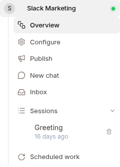
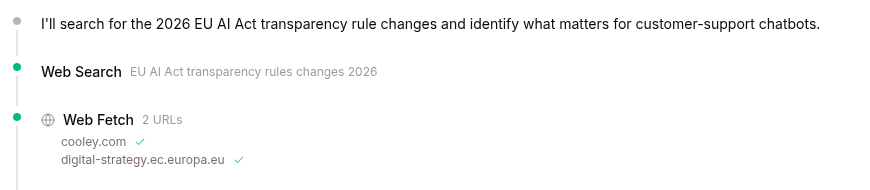
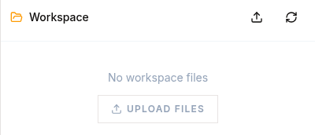
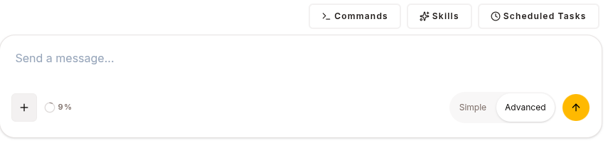
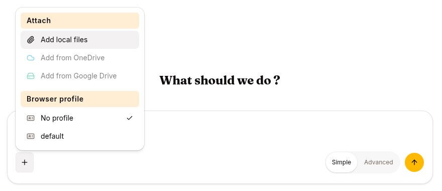

Open an agent from **Agents** in the left nav, then click **New chat** in the agent's left navigation (between Publish and Inbox). The composer opens with a `Send a message...` field; you'll see Commands / Skills / Scheduled Tasks shortcuts above it and an Add button for attachments.



## What you'll see in the thread

The agent streams its response in real-time, token by token. Tool calls render inline as bracketed events you can expand:

```
You: Compare our Standard and Pro plans.

Agent: I'll pull the pricing details for you.
[kb_list_pages: pricing-kb]
[kb_read_page: plans/standard-vs-pro]
Agent: Here's a comparison: ...
```

Bracketed items are **tool calls** — the agent searching a KB, calling an API, running code. Expand any of them to see args and results.



## The workspace pane



Every chat has a workspace: the files the agent writes, downloads or generates, and the ones you upload. Open **Files** above the composer to see it; it has **Upload files** and **Refresh workspace** buttons, and a download button on each file. Click a file to open it beside the chat. Markdown / code / CSV / images preview in-browser; Word, Excel, PowerPoint and PDF files open in an office editor, where you and the agent can edit them together (see [Work with documents](/work/workflow/work-with-documents/) and [Office documents](/work/tools/office-documents/)).

Files persist for the lifetime of the session and survive sandbox restarts. They're cleared when the session ends or resets.

## What the agent can do

Each agent has an allowlist of built-in tools set in its CONFIG tab:

| Tool | Purpose |
|---|---|
| `kb_search_pages`, `kb_list_pages`, `kb_read_page` | Search, browse and read any KB attached to this agent |
| `web_search`, `web_extract` | Public web research (Tavily / Exa) |
| `read_file`, `write_file`, `patch` | Read and modify workspace files |
| `office_read`, `office_edit` | Read and edit Word documents, spreadsheets, presentations and PDFs live, in the editor beside the chat. Not set in CONFIG: the agent has them in chats with a file pane, where the platform offers the office editor |
| `terminal`, `process` | Shell + code execution in the isolated sandbox |
| `vision_analyze` | Image analysis |
| `browser_*` | Drive a real Chromium browser (with user-handoff for login / MFA) |
| `consult_expert` | Delegate a hard task to a fine-tuned expert |
| `create_artifact` | Render a chart, table, HTML, or SVG inline |

The agent picks. You describe what you want.

## Composer



| Control | What it does | Always visible? |
|---|---|---|
| Text field + Submit | Send a message | yes |
| **Add** (`+`) | Attach a file to the message (CSV, screenshot, document, …), and pick the session's browser profile | yes |
| **Simple / Advanced** | Switch between the conversation alone and every step the agent took | yes |
| **Commands** | Slash commands: `/clear`, `/compress`, `/goal`, `/loop` | **Advanced only** |
| **Skills** | Invoke a skill by name: `/<skill-name>` | **Advanced only** |
| **Scheduled Tasks** | View `/loop` schedules for this agent | **Advanced only**, and only when `/loop` is enabled for the agent |

The three shortcut buttons sit above the composer and appear only in **Advanced** view — in Simple view the composer is just the text field, the **+** and the view switch. You can always type the slash command directly instead; the palette opens as soon as the message starts with `/`.

`/goal` is documented in [Goals](/work/tools/goals/). The Copilot (`⌘+/`) is in [Copilot](/work/tools/copilot/).



## Interrupting mid-stream

The Submit arrow becomes a Stop button while the agent is responding. Hitting it interrupts the current turn; the partial work is preserved in the event log and the next message resumes from there.


## Cross-channel sessions

If you've linked a Slack or Telegram identity to your Surogate account, a session that started on the web continues on Slack (same event log, same memory). The Web channel shows everything — tools, files, reasoning — that messaging channels usually drop. Use Web for deep dives.

## Next

[Review what your agent did](/work/workflow/review-sessions/).
