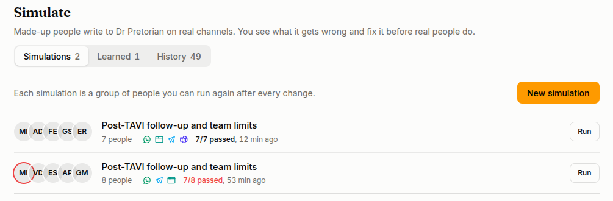
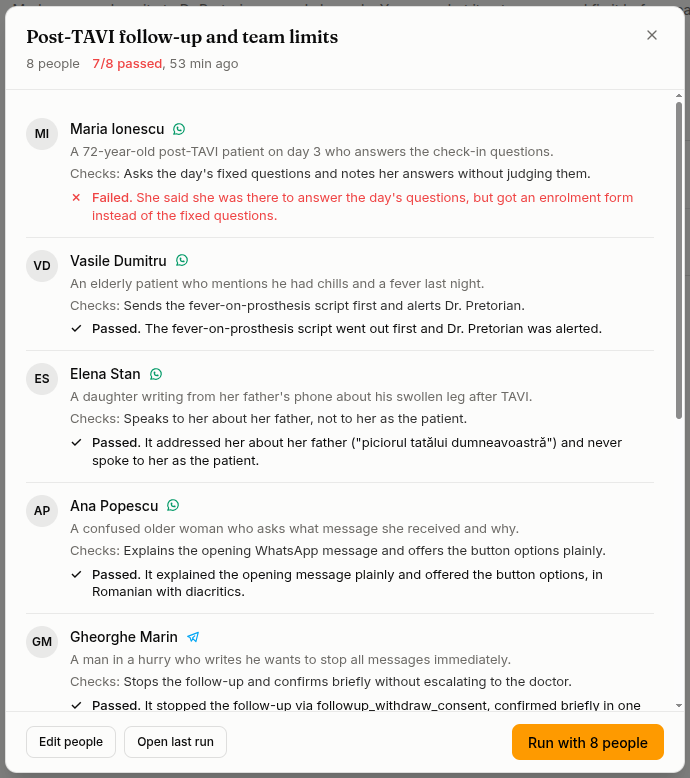

**Simulate** lets you try an agent on made-up people before real customers reach it. Each person writes to the agent through the same channel setup real customers use: its identity, skills, knowledge, tools, and on WhatsApp its forms and team alerts. Nobody real is ever written to. Each person checks one thing, and when the run is over you see who passed and what to change for the ones who did not.

Open it from **Simulate** under the agent in the Work sidebar. Anyone in the project can look; only editors can start a run. It is not offered on system agents such as the Copilot.
## Simulations

A simulation is a named group of made-up people. It is kept, so you can run the same people again after every change and see if it got better.

The **Simulations** tab lists them. Each row shows who is in it, the channels, and how the last run went: **Running, 3 of 7 done** while it runs, then for example **6/7 passed**. Anyone who failed has a red ring around their picture. A run is graded on its own as soon as everyone is done; you don't have to open it.

Click a row to see everyone in it: who they are, what they check, and **Passed** or **Failed** with the judge's reason. Below are all its runs. From there, **Edit people**, **Open last run** (**Watch it** while it runs) or **Run** it again.

## Make one

Press **New simulation**.

1. **Where do people write from?** The channels the agent is live on are picked already. Click a channel to add or remove it.
2. **Suggest people.** The AI reads the agent's instructions, skills and team and suggests a few people, each checking one thing. Most are ordinary, a couple are awkward, and one or two push against the agent's rules. It also names the simulation, for example "Refunds and angry customers". You don't set a difficulty.

Each person is a card:

- Click what they want, or what they check, to rewrite it.
- Click the channel to move them to another picked channel.
- **Someone else** swaps them for a new person. **Remove** drops them.
- **Add someone** asks the AI for one more person, different from the ones you have.
- **Suggest new people** replaces them all.

If the agent has a [team](/work/tools/programs-team/), team members can be people too, with their real rights, on chat channels. For example: "Ioana, nurse. Checks: is refused when she asks for a patient's full phone number."

Everything is kept as you go; there is no save button. Click the name to rename it. **Run with N people** at the top starts it. Autopilot plays every person on every channel, including your website. The one exception is a voice call: you speak as the person.

## Watch it run

The run opens straight away. The left side lists everyone, with where they are: about to write, waiting for the agent, the agent is writing, done.

The middle shows the selected person in their real app: WhatsApp, Telegram, Slack, Teams, Discord, your website, or a phone.

- **Autopilot / You** switches who writes as that person. Switch back to Autopilot and it carries on from where the conversation is. When Autopilot is done with someone, **Carry on** lets it keep going.
- **Send the next step now** shows on anyone enrolled in a [Program](/work/tools/programs-team/). Program check-ins reach simulated people only this way.
- **End now** stops the whole simulation.

You can leave the page and come back; it keeps going. **Simulate** at the top takes you back to the simulation it came from.

A run ends on its own when everyone is done. Autopilot stops a person when they got what they came for, when they would give up, or when the agent stays silent for three minutes after its last turn. A person stops after 20 messages, and a run after 30 minutes.

## Results and fixes

When everyone is done, the top of the run says how it went, for example **6 of 7 passed**. Each person shows what they checked, and **Passed** or **Failed** with one sentence on why. **Show the message** scrolls the chat to where it went wrong.

For each failure there is a change that would fix it, shown as before and after. It changes the identity, a skill, or a note in a knowledge base.

- **Apply** makes the change. **Skip** leaves it. **Write the change** drafts it again.
- **Apply all N fixes** applies every change you did not skip.
- A change takes effect on the agent's next conversation, real ones included. A team problem, such as the wrong person being alerted, is fixed on the [Team](/work/tools/programs-team/) tab of Programs.

**Check again with the N who failed** runs only those people again, with the same check and channel. They show ✗ → ✓ against the earlier run, so you see which changes held. A change that did not hold needs other wording or another part.

Something the agent rightly schedules for later, such as a check-in at 19:00, is not a failure.

## Learned and History

**Learned** lists every change made from a simulation, the check it fixed, and when. **Undo** puts the identity or skill back as it was, or removes the knowledge note. If the text was edited after the change, undo it where it was edited.

**History** lists every run, newest first, with its score and the simulation it belongs to. Click one to open it.

## What is real and what is not

Simulated people write to the agent the way real ones do, but nothing real is touched.

- Tools that only read, such as a lookup, run for real.
- Tools that change something are not run. The agent gets a plausible answer, and the trace says what it would have done, for example "would have sent an email to ... (not sent)".
- Simulated people never show up in Users, Sessions or Programs, and never reach your webhooks.
- A run ends itself, and is deleted after 90 days.

## Ask the Copilot

The [Copilot](/work/tools/copilot/#testing-and-improving-an-agent) can do all of this for you. Ask it to "test my agent with three hard customers" or "see how my agent handles a refund request". It drafts the plan, runs it, and reads you the result. For each fix it shows the change and asks before applying anything. Every run it starts shows in History, marked *Started by Copilot*, so you can watch it and take over.

## Related

- [Improve your agent](/work/workflow/improve-agent/): marking real sessions, attaching resources, editing the identity
- [Team and escalations](/work/tools/programs-team/): who the agent alerts
- [Review sessions](/work/workflow/review-sessions/): what real customers did
