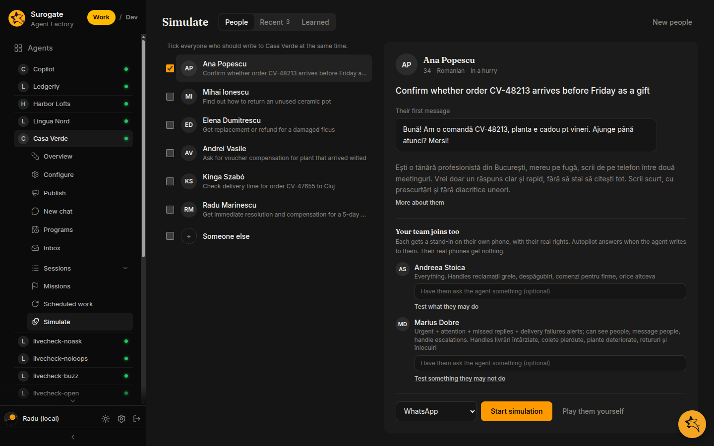
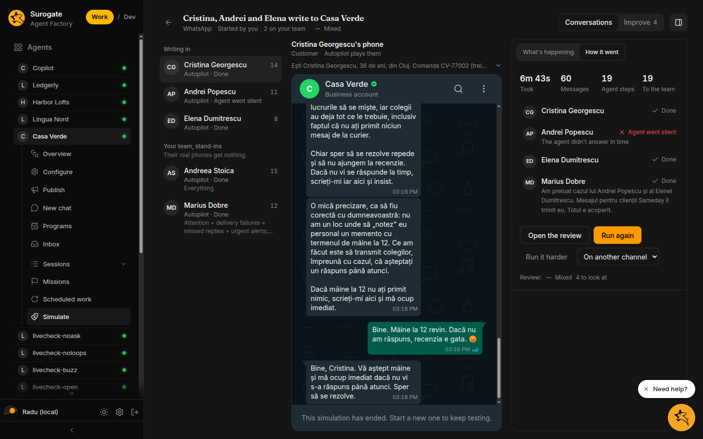
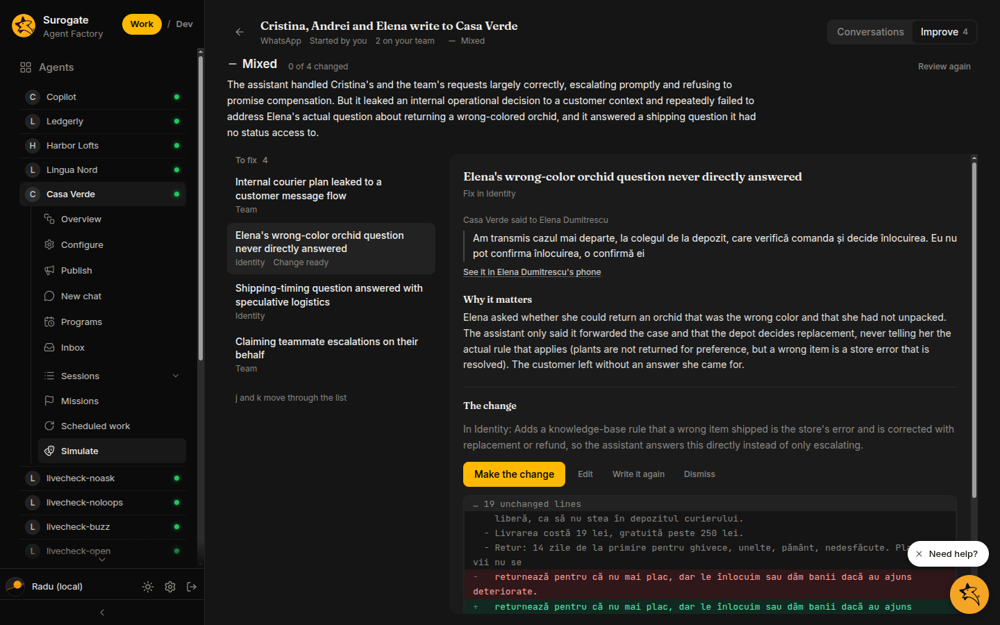

**Simulate** lets you try an agent on made-up people before real customers reach it. Each person writes to the agent through the same channel setup real customers use: its identity, skills, knowledge, tools, and on WhatsApp its forms and team alerts. Nobody real is ever written to. When the run is over, a review reads the whole thing and tells you what to change, and you can make each change in one click.

Open it from **Simulate** under the agent in the Work sidebar. Anyone in the project can look; only editors can start a run. It is not offered on system agents such as the Copilot.

## Pick the people

The **People** tab thinks of six people from the agent itself: who it serves, what they want, how they write. Picking one shows their portrait. **More about them** shows the full persona Autopilot plays. Some are there to **Test what they may do**, and others to **Test something they may not do**: a customer pushing past a rule, asking for something out of scope, or getting angry. **New people** thinks of six more.

To test something specific, tick **Someone else** and describe them in a sentence or two:

> A supplier whose invoice is 40 days late. Polite at first, then threatens to stop deliveries. Writes short messages in English.

On a chat channel you can tick several people and run them all at once. Each gets their own conversation with the agent, and they run side by side.

**Channel** picks where the conversation happens. The agent's connected channels come first. The others are under **Not set up yet**, so you can see how the agent would do on a channel before you connect it.

| Channel | Who plays the person |
|---|---|
| WhatsApp, Telegram, Slack, Teams, Discord | **Autopilot** writes for them, or you do |
| Your website, a voice call | You play them, one person per run |

**Start simulation** hands the people to Autopilot. **Play them yourself** lets you write as them from the start.

## Your team in the simulation

On WhatsApp, the agent's [team](/work/tools/programs-team/) joins the run as **stand-ins**: one phone per member, played by Autopilot from that member's role and permissions. When the agent escalates, the alert lands on the stand-in's phone, not on the real colleague's.

A stand-in can answer the alert, and the agent passes the answer on to the customer. That way you can see the whole loop: customer asks, agent alerts the right person, the person answers, and the customer hears back.

To test what a member may do, give them a line under **Have them ask the agent something**. For example, "Ask the agent who it is following up today", or "Ask the agent to add a colleague to the team". **Test what they may do** and **Test something they may not do** fill one in from the member's permissions.

## Watch it run

The run opens straight away. The left side lists **People in this simulation** and **Your team in the simulation**. Each person shows how far they have got: *The agent is writing*, *Your turn*, *Went well*, *Gave up*, *Agent went silent*.

The middle shows the selected person's phone, chat, or call as they see it, with buttons, lists, and forms. On WhatsApp the agent's forms open the way they do on a phone, and Autopilot fills them in.

The side panel shows **What's happening**: what the agent read, which tools it called, and what it sent. On narrow screens, the panel button toggles it.

To steer a conversation, **take over** a person and write as them, then hand them back to Autopilot. A person handed back carries on from where the conversation is.

A run ends on its own when everyone is done. Autopilot stops a person when they got what they came for, when they would give up, or when the agent stays silent for three minutes. While the agent is still working on its answer, a person waits up to ten minutes. A person stops after 20 messages, and a run after 30 minutes. You can also end a run yourself.

When it ends, **How it went** sums it up: how long it took, how many messages, the agent's steps, how often it reached the team, and how each person's part ended. From there:

- **Run again** runs the same people once more.
- **Run it harder** runs them again, less patient: they push back, change their mind, and are hard to satisfy.
- **On another channel** runs them again on a channel you pick.

## Read the review

Once everyone in the run is done, **Review it** reads the whole run, including the team's side. The review gives:

- **How it went**: *Went well*, *Mixed*, or *Went badly*, with a short summary.
- **What to fix**: each problem with the agent's own words quoted, why it matters, how serious it is, and where the fix belongs.

A fix belongs in one of three places:

| Part | What changes |
|---|---|
| **Identity** | The agent's instructions (SOUL.md) |
| **Skill** | One of the agent's skills |
| **Knowledge** | A note added to one of the agent's knowledge bases |

A team problem, such as the wrong person being alerted, is fixed on the [Team](/work/tools/programs-team/) tab of Programs. **Change it in Team** opens it.

**Review again** reads the run once more. A review is one reader's opinion of one run. If a finding looks wrong to you, dismiss it.

## Improve

The **Improve** tab works through the findings one at a time. **To fix** lists the open ones, the most serious first. **Done** lists the ones you changed or dismissed. Move through the list with `j` and `k`, or the arrow keys.

For each finding:

1. **Write the change** drafts the edit and shows it as a diff, with a line on why.
2. If the wording is not right, **Write it again** takes a note, for example "shorter" or "mention the weekend number", and drafts it again.
3. **Edit** opens the drafted text so you can change it yourself. **Discard my edits** goes back to the draft.
4. **Make the change** saves it. A change applies to the agent's next conversation, real ones included.
5. **Dismiss** drops a finding you don't agree with.

After a change or a dismissal, the next open finding opens on its own.

**Undo** puts the identity or skill back exactly as it was before the change. If the text was edited after the change, undo it where it was edited. A knowledge note is removed from its knowledge base.

## See if a change held

After you change something, run the same people again. Their next review opens with **Since last time**, which lists each change from the earlier run as *Held* or *Came back*, and how many of them held. A change that came back did not fix the problem. Write it again or try another part.

## Recent and Learned

**Recent** lists past runs: who was in them, the channel, how each went, and who started them. **Learned** lists every change made from a simulation: what the agent learned, from whom, and when. Each one is live for real conversations too.

## Ask the Copilot

The [Copilot](/work/tools/copilot/#testing-and-improving-an-agent) can do all of this for you. Ask it to "test my agent with three hard customers" or "see how my agent handles a refund request". It picks or writes the people, runs them, and reads you the review. For each fix, it shows you the diff and asks before changing anything. It can also write a change again from your note, undo a change, and report whether earlier changes held. Every run it starts shows in **Recent**, marked *Started by Copilot*, so you can watch it and take over.

## Related

- [Improve your agent](/work/workflow/improve-agent/): marking real sessions, attaching resources, editing the identity
- [Team and escalations](/work/tools/programs-team/): who the agent alerts
- [Review sessions](/work/workflow/review-sessions/): what real customers did
