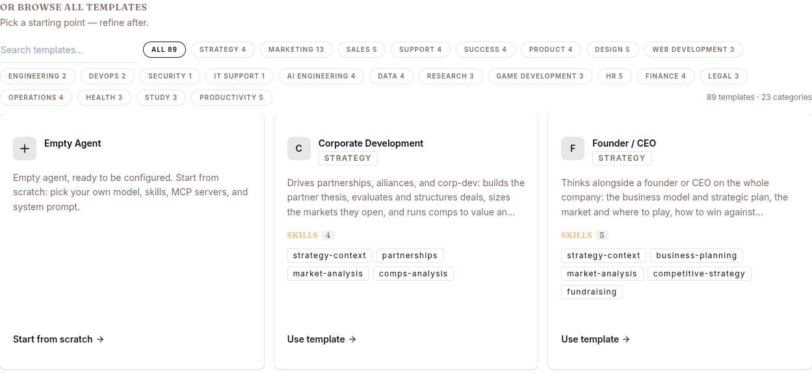

The **Templates** page is where you start a new agent — either from a pre-built template or from scratch.

Open it at `/work/templates`. The page header reads "Templates — Start from a pre-built agent." A **Dashboard** link returns you to `/work`.

## Layout

- **Prompt hero** — a box to describe what you want the agent to do, plus quick-start chips (one per category, drawn from the real template registry).
- **Best matches** — after you submit a prompt, the top templates that fit appear here.
- **Browse all templates** — a search box, category filter chips (each showing its count), and a grid of every template.

Each template card shows the template's name, its category badge, a description, and the skills it ships with (hover a skill chip to see its trigger text).

## Finding a template by describing the work

1. In the prompt hero, type what you want the agent to do (or click a quick-start chip).
2. Press Enter / submit. The page runs a match and shows **Best matches based on your prompt** — a count of templates that fit, as cards.
3. Use one of the matches, or scroll down and keep browsing.

You can also open the page pre-filled by arriving with a `?q=…` query — it auto-submits that prompt on load.

## Browsing and filtering

- Type in the **Search templates…** box to filter by name, description, or category.
- Click a category chip (e.g. **All _n_**, or a named category with its count) to filter the grid.
- The footer notes the totals: "_n_ templates · _m_ categories."

## Using a template

1. Click a template card to open its **preview** dialog.
2. In the preview, click **Use** (also available directly on the card).
3. The agent is created in your active project with the template's skills attached. You'll see a confirmation like "_Template name_ created with its skills attached," and you're taken to the new agent.

You must have an active project selected first; otherwise the page asks you to "Pick a project before creating an agent." Creating an agent may be gated by your plan, in which case an upgrade prompt appears.

## Starting from scratch

If no template fits, use the **Empty agent** card (shown when browsing all categories with no search filter). Clicking it opens the create-agent flow at `/work/create-agent`.

### The create-agent flow

The **Create agent** page ("Name it and describe what it does — it's live in ~30 seconds") has these fields:

| Field | Required | Notes |
|---|---|---|
| **Agent name** | Yes | How it appears in your dashboard. |
| **What does this agent do?** | Yes | One or two sentences; shapes the agent's persona and shows on its overview page. |
| **URL slug** | No | Defaults to a slug of the name, under `cloud.surogate.ai/`. Locked after creation; renaming later changes the public URL and breaks existing integrations. |
| **Model** | No | Defaults to **Surogate**; changeable later under Configure. |

Steps:

1. Enter the **Agent name** and a description of what the agent does.
2. Optionally adjust the **URL slug** (the server appends a unique suffix, so a name is never rejected as taken).
3. Click **Create agent**. A progress indicator deploys the agent (about 30 seconds), then you land back on the dashboard with the new agent live.

New agents are created on the `surogates` harness. As with templates, you need an active project, and creation may hit a plan gate.
